# DCVC 讲解全文

Deep Contextual Video Compression · NeurIPS 2021 · Jiahao Li / Bin Li / Yan Lu

整理日期：2026-10-15，Asia/Shanghai。版本范围：NeurIPS 2021 正式版 12 页、补充材料 7 页及当次官方 2021 代码只读核查。

## 收录范围与阅读说明

本文件把已经发生的讲解全文汇编为一份可检索的主文。先按实际聊天顺序收录 3 轮完整回复和 10 条准备或补充说明，再保留 4 份内容并不完全相同的保存稿，以及参考文献与覆盖核查附录。保存稿与聊天中对同一问题的不同解释均保留，未用摘要替代原文。

论文正文与补充材料的讲解已完成；代码逐模块、逐行讲解在用户切换到整理任务时尚未形成完整回复，只收录中断前实际发出的 2 条核查说明。未训练模型、未执行实际编解码、未复现实验数字。这里的“全文”指已完成讲解的全文汇编，不是论文英文全文转载。

讲解保留了原有短摘录、中文释义、公式推导、数值例子、图表分析、独立判断及证据限制。正文中的“本轮”“后面核查”“下一轮”等措辞属于当时的讲解语境；完成情况应结合后续回复和本节范围判断。没有为整理任务新增一轮冒充历史的代码讲解。

正文沿用原文可编辑的 TeX；HTML 从本 Markdown 同一主文生成，并用本地 KaTeX 渲染。原图、PDF、书目和渲染字体均保存在旁边的资源目录。复制时同时保留 Markdown、HTML 和整个“DCVC_讲解资源”目录。窄屏下长公式与表格可横向滚动。外部参考网页需联网访问，本地讲解和公式阅读不依赖网络。

原始讲解文本按原样保存，主文只调整标题层级、图片与文件链接，并把聊天专用文件引用转换为正常链接。没有删改论断或合并重复解释。来源清单与核对结果见[来源覆盖表](#coverage)。

原始材料：[正式版 PDF](DCVC_讲解资源/原论文/Li_Deep_Contextual_Video_Compression_NeurIPS_2021_paper.pdf) · [补充材料 PDF](DCVC_讲解资源/原论文/Li_Deep_Contextual_Video_Compression_NeurIPS_2021_supplemental.pdf) · [用户提供的 bib](DCVC_讲解资源/原论文/deep-contextual-video-compression.bib)。

## 主题导航

| 阅读主题 | 实际聊天全文 | 更细的保存稿 |
| --- | --- | --- |
| 标题、摘要、预测与条件编码、熵不等式及 1.5 / 0.5 bit 例子 | [第 1 轮](#chat-199) | [保存稿 1](#file-1) |
| Figure 1、条件在编码器/解码器/熵模型中的作用、引言贡献 | [第 2 轮](#chat-285) | [保存稿 2](#file-2) |
| Related works、公式 1—7、上下文、熵模型、训练目标、实验与消融 | [第 3 轮前半](#chat-539) | [保存稿 3](#file-3) |
| 补充网络图、四阶段训练、实验设置、长 GOP、通道数、MEMC 与视觉结果 | [第 3 轮后半](#chat-539) | [保存稿 4](#file-4) |
| 全篇评价、局限、最小复现路线与研究接口 | [第 3 轮末](#chat-539) | [保存稿 4 后半](#file-4) |
| 代码量化差异、逐位置编码、Laplace、P 帧 24 字节文件头 | [中断前核查说明](#code-partial) | [只读源码快照](DCVC_讲解资源/代码核查快照/SOURCE_MANIFEST.json) |
| 正文 40 项、补充 15 项参考文献及结构覆盖 | [参考文献附录](#file-5) | [来源覆盖表](#coverage) |

- [从第 1 轮开始顺序阅读](#round-1)
- [第 2 轮](#round-2) · [第 3 轮](#round-3) · [代码未完成范围](#code-partial)
- [四份保存稿](#saved-manuscripts) · [答疑与纠错索引](#qa-index) · [术语与公式索引](#terms-index)

# 第一轮：标题、摘要与引言开篇

用户请求：“精读 deep-contextual-video-compression.bib”。以下按实际发送顺序保留准备说明、两条实质性说明和完整回复。

## 准备说明：材料与解释方式

> 来源：会话 JSONL 第 41 行，commentary。2026/10/15 00:18:03（Asia/Shanghai）。可核对[原始文本](DCVC_讲解资源/来源/准备说明01.md)。

<!-- SOURCE-BEGIN:chat-41 -->
这份 `.bib` 对应 NeurIPS 2021 的《Deep Contextual Video Compression》（DCVC），里面只有书目信息和摘要。我会获取论文正文及补充材料，并使用 PDF 技能核对公式、架构图和实验表。
<!-- SOURCE-END:chat-41 -->

## 补充说明：残差减法与条件信息

> 来源：会话 JSONL 第 131 行，commentary。2026/10/15 00:23:33（Asia/Shanghai）。可核对[原始文本](DCVC_讲解资源/来源/补充说明01.md)。

<!-- SOURCE-BEGIN:chat-131 -->
正文和补充材料已下载，首页的段落与公式也已核对。这里最关键的一点是：做减法本身并不丢失信息；论文的熵不等式比较的是“忽略预测信息来编码残差”和“利用预测信息做条件编码”。我会用推导和一个数值例子说明这个区别。
<!-- SOURCE-END:chat-131 -->

## 补充说明：数值例子与本轮范围

> 来源：会话 JSONL 第 187 行，commentary。2026/10/15 00:28:51（Asia/Shanghai）。可核对[原始文本](DCVC_讲解资源/来源/补充说明02.md)。

<!-- SOURCE-BEGIN:chat-187 -->
第一轮讲解和阅读记录已保存。数值例子中，残差的无条件熵是 1.5 bit，利用预测信息后的条件熵是 0.5 bit；讲解中也区分了这个理论差值与实际有损压缩的码率收益。下一轮起点已定位到第 2 页 Figure 1 和引言第 3 段。
<!-- SOURCE-END:chat-187 -->

## 第 1 轮完整回复：标题、摘要与引言第 1—2 段

> 来源：会话 JSONL 第 199 行，final_answer。2026/10/15 00:30:54（Asia/Shanghai）。可核对[原始文本](DCVC_讲解资源/来源/聊天讲解01_标题摘要与引言.md)。

<!-- SOURCE-BEGIN:chat-199 -->
这份 [bib 文件](DCVC_讲解资源/原论文/deep-contextual-video-compression.bib) 对应 **《Deep Contextual Video Compression》（DCVC，NeurIPS 2021）**，作者是 Jiahao Li、Bin Li、Yan Lu，来自微软亚洲研究院。[论文官方页面](https://proceedings.neurips.cc/paper/2021/hash/96b250a90d3cf0868c83f8c965142d2a-Abstract.html)

按项目的精读规则，本轮从标题开始，读到**引言第 2 段**，对应 [正式版 PDF](DCVC_讲解资源/原论文/Li_Deep_Contextual_Video_Compression_NeurIPS_2021_paper.pdf) 第 1 页。摘要来自你提供的 `.bib`，可以完整呈现；网络获取的正文采用短摘录、逐段释义与推导。

本轮最重要的问题是：**已经编码了残差，为什么还需要条件编码？**

### 一、标题怎么理解

*Deep Contextual Video Compression* 可以译为“深度上下文视频压缩”。

这里的 **context（上下文）**，指压缩当前帧时能够利用的辅助信息。比如，上一帧已经解码，里面哪些信息能帮助表示当前帧？

作者希望让网络学习一种适合压缩的上下文表示。标题中的 *contextual*，正是这篇论文的核心。

### 二、Abstract：原文与翻译

> Most of the existing neural video compression methods adopt the predictive coding framework, which first generates the predicted frame and then encodes its residue with the current frame. However, as for compression ratio, predictive coding is only a sub-optimal solution as it uses simple subtraction operation to remove the redundancy across frames. In this paper, we propose a deep contextual video compression framework to enable a paradigm shift from predictive coding to conditional coding. In particular, we try to answer the following questions: how to define, use, and learn condition under a deep video compression framework. To tap the potential of conditional coding, we propose using feature domain context as condition. This enables us to leverage the high dimension context to carry rich information to both the encoder and the decoder, which helps reconstruct the high-frequency contents for higher video quality. Our framework is also extensible, in which the condition can be flexibly designed. Experiments show that our method can significantly outperform the previous state-of-the-art (SOTA) deep video compression methods. When compared with x265 using veryslow preset, we can achieve 26.0% bitrate saving for 1080P standard test videos.

**中文翻译：**

现有的大多数神经视频压缩方法采用预测编码框架：先生成预测帧，再编码当前帧与预测帧之间的残差。然而，从压缩率来看，预测编码只是次优方案，因为它仅通过简单的减法操作消除帧间冗余。本文提出深度上下文视频压缩框架，以实现从预测编码到条件编码的范式转变。具体而言，我们试图回答以下问题：在深度视频压缩框架中，如何定义条件、使用条件以及学习条件？为挖掘条件编码的潜力，我们提出将特征域上下文作为条件。这样可以利用高维上下文向编码器和解码器传递丰富的信息，帮助重建高频内容，从而获得更高的视频质量。我们的框架还具有可扩展性，能够灵活设计条件。实验表明，该方法能够显著优于此前最先进的深度视频压缩方法。对于 1080P 标准测试视频，相比采用 veryslow 预设的 x265，我们可以节省 26.0% 的码率。

**深入讲解：**

摘要提出了三个相互关联的问题：

| 问题 | 实际要解决什么 |
|---|---|
| 如何定义条件？ | 用什么信息帮助压缩当前帧？ |
| 如何使用条件？ | 条件参与编码、重建的哪些环节？ |
| 如何学习条件？ | 怎样训练网络，获得真正有助于压缩的信息？ |

**特征域上下文（feature domain context）**，可以先理解为网络提取的多通道表示。它有机会同时表达边缘、纹理等多种线索，提供比一张 RGB 预测图更灵活的信息。

“高频内容”是空间变化较快的内容，例如细密纹理和清晰边缘。**高维特征能否改善这些内容的重建，目前仍是作者主张**，后面要检查对应的设计和实验证据。

摘要中的 **26.0%** 是特定测试条件下报告的码率节省。质量指标、编码配置和平均方式，我们将在实验部分核对。

### 三、Introduction 第 1 段：神经网络替换了什么？

英文短摘录：

> “merely replaced by neural networks”

译为：“仅仅被神经网络替代。”

**段落释义：** 作者把传统视频编码和许多当时的神经方法归纳为先预测、再编码残差的框架。虽然模块实现发生变化，处理当前帧的基本方式仍然延续。

下面是帮助理解的补充示意：

\[
r_t=x_t-\tilde{x}_t,
\qquad
\hat{x}_t=\tilde{x}_t+\hat{r}_t.
\]

其中：

- \(x_t\)：真实的当前帧。
- \(\tilde{x}_t\)：预测帧。
- \(r_t\)：残差。
- \(\hat{r}_t\)：解码得到的重建残差。
- \(\hat{x}_t\)：最终重建帧。

例如，预测像素值为 100，真实值为 103，只需要编码差异 3。预测已经解释了大量内容，这是残差编码有效的直觉。

作者想强调的是：**替换模块和改变框架，是两个层次的设计。** 即使预测器、编码器都换成神经网络，整个系统仍可能保留“相减后编码、解码后相加”的结构。

这里还有一个后续必须检查的条件：**编码端和解码端需要生成相同的预测信息。** 否则，解码器无法正确恢复当前帧。

### 四、Introduction 第 2 段：熵不等式究竟说明什么？

**段落释义：** 作者承认残差编码有效，但认为条件编码能够进一步利用相关性，并用下面的熵不等式支撑研究动机。段末提出使用可学习的自编码器探索视频相关性。

原文给出的公式没有独立编号：

\[
H(x_t-\tilde{x}_t)\geq H(x_t\mid\tilde{x}_t).
\]

\(H\) 表示香农熵。直观地说：

- 左边：不再利用预测帧作为条件时，残差还有多少不确定性。
- 右边：已经知道预测帧之后，当前帧还剩多少不确定性。

**关键是：减法本身并不丢失信息。**

以下是补充推导，不是论文原文。

令当前信号为 \(X\)，预测信息为 \(P\)，残差为：

\[
R=X-P.
\]

先考虑离散随机变量、有限熵，以及减法之后没有截断等不可逆操作的情形。

**第 1 步：给定预测信息，原信号与残差可以互相恢复。**

当 \(P=p\) 已知时：

\[
R=X-p,\qquad X=R+p.
\]

于是：

\[
\Pr(R=r\mid P=p)=\Pr(X=r+p\mid P=p).
\]

两者只是取值的编号不同，概率没有变化，因此：

\[
H(R\mid P=p)=H(X\mid P=p).
\]

对所有 \(p\) 取平均：

\[
H(R\mid P)=H(X\mid P).
\]

**第 2 步：忽略条件，可能增加不确定性。**

互信息满足：

\[
I(R;P)=H(R)-H(R\mid P)\geq0.
\]

代入上面的等式：

\[
\boxed{
H(X-P)=H(X\mid P)+I(X-P;P)
\geq H(X\mid P)
}
\]

因此，**两边的差距，恰好是残差与预测信息之间仍然存在的互信息。**

当残差与预测信息独立时，互信息为零，不等式取等号。条件编码并不必然严格优于残差的无条件编码。

**一个数值例子**

下面是自行构造的教学例子，三种情况构成全部概率分布：

| 预测值 \(P\) | 当前值 \(X\) | 残差 \(R\) | 概率 |
|---:|---:|---:|---:|
| 50 | 50 | 0 | \(1/2\) |
| 100 | 99 | −1 | \(1/4\) |
| 100 | 101 | 1 | \(1/4\) |

忽略预测值时，残差的熵为：

\[
H(R)
=-\frac12\log_2\frac12
-2\cdot\frac14\log_2\frac14
=1.5\ \text{bit}.
\]

利用预测值时：

- \(P=50\)：残差必定为 0，没有不确定性。
- \(P=100\)：残差为等概率的 −1 或 1，有 1 bit 不确定性。

所以：

\[
H(R\mid P)
=\frac12\cdot0+\frac12\cdot1
=0.5\ \text{bit}.
\]

**残差数值没有改变，但知道它出现在哪种预测条件下，就能使用更准确的概率分布。**

这里比较的是平均熵；不意味着每个像素可以单独用半个二进制位表示。

**这条公式的解释边界**

【独立分析】需要特别注意两点。

第一，如果残差编码器也充分利用同一个条件 \(P\)，理想情况下同样有：

\[
H(R\mid P)=H(X\mid P).
\]

因此，这条不等式**不能单独证明所有残差架构都存在不可消除的劣势**。它为更充分的条件建模提供动机，具体框架是否更好，还需要方法和实验支持。

第二，这是抽象的熵比较。实际有损视频压缩还涉及量化、重建失真、概率模型误差和辅助信息开销，理论差距不能直接当作实际码率收益。

传统视频编码也使用上下文，例如 CABAC 会根据上下文组织概率估计。因此，不能把引言的简化描述理解为传统编码完全没有条件建模。[Fraunhofer HHI 的 CABAC 技术说明](https://www.hhi.fraunhofer.de/en/departments/vca/research-groups/video-coding-technologies/research-topics/past-research-topics/context-based-adaptive-binary-arithmetic-coding-cabac.html)

需要补充前置知识时，可以读 [MIT 6.441 讲义](https://www.ocw.mit.edu/courses/6-441-information-theory-spring-2016/pages/lecture-notes/)第 1、2 章的熵与互信息内容。

**本轮进度：** 已读完标题、作者与机构、摘要、引言第 1—2 段，并完成熵不等式的推导。下一轮从**第 2 页 Figure 1、图注和引言第 3 段**开始，具体看条件如何定义、使用和学习。

[本轮逐段讲解](#file-1) · [阅读进度记录](DCVC_讲解资源/来源/DCVC_阅读记录.md)
<!-- SOURCE-END:chat-199 -->

# 第二轮：Figure 1、引言与贡献

用户请求：“继续”。

## 补充说明：Figure 1 中的条件与运动开销

> 来源：会话 JSONL 第 257 行，commentary。2026/10/15 16:34:16（Asia/Shanghai）。可核对[原始文本](DCVC_讲解资源/来源/补充说明03.md)。

<!-- SOURCE-BEGIN:chat-257 -->
Figure 1 的橙色虚线表示：上下文还参与熵建模，不仅供编码器和解码器使用。图中省略了运动编码支路；我核对了方法部分，确认特征对齐使用解码后的运动信息，因此不能把这张概念图理解为“不需要运动码率”。
<!-- SOURCE-END:chat-257 -->

## 第 2 轮完整回复：Figure 1、引言与贡献

> 来源：会话 JSONL 第 285 行，final_answer。2026/10/15 16:38:44（Asia/Shanghai）。可核对[原始文本](DCVC_讲解资源/来源/聊天讲解02_Figure1与贡献.md)。

<!-- SOURCE-BEGIN:chat-285 -->
继续读 [正式版 PDF](DCVC_讲解资源/原论文/Li_Deep_Contextual_Video_Compression_NeurIPS_2021_paper.pdf) **第 2 页：Figure 1、引言第 3—4 段，以及四项贡献**。本轮读完 Introduction。

这一页要抓住的核心是：**上下文同时参与表示、重建和概率估计，三个位置的作用各不相同。**

### 一、Figure 1：先看信息怎样流动

下面是论文原图的裁切：

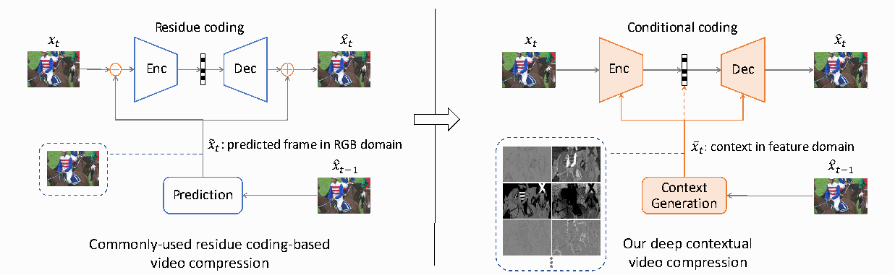

先区分四个符号：

| 符号 | 含义 |
|---|---|
| \(x_t\) | 当前原始帧 |
| \(\hat{x}_{t-1}\) | 上一重建帧，编码端和解码端都可以获得 |
| \(\tilde{x}_t\) | RGB 域预测帧 |
| \(\bar{x}_t\) | 特征域上下文 |

**左侧：先相减，再编码残差。**

从下往上看：

1. 上一重建帧经过 Prediction，生成预测帧 \(\tilde{x}_t\)。
2. 当前帧与预测帧相减，得到残差。
3. Enc 编码残差，Dec 恢复重建残差。
4. 将重建残差与预测帧相加，得到 \(\hat{x}_t\)。

图中的两个橙色圆圈，明确规定了图像域的“减”和“加”。

**右侧：让参考信息以特征形式参与编码与重建。**

参考信息经过 Context Generation，生成上下文 \(\bar{x}_t\)，随后分成三路：

- 送入 **Enc**，帮助形成当前帧的表示。
- 送入 **Dec**，帮助重建当前帧。
- 沿**橙色虚线**参与熵建模，帮助估计编码符号的概率。

右侧没有预先规定必须先做 RGB 域相减、最后再相加。网络获得了更灵活的条件输入，可以学习怎样组合当前内容与参考信息。

蓝色虚线框展示的是预测图或特征图的样貌。右侧几张灰度图只是特征示意，不能据此判断实际通道数，也不能给每个通道指定固定语义。

**这张图展示了框架差异；实际码率、画质和速度，仍需要实验验证。**

### 二、引言第 3 段：条件是什么，怎样使用，怎样学习？

**英文短摘录：**

> “What is condition?”

**翻译：**“什么是条件？”

**段落释义：** 作者将条件定义为可学习的特征上下文，供编码器、解码器和熵模型共同使用，并以运动估计与补偿引导上下文生成。本段还报告了与 x265 veryslow、DVCPro 的码率比较结果。

先把三个问题分别讲清楚。

**1. 条件是什么？**

一张预测图可以作为条件，但条件也可以是一份多通道特征。

例如，网络可以将参考图像转换为便于处理边缘、纹理等结构的表示。这里不要求每个通道都具有明确的人类语义。

作者说条件维度可以灵活设计，意思是表示形式、通道数等可以由模型选择。**增加通道并没有凭空创造当前帧的真实信息；它可能让网络更容易利用已有信息。** 通道更多是否值得，要结合压缩收益与计算成本判断。

**2. 条件为什么要送到三个位置？**

下面是教学用简化式，省略了论文实际模型的其他先验和支路：

\[
c_t:=\bar{x}_t,
\qquad
y_t=E_\theta(x_t,c_t),
\]

\[
\hat y_t=Q(y_t),
\qquad
\hat x_t=D_\phi(\hat y_t,c_t).
\]

其中 \(E\) 是编码变换，\(D\) 是解码变换，\(Q\) 是量化，\(\hat y_t\) 是量化后的潜在表示。

| 使用位置 | 它回答的问题 |
|---|---|
| 编码器 | 已有参考信息后，当前帧还需要怎样表示？ |
| 解码器 | 如何结合码流与参考信息恢复当前内容？ |
| 熵模型 | 当前条件下，各个量化符号出现的概率是多少？ |

前两项影响**表示与重建方式**，第三项影响**这些表示需要多少比特**。

理解熵模型，可以联系理想码长：

\[
\ell(\hat y_t,c_t)
\approx-\log_2 p_\psi(\hat y_t\mid c_t,\ldots).
\]

概率模型认为某个实际出现的符号越可能，其理想码长就越短。

【补充示例】若上下文使某个实际出现符号的模型概率从 \(1/8\) 提高到 \(1/2\)，对应的信息量就从 3 bit 变为 1 bit。不过，总体收益取决于全部符号的平均负对数概率，不能只看单个符号。

这也解释了论文为什么强调橙色虚线：**条件不仅帮助网络生成表示，还帮助概率模型压缩这些表示。**

文中“熵模型随时间自适应”，在这里表示条件随视频内容变化，预测的概率分布相应变化；不能直接理解成网络权重必须逐帧在线更新。

**3. 条件怎样学习？为什么需要运动？**

作者使用运动估计与运动补偿，即 **MEMC**，帮助寻找相关的参考特征。

【补充示例】假设一辆车向右移动了 5 个像素。当前车门位置对应的参考内容，可能位于上一帧左侧 5 个像素附近。直接取上一帧同坐标的特征，可能取到其他部位甚至背景；运动对齐则帮助找到相关位置。

这里有一个容易误解的细节。

【方法核查补充】我核对了第 6 页 Section 3.3：实际方案从参考重建帧与当前帧估计运动，**将运动编码并解码，再用解码后的运动对齐参考特征**，之后进行特征细化。

因此：

- 特征域补偿仍然可以依赖运动估计。
- Figure 1 没画运动支路，不代表没有运动码率。
- 解码器使用的条件，必须能由共享模型和已解码信息一致生成。

Section 3.3 尚未计为逐段精读；这里只核查引言概述的准确含义。

本段报告的数字是：针对其 1080p 标准测试视频，相比 x265 veryslow 节省 **26.0%** 码率，相比 DVCPro 节省 **16.4%**。目前先记录为作者报告，实验设置与统计方式留到实验部分核验。

### 三、引言第 4 段：DCVC 的创新定位是什么？

**英文短摘录：**

> “a more comprehensive solution”

**翻译：**“一种更全面的方案。”

**段落释义：** 作者承认此前已有工作研究条件编码，将本文的区别定位在条件参与范围与可扩展性，并把更好的条件设计留作开放问题。

这一段对判断创新性非常重要：**不能把“首次提出条件编码概念”算作 DCVC 的贡献。**

作者强调的是：

- 条件同时进入编码、解码与熵建模。
- 条件可以用可学习的特征表示。
- 条件的定义、生成和使用方式可以继续调整。

作者对先前工作的概括——仅覆盖部分模块，或者需要人工规则筛选内容——仍属于需要核查的文献比较。下一节 Related works 会具体展开。

可扩展性也有明确边界：它说明框架允许改动哪些部分，并不意味着任意替换条件都能改善压缩。

### 四、四项贡献，分别应该怎样理解？

以下保持论文原列表的顺序，并区分作者主张与后续所需证据。

| 作者的贡献主张 | 阅读时应检查什么 |
|---|---|
| 设计条件编码框架，对条件的定义、使用与学习进行系统设计 | 与残差基线相比，框架改变带来了多少收益？ |
| 条件参与三个环节，熵模型提供压缩率与速度的选择 | 各个使用位置是否有效？速度比较怎样进行？ |
| 使用特征域条件，帮助恢复高频内容 | 特征维度、消融和重建结果是否支持这一解释？ |
| 框架可扩展，条件仍有改进空间 | 哪些部分能替换，已有何种验证？ |

第二项还提出：熵模型可以结合空间与时间相关性追求压缩率，也可以仅利用时间相关性追求速度。这里的“仅时间”针对熵模型中的相关性利用方式，不意味着整套网络不处理空间结构，也不能据此认定编解码器已经达到实时运行。

这四项贡献彼此关联：框架概括整体设计，三个使用位置描述实现方式，特征域决定条件的表示，可扩展性描述后续能调整的部分。

**Introduction 读完后，应掌握的主线**

作者先用残差编码框架提出问题，再通过条件熵说明进一步利用相关性的空间，随后提出：

\[
\text{参考信息}
\rightarrow
\text{运动对齐的特征上下文}
\rightarrow
\begin{cases}
\text{帮助形成表示}\\
\text{帮助图像重建}\\
\text{帮助概率估计}
\end{cases}
\]

其中，**改善概率估计与让解码变换直接获得参考特征，是两个不同作用**。只把上下文送给熵模型，不会自动让解码变换获得同样的条件输入。

本轮已读完 **Figure 1、引言第 3—4 段和四项贡献**。下一轮从**第 3 页 Section 2 Related works 的图像压缩首段**开始。

[本轮逐段讲解](#file-2) · [已更新的阅读记录](DCVC_讲解资源/来源/DCVC_阅读记录.md)
<!-- SOURCE-END:chat-285 -->

# 第三轮：完成其余正文与补充材料

用户请求：“继续，直到完成讲解”。这轮聊天回复对应两份更细的保存稿；两种文本均完整保留。

## 补充说明：四路码流与实验边界

> 来源：会话 JSONL 第 348 行，commentary。2026/10/15 16:45:54（Asia/Shanghai）。可核对[原始文本](DCVC_讲解资源/来源/补充说明04.md)。

<!-- SOURCE-BEGIN:chat-348 -->
正文方法已核对到训练部分：完整码流包含图像潜变量、运动潜变量，以及各自的超先验，共四部分。实验也有两个关键边界：26.0% 是相对 x265 的特定测试结果；无空间自回归的版本仍保留超先验和运动编码，不能直接称为实时编解码器。
<!-- SOURCE-END:chat-348 -->

## 补充说明：先验与通道数消融

> 来源：会话 JSONL 第 437 行，commentary。2026/10/15 16:51:29（Asia/Shanghai）。可核对[原始文本](DCVC_讲解资源/来源/补充说明05.md)。

<!-- SOURCE-BEGIN:chat-437 -->
消融实验支持了两项具体结论：特征域条件比 RGB 条件更有效；时间先验能帮助压缩，去掉空间先验后码率增加约 3.8%。补充材料还显示，256 通道在 HEVC Class E 上不如 64 通道，说明上下文维度并非越大越好。
<!-- SOURCE-END:chat-437 -->

## 补充说明：渐进训练与真实码流

> 来源：会话 JSONL 第 450 行，commentary。2026/10/15 16:55:10（Asia/Shanghai）。可核对[原始文本](DCVC_讲解资源/来源/补充说明06.md)。

<!-- SOURCE-BEGIN:chat-450 -->
补充材料已读完。它补上了训练稳定性的关键：先训练运动分支，再训练重建，随后加入内容码率，最后联合优化。我还核对了官方 2021 代码入口：测试默认估计概率码率，实际写出码流需要开启选项；复现时还要统一图像裁剪、I 帧和 GOP 设置。
<!-- SOURCE-END:chat-450 -->

## 补充说明：长 GOP 与误差传播

> 来源：会话 JSONL 第 489 行，commentary。2026/10/15 17:01:15（Asia/Shanghai）。可核对[原始文本](DCVC_讲解资源/来源/补充说明07.md)。

<!-- SOURCE-BEGIN:chat-489 -->
讲解文件已覆盖剩余正文和全部补充材料，我正在核对图表与覆盖清单。最终评价会保留证据边界：长 GOP 实验支持缓解误差传播，尚未证明消除闪烁；原始 DCVC 也不能与后来同名家族模型的速度或压缩结果混用。
<!-- SOURCE-END:chat-489 -->

## 第 3 轮完整回复：其余正文、补充材料与全篇评价

> 来源：会话 JSONL 第 539 行，final_answer。2026/10/15 17:06:42（Asia/Shanghai）。可核对[原始文本](DCVC_讲解资源/来源/聊天讲解03_正文与补充材料.md)。

<!-- SOURCE-BEGIN:chat-539 -->
下面从 Related works 接着讲到补充材料结束。**正文、补充材料、全部图表和公式的讲解现已完成**，逐段内容已保存到[全文精读导航](DCVC_讲解资源/来源/DCVC_全文精读导航.md)。

阅读依据是 [正式版 PDF](DCVC_讲解资源/原论文/Li_Deep_Contextual_Video_Compression_NeurIPS_2021_paper.pdf) 和 [补充材料 PDF](DCVC_讲解资源/原论文/Li_Deep_Contextual_Video_Compression_NeurIPS_2021_supplemental.pdf)。以下继续区分论文报告、作者解释与独立分析。

### 一、Related works：DCVC 接续了哪些研究？

这一节有三个段落。

第一段回顾学习式图像压缩的发展。这里需要建立一个基本认识：压缩网络既要学习**怎样表示图像**，也要学习**怎样给表示分配比特**。

编码器与解码器主要负责前者；超先验、自回归上下文和概率分布模型主要负责后者。DCVC 同时改动这两个层面，所以不能将其理解为单纯换了一个预测网络。

第二段区分两类视频方法：

| 参考方式 | 主要特点 |
|---|---|
| 可以使用未来显示帧 | 能利用双向信息，但通常涉及缓存和重排序 |
| 只使用过去参考信息 | 避免未来参考依赖，适合低延迟结构 |

DCVC 属于第二类。**参考结构具有因果性，并不等于计算速度达到实时。** 这个区别在复杂度实验中会再次出现。

第三段讨论已有条件编码。DCVC 并非首次提出条件编码概念：

- Liu 等人的方法重点学习帧间潜变量的条件熵，并省去显式帧间变换。[原论文摘要](https://arxiv.org/abs/2008.09180)
- Ladune 等人的工作已经采用条件编码，并具有显式的 skip 与编码分支。[原论文](https://arxiv.org/abs/2104.07930)

这里还要纠正一种容易出现的误读：前作具有显式模式划分，不意味着每帧的划分由人工标注。其模式参数也可以由网络生成。

因此，DCVC 的创新定位应当是：**选择特征域上下文，并让条件系统地参与编码、解码与熵建模。**

### 二、Section 3.1：从残差编码到上下文编码

作者用三个公式逐步改变框架。

传统残差形式为：

\[
\hat x_t=
f_{\mathrm{dec}}\!\left(
Q\!\left(f_{\mathrm{enc}}(x_t-\tilde x_t)\right)
\right)+\tilde x_t .
\tag{1}
\]

其中 \(Q\) 代表量化。流程是“预测—相减—编码残差—恢复残差—相加”。

第一步改变，是直接把 RGB 预测图作为条件：

\[
\hat x_t=
f_{\mathrm{dec}}\!\left(
Q(f_{\mathrm{enc}}(x_t\mid\tilde x_t))
\mid\tilde x_t
\right).
\tag{2}
\]

这里的竖线表示网络接收条件。实际操作采用通道拼接，不是概率运算。

第二步改变，是把预测图换成学习到的特征上下文：

\[
\hat x_t=
f_{\mathrm{dec}}\!\left(
Q(f_{\mathrm{enc}}(x_t\mid\bar x_t))
\mid\bar x_t
\right).
\tag{3}
\]

从公式 1 到 2，改变的是**条件的使用方式**；从 2 到 3，改变的是**条件的表示形式**。

看完整框架：

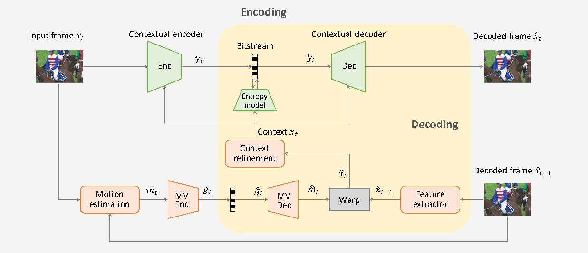

按数据依赖读这张图：

1. 编码端利用当前帧和上一重建帧估计运动 \(m_t\)。
2. 运动经过编码与解码，得到双方一致可用的 \(\hat m_t\)。
3. 从上一重建帧提取特征，用 \(\hat m_t\) 对齐，再细化为上下文 \(\bar x_t\)。
4. 当前帧与上下文共同生成图像潜变量 \(y_t\)。
5. 解码端恢复量化潜变量，再结合相同上下文重建 \(\hat x_t\)。
6. 当前重建帧继续作为下一帧的参考。

**解码器不需要原始当前帧，因为它使用的是已解码运动和重建参考。**

随后 Figure 3 展示不同特征通道及重建误差变化。作者观察到部分通道更像在响应纹理，部分更像在响应颜色，并展示了高频区域、新出现区域的改善。

该示例中，DCVC 为 **0.0306 BPP**，DVCPro 为 **0.0359 BPP**。

【独立分析】这些图支持设计直觉，但不能证明每个通道都有固定语义。新内容没有可靠参考时，条件网络可以降低对参考的依赖；论文没有因此显式增加一个硬性的帧内/帧间开关。

### 三、Section 3.2：熵模型究竟怎样节省比特？

作者首先给出码率与负对数概率的关系：

\[
R(\hat y_t)\ge
\mathbb E_{\hat y_t\sim q}
[-\log_2p(\hat y_t)].
\tag{4}
\]

其中 \(q\) 是实际潜变量分布，\(p\) 是模型估计的分布。论文将右侧作为使用该模型进行熵编码时的紧致码率估计。

理解它可以补充一个推导：

\[
\begin{aligned}
H(q,p)
&=-\sum_u q(u)\log_2p(u)\\
&=H(q)+D_{\mathrm{KL}}(q\Vert p).
\end{aligned}
\]

表示分布固定时，概率模型越准确，失配造成的额外比特通常越少。实际文件还可能包含有限精度、终止与封装开销。

DCVC 使用三种先验：

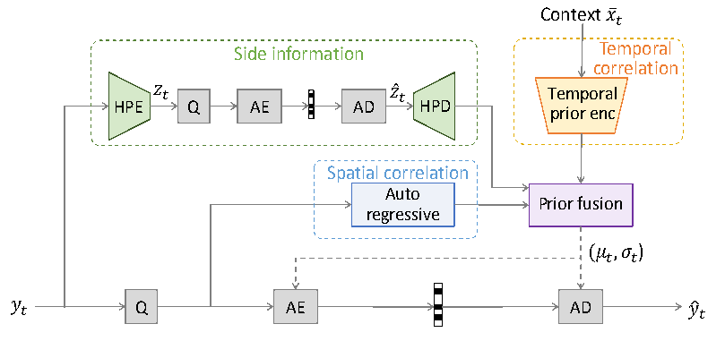

| 先验 | 从哪里来 | 主要代价 |
|---|---|---|
| 超先验 | 从当前潜变量生成并传输的侧信息 | 本身需要比特 |
| 空间先验 | 当前帧已经解码的潜变量符号 | 引入顺序依赖 |
| 时间先验 | 参考信息生成的上下文 | 依赖参考和已解码运动 |

融合网络利用三者，预测分布参数：

\[
(\mu_{t,i},\sigma_{t,i})=
f_{\mathrm{pf}}\!\left(
f_{\mathrm{hpd}}(\hat z_t),
f_{\mathrm{ar}}(\hat y_{t,<i}),
f_{\mathrm{tpe}}(\bar x_t)
\right).
\]

注意 \(\hat y_{t,<i}\)：解码当前位置之前，需要先恢复前面的符号。因此，公式中的概率乘积**不表示所有符号无条件独立**。

论文用 Laplace 分布与均匀分布卷积表示量化符号概率：

\[
p(\hat y_t\mid\bar x_t,\hat z_t)
=
\prod_i
\left[
\mathcal L(\mu_{t,i},\sigma_{t,i}^{2})
*\mathcal U(-\tfrac12,\tfrac12)
\right](\hat y_{t,i}).
\tag{5}
\]

这里最值得推导的是：**为什么需要均匀卷积？**

量化得到整数 \(k\)，意味着连续值落在对应量化区间内。因此它的概率质量是：

\[
p(\hat y=k)
=
\int_{k-1/2}^{k+1/2}f(u)\,du
=
F(k+1/2)-F(k-1/2).
\]

宽度为 1 的均匀核卷积，正好表达这个积分。

【补充示例】若 Laplace 的位置为 0、尺度为 1，则：

\[
p(\hat y=0)=1-e^{-0.5}\approx0.39347.
\]

不能直接使用连续密度 \(f(0)=0.5\) 作为离散符号概率。

原文的尺度记号也值得留意：公式写了 \(\sigma^2\)，但官方实现直接将预测的尺度传给 Laplace，并计算 CDF 差。复现时应检查参数约定，不能机械地额外平方。

最后，作者给出删除空间先验的变体：

\[
(\mu,\sigma)=
f_{\mathrm{pf}}\!\left(
f_{\mathrm{hpd}}(\hat z_t),
f_{\mathrm{tpe}}(\bar x_t)
\right).
\]

它仍然保留超先验。删除图像潜变量的空间自回归，也不意味着整个运动与内容编解码系统已经完全并行。

### 四、Section 3.3：上下文为什么要先对齐再细化？

作者的上下文生成公式为：

\[
\bar x_t=
f_{\mathrm{cr}}\!\left(
\operatorname{warp}
\left(f_{\mathrm{fe}}(\hat x_{t-1}),\hat m_t\right)
\right).
\tag{6}
\]

依次执行：

\[
\text{参考图像}
\rightarrow\text{特征提取}
\rightarrow\text{运动对齐}
\rightarrow\text{上下文细化}.
\]

运动后，同一坐标处的参考内容可能已经不相关。warp 根据运动寻找其他位置的特征，细化网络再处理采样误差和不连续。

【补充示例】相邻特征值为 10 和 14，采样点在两者之间的 0.25 处，线性插值得到：

\[
0.75\times10+0.25\times14=11.
\]

二维双线性采样对应组合四个邻点。实际流方向、边界处理和坐标归一化仍需服从实现。

这一节也解释了为什么必须使用**解码后的运动**：编码端若使用高精度原始运动，而解码端只能获得有损运动，两边生成的条件就可能不同。

### 五、Section 3.4：训练优化的是什么？

正文目标是：

\[
L=\lambda D+R.
\tag{7}
\]

\(\lambda\) 越大，优化通常越愿意付出比特来减少失真。

论文训练了四个工作点：

| 目标 | \(\lambda\) |
|---|---|
| MSE | 256、512、1024、2048 |
| MS-SSIM | 8、16、32、64 |

学习率从 \(10^{-4}\) 降到微调阶段的 \(10^{-5}\)，batch size 为 4。

这表示多个分别训练的模型，不是一个模型已支持连续码率控制。另外，MS-SSIM 原值越大越好；用于最小化目标时，应转成合适的失真形式，不能直接把它理解为越小越好。

完整码率和渐进训练细节，作者放在补充材料中，下面按原顺序继续到那里。

### 六、Section 4：实验到底证明了什么？

训练数据是 Vimeo-90k septuplet，随机裁剪为 \(256\times256\)。

测试覆盖 MCL-JCV、UVG、HEVC Class B/C/D/E。主实验使用：

- HEVC：GOP 为 10，测试 100 帧。
- MCL-JCV、UVG：GOP 为 12，测试 120 帧。
- 神经方法采用相同 I 帧模型重新比较。
- x264/x265 使用 veryslow 和固定 QP。

统一 I 帧很重要：一个 GOP 的总结果既受 P 帧方法影响，也受第一张参考图像的质量和码率影响。

Figures 5、6 分别展示 PSNR 与 MS-SSIM 曲线，横轴为 BPP，纵轴为质量；更靠左上方通常更有利。MS-SSIM 图对应为该指标微调过的神经模型。

正文 Table 1 的关键结果如下，均为**相对 x265 veryslow 的 PSNR BD-Rate**：

| 数据集 | DCVC | DVCPro |
|---|---:|---:|
| MCL-JCV | −23.9% | −4.1% |
| UVG | −25.3% | −7.9% |
| HEVC B | −26.0% | −9.0% |
| HEVC C | −5.8% | +7.2% |
| HEVC D | −17.5% | −6.9% |
| HEVC E | −11.9% | +17.2% |

负数表示码率节省。**摘要中的 26.0% 对应 HEVC B，不是所有视频共同的收益。**

BD-Rate 的基本过程是：在共同质量区间内，对两条曲线的对数码率差取平均，再转换为相对百分比。它不是某个单独文件的大小差。

也因此，不能简单计算：

\[
26\%-9\%=17\%
\]

便声称验证了相对 DVCPro 的节省。改变锚点时，应重新比较曲线与共同积分区间。

作者将高分辨率上的较大提升解释为丰富纹理使特征上下文更有用。这个解释与可视化相符，但跨数据集还同时改变了内容和运动，不能仅凭这些结果确定分辨率是独立原因。

复杂度方面，论文报告：

| 项目 | DCVC | DVCPro |
|---|---:|---:|
| MAC | 2268G | 2014G |
| P40 上每个 1080p 帧的推理耗时 | 857 ms | 849 ms |

运算量约增加 13%，所报推理耗时约增加 1%。这说明硬件并行度会影响运算量与耗时的关系，**没有证明原始 DCVC 已达到实时运行**。

### 七、Section 4.3：消融实验如何支持设计？

第一组拆分“条件形式”和“时间先验”：

| 时间先验 | 编码方式 | 相对最终方案的码率增加 |
|---|---|---:|
| 有 | 特征上下文条件 | 0.0% |
| 有 | RGB 预测条件 | 5.4% |
| 无 | 特征上下文条件 | 4.6% |
| 无 | RGB 预测条件 | 8.7% |
| 有 | 残差编码 | 11.2% |
| 无 | 残差编码 | 12.9% |

可以得到三个较具体的判断：

1. 有无时间先验时，特征条件都优于相应 RGB 条件和残差方案。
2. 时间先验对三种编码方式都有帮助。
3. 改变条件表示与改变概率模型，确实是两个有作用的设计环节。

但这些百分比不能直接线性相加。方向也要保留：RGB 方案“比最终方案多 5.4%”，反向节省约为：

\[
1-\frac1{1.054}\approx5.12\%.
\]

第二组拆分熵模型：

| 先验组合 | 码率增加 |
|---|---:|
| 超先验＋空间＋时间 | 0.0% |
| 超先验＋时间 | 3.8% |
| 超先验＋空间 | 4.6% |
| 仅超先验 | 60.9% |

这说明空间与时间上下文都提供重要帮助。删除空间先验只损失 3.8%，为作者的速度取舍提供了依据；但没有快速变体的完整实际计时，就不能进一步给出确定的加速倍数。

60.9% 也不是“时间先验单独贡献了这么多”，因为它的比较对象同时使用了多种先验。

### 八、Section 4.4 与 Discussion：证据边界是什么？

Figure 7 说明，更强的 I 帧编码能明显提高 DVC 与 DVCPro 的结果；统一 I 帧后，DCVC 仍然领先。

图中一部分曲线来自公开结果，一部分来自作者重新测试。因此不能把所有新增基线都描述为已经在完全统一条件下重新训练、测试。

Discussion 的三个段落依次强调：

- 条件编码对时间与空间信息的适应性，以及高维特征的作用。
- 条件怎样定义、使用和学习仍是开放问题。
- 当前存在通道冗余、单参考帧、未专门考虑时间稳定性等限制。

这里没有独立的 Conclusion，Discussion 后面直接进入参考文献。

【独立分析】本文已经提供了较完整的框架与消融证据，但没有证明：

- 所有残差模型都必然严格更差。
- 任意视频都能节省 26%。
- 原始模型优于所有传统编码配置或 VVC。
- 缓解误差传播就等于消除了闪烁。

### 九、补充材料 Section 1：网络实际长什么样？

编码器与解码器如下：

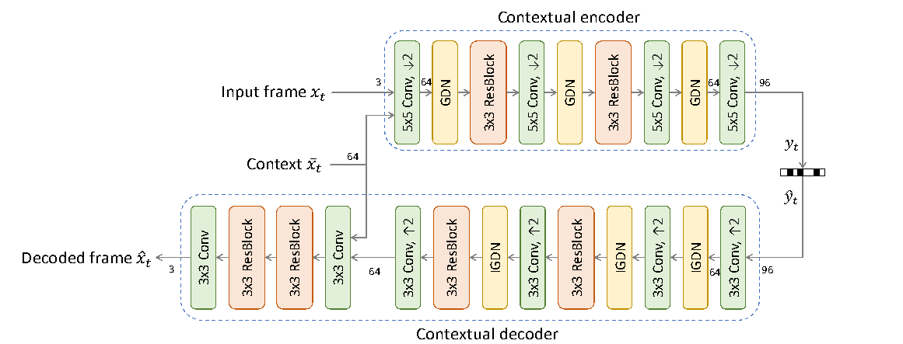

默认上下文为 **64 通道**，图像潜变量为 **96 通道**。

以 NCHW 张量表示：

\[
x_t:[B,3,H,W],\qquad
c_t:[B,64,H,W].
\]

拼接后：

\[
[x_t,c_t]:[B,67,H,W].
\]

四次二倍下采样后：

\[
y_t:[B,96,H/16,W/16].
\]

注意：每个空间方向缩小 16 倍，对应面积缩小到 \(1/256\)。

解码器将潜变量恢复到原分辨率特征，再与上下文拼接，最终输出 RGB 图像。

GDN 用于改变特征的统计结构，IGDN 用于相应的合成变换。由于包含学习变换和量化，不能把整套网络当成严格可逆函数。网络里的 ResBlock，也不等于图像域的帧间残差编码。

补充 Figure 2 给出较浅的特征提取与细化网络；Figure 3 给出将原分辨率上下文下采样到潜变量尺度的时间先验编码器。

还有一个重要区别：**运动潜变量另有熵模型，使用超先验和自回归，但没有本文这个时间先验编码器。**

### 十、补充材料 Section 2：为什么要分四阶段训练？

完整 P 帧码流有四部分：

| 符号 | 内容 |
|---|---|
| \(\hat y_t\) | 图像内容潜变量 |
| \(\hat z_t\) | 图像超先验 |
| \(\hat g_t\) | 运动潜变量 |
| \(\hat s_t\) | 运动超先验 |

因此：

\[
R_{\mathrm{P}}
=
R(\hat y_t)+R(\hat z_t)
+R(\hat g_t)+R(\hat s_t).
\]

作者报告，直接联合训练有时会出现：运动码率很小，但总体率失真很差。其解释是，模型绕开了还没学好的运动补偿路径。

四阶段就是逐步建立这条路径：

| 阶段 | 训练安排 | 目标 |
|---|---|---|
| 1 | 预热运动分支 | 像素域预测失真＋运动码率 |
| 2 | 冻结运动，训练重建链条 | 仅重建失真 |
| 3 | 继续冻结运动 | 重建失真＋内容及其超先验码率 |
| 4 | 解冻运动，联合优化 | 重建失真＋全部四项码率 |

第一阶段虽然使用像素域 warp 损失训练运动，最终模型仍然执行特征域补偿，两者并不矛盾。

第二阶段先让上下文“确实有用”，第三阶段再要求它“用更少比特完成任务”，第四阶段协调运动开销与内容开销。

作者报告单张 V100 约一周训练，但该段没有充分明确涵盖多少个质量模型，也没有完整列出各阶段时长，不能据此确定所有模型的总训练预算。

### 十一、补充材料 Section 3：复现不能忽略的设置

补充材料明确了 I 帧档位：CompressAI 的 quality 3、4、5、6，分别匹配 DCVC 四个工作点。

FFmpeg 配置采用固定 QP、明确 GOP、veryslow 等参数。x264 命令还包含具体 B 帧相关设置，因此应保留整套命令并检查实际帧型，不能只凭 tune 名称判断参考结构一致。

数据集段落和脚注还列出了来源及当时的许可说明。这些是论文报告的信息，不等于本次重新审计了全部数据和授权。

### 十二、补充材料 Section 4：长 GOP 是否缓解误差传播？

作者将 GOP 扩大三倍，比较 DCVC 相对对应 DVCPro 的节省：

| 数据集 | 默认 GOP | 三倍 GOP |
|---|---:|---:|
| MCL-JCV | 14.7% | 20.6% |
| UVG | 17.3% | 25.0% |
| HEVC B | 16.2% | 24.0% |
| HEVC C | 10.5% | 14.2% |
| HEVC D | 10.4% | 15.5% |
| HEVC E | 24.6% | 31.3% |

这组测试只使用 HEVC 的 30 帧、其他集合的 36 帧，不能直接与主实验 100/120 帧的统计混读。

结果支持：随着参考递推链变长，DCVC 相对 DVCPro 的优势增大。它不意味着 DCVC 自身的绝对质量不会下降。

看 BasketballDrive 的逐帧例子：

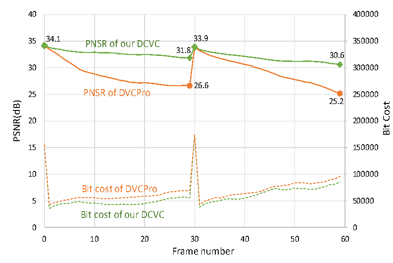

GOP 为 30，共 60 帧。实线看左轴 PSNR，虚线看右轴比特成本。

第一 GOP 中：

- DVCPro：34.1 dB 降到 26.6 dB。
- DCVC：下降到 31.8 dB。

周期性 I 帧使参考质量回升，并出现比特峰值。

这个例子说明误差积累得到缓解，但 DCVC 的质量也在下降，所以不能称为消除了误差传播；它也没有替代专门的时间稳定性评测。

### 十三、补充材料 Section 5：维度与运动的消融

通道实验以 3 通道为锚点，比较 16、64、256 通道：

- 16 通道已有收益。
- 64 通道通常进一步改善。
- 256 通道收益有限，在 HEVC E 上明显不如 64 通道。

因此，**特征维度存在收益、优化难度和计算成本的取舍。**

作者推测高维上下文缺少额外监督时可能训练不稳定，但该实验没有排除其他解释，不能把推测当成唯一原因。

移除 MEMC 的实验则使用像素域条件 DCVC，与相应 DVCPro 控制比较：

- 有 MEMC 时，DCVC 相对 DVCPro 节省 12.7%。
- 无 MEMC 时，DCVC 相对无 MEMC 的 DVCPro 节省 22.1%。
- 移除 MEMC 后，两种方法本身都明显变差。

所以，不能把 22.1% 解读成“去掉运动后 DCVC 更好”。它说明条件框架在参考不够准确时仍保留了相对优势，运动对齐本身仍然重要。

后面提到 Transformer，只是未来方向，不是本文已经实现的网络。

### 十四、补充材料 Section 6：视觉结果怎样读？

补充 Figure 8 展示了人像、彩色车辆、鸟和篮球场景。标注结果为：

| 场景 | DVCPro：BPP / PSNR | DCVC：BPP / PSNR |
|---|---|---|
| 人像 | 0.012 / 38.9 | 0.011 / 43.0 |
| 彩色车辆 | 0.032 / 25.6 | 0.031 / 33.7 |
| 鸟 | 0.020 / 34.0 | 0.019 / 36.2 |
| 篮球 | 0.050 / 26.2 | 0.047 / 28.6 |

这些例子支持较低 BPP 下改善颜色、异常纹理和条纹细节的观察。

但它们是挑选出的展示，不是全数据集平均结果，也不是人类偏好的盲测。图中的裁切展示与标注 PSNR，也不能未经核实就认定为同一个局部统计范围。

至此，补充材料正文结束，后面是 15 项参考文献。正文的 40 项与补充的 15 项条目信息均已保存在[参考文献与覆盖核查表](#file-5)，重点关联工作已结合方法解释。

### 十五、读完之后，应该怎样评价这篇论文？

DCVC 最值得学习的，是把三个问题组织成一个可运行系统：

\[
\boxed{
\text{条件怎样表示}
\quad+\quad
\text{条件在哪些环节使用}
\quad+\quad
\text{条件怎样学得}
}
\]

它既改变表示与重建，也改变概率估计，并通过完整码流与渐进训练使这些想法落地。

最有说服力的证据，是主实验、条件形式消融、先验消融，以及长 GOP、通道数和 MEMC 实验之间的相互印证。

其限制也比较清楚：单参考帧、通道冗余、实际速度、训练细节完整性，以及未专门处理的时间稳定性。若从本文出发做实验，比较具体的方向是：

- 在统一训练预算下研究上下文通道裁剪或门控。
- 按遮挡、显露区域和场景切换分析条件失效。
- 比较多参考收益时，同时计算运动与内容总码率。
- 引入时间一致性目标，同时检查码率、逐帧质量和闪烁。

这些是从本文出发的研究接口，不应直接声称是当前年份尚未有人研究的新问题。

### 十六、最小复现路线

应使用[官方仓库中的 2021 子目录](https://github.com/microsoft/DCVC/tree/main/DCVC-family/DCVC)，不要套用仓库根目录后来模型的配置。

我只读核对了其 README、测试脚本和核心模型，发现两个实际复现要点：

1. 原始 README 要求尺寸为 64 的整数倍，并示例将 \(1920\times1080\) 裁成 \(1920\times1024\)。传统基线必须处理相同区域。[原始 README](https://raw.githubusercontent.com/microsoft/DCVC/main/DCVC-family/DCVC/README.md)
2. 测试脚本默认 `write_stream=false`，走概率码率估计路径；需要显式开启写流来检查实际编解码。[测试脚本](https://raw.githubusercontent.com/microsoft/DCVC/main/DCVC-family/DCVC/test_video.py)

即使写出码流，日志中的四段 payload 长度也需要与完整文件字节数区分，确认头信息是否计入。[核心实现](https://raw.githubusercontent.com/microsoft/DCVC/main/DCVC-family/DCVC/src/models/DCVC_net.py)

合理的顺序是：先用一个质量模型跑通短 GOP，检查参考递推与四项码率；再检查真实码流解码；最后统一 I 帧、GOP、帧数、裁剪与指标，在四个工作点上比较曲线和 BD-Rate。

**完成范围：** 已讲解全部正文与补充材料，覆盖正文公式 1—7、7 张图、3 张表，以及补充材料 8 张图和训练表。阅读记录已标为完成；本次没有训练模型或重新计算论文性能。

[正文方法与实验详解](#file-3) · [补充材料与全篇评价](#file-4) · [完整导航](DCVC_讲解资源/来源/DCVC_全文精读导航.md)
<!-- SOURCE-END:chat-539 -->

# 代码任务：中断前的实际核查说明

用户请求：“展开讲代码实现”。在完整代码讲解尚未生成时，用户切换到“利用全文整理 skill 操作”，随后要求继续。本节只保留已经发出的两条实质性说明，不把工具读取记录或新编写的说明充当已完成讲解。

已保存的[官方源码选择性快照](DCVC_讲解资源/代码核查快照/SOURCE_MANIFEST.json)固定提交为 <code>cbdae87a5445114cdc7f48816da63ea80bdeac40</code>，仅供核对当次只读结论，不是包含依赖、权重和训练工程的完整可运行安装。完整的逐模块代码讲解仍待继续。

## 代码核查说明 1：两条量化路径

> 来源：会话 JSONL 第 571 行，commentary。2026/10/15 17:11:56（Asia/Shanghai）。可核对[原始文本](DCVC_讲解资源/来源/代码核查说明01.md)。

<!-- SOURCE-BEGIN:chat-571 -->
我会按项目的 paper-reading 技能保存本轮完整讲解，并固定官方仓库的一个提交，方便逐行对照。代码中有个重要细节：`forward()` 的取整方式与真实码流路径的按均值量化不同，不能默认两条路径会产生逐像素完全相同的重建结果。
<!-- SOURCE-END:chat-571 -->

## 代码核查说明 2：逐位置编码、分布与文件头

> 来源：会话 JSONL 第 610 行，commentary。2026/10/15 17:15:36（Asia/Shanghai）。可核对[原始文本](DCVC_讲解资源/来源/代码核查说明02.md)。

<!-- SOURCE-BEGIN:chat-610 -->
真实编码是逐位置推进的：每恢复一个潜变量位置，就把重建值写回缓冲区，供后续位置预测概率。源码还确认了两点：名为 `GaussianEncoder` 的类实际使用 Laplace 分布；P 帧文件除了四段码流，还有 24 字节头信息。
<!-- SOURCE-END:chat-610 -->

# 已保存讲解稿与参考文献附录

下列四份保存稿与上方聊天全文主题重叠，但段落组织、推导展开和图表细节并不完全一致。为保留全部已完成讲解，不按题目相同去重。原文件保持不变；这里对本次收集时的版本做全文快照收录。第五项是参考文献与覆盖核查。

## 保存稿 1：标题摘要与引言

> 来源：论文目录原有讲解文件。原有保存文件；与聊天回复分别保留。可核对[原始文本](DCVC_讲解资源/来源/DCVC_精读01_标题摘要与引言.md)。

<!-- SOURCE-BEGIN:file-1 -->
### DCVC 精读第 1 轮 标题摘要与引言

本轮范围为 NeurIPS 2021 正式版第 1 页：标题、作者与机构、摘要、引言第 1 至第 2 自然段。要掌握的核心是预测编码与条件编码的区别，以及引言中熵不等式的成立原因和解释边界。

用户指定的 [bib 文件](DCVC_讲解资源/原论文/deep-contextual-video-compression.bib) 提供了摘要全文，以下按其内容呈现与翻译。其余正文从 [正式版 PDF](DCVC_讲解资源/原论文/Li_Deep_Contextual_Video_Compression_NeurIPS_2021_paper.pdf) 获取，采用短摘录、逐段释义与讲解；释义不标为全文翻译。论文来源为 [NeurIPS 官方页面](https://proceedings.neurips.cc/paper/2021/hash/96b250a90d3cf0868c83f8c965142d2a-Abstract.html)。

#### 标题与作者

**英文标题：** Deep Contextual Video Compression。

**中文译名：** 深度上下文视频压缩。

**作者与机构：** Jiahao Li、Bin Li、Yan Lu，Microsoft Research Asia。论文发表于 NeurIPS 2021。

这里的 context 指压缩当前帧时可以利用的辅助信息。它与自然语言中的上下文不是同一个任务概念。作者关注的是：已解码的参考信息能否以更适合压缩的形式帮助表示和重建当前帧。标题中的 contextual 提示了方法的重点。

#### Abstract

**阅读位置：** 正式版第 1 页摘要，1 个自然段。

**英文原文，来自用户提供的 bib**

> Most of the existing neural video compression methods adopt the predictive coding framework, which first generates the predicted frame and then encodes its residue with the current frame. However, as for compression ratio, predictive coding is only a sub-optimal solution as it uses simple subtraction operation to remove the redundancy across frames. In this paper, we propose a deep contextual video compression framework to enable a paradigm shift from predictive coding to conditional coding. In particular, we try to answer the following questions: how to define, use, and learn condition under a deep video compression framework. To tap the potential of conditional coding, we propose using feature domain context as condition. This enables us to leverage the high dimension context to carry rich information to both the encoder and the decoder, which helps reconstruct the high-frequency contents for higher video quality. Our framework is also extensible, in which the condition can be flexibly designed. Experiments show that our method can significantly outperform the previous state-of-the-art (SOTA) deep video compression methods. When compared with x265 using veryslow preset, we can achieve 26.0% bitrate saving for 1080P standard test videos.

**中文翻译**

现有的大多数神经视频压缩方法采用预测编码框架：先生成预测帧，再编码当前帧与预测帧之间的残差。然而，从压缩率来看，预测编码只是次优方案，因为它仅通过简单的减法操作消除帧间冗余。本文提出深度上下文视频压缩框架，以实现从预测编码到条件编码的范式转变。具体而言，我们试图回答以下问题：在深度视频压缩框架中，如何定义条件、使用条件以及学习条件？为挖掘条件编码的潜力，我们提出将特征域上下文作为条件。这样可以利用高维上下文向编码器和解码器传递丰富的信息，帮助重建高频内容，从而获得更高的视频质量。我们的框架还具有可扩展性，能够灵活设计条件。实验表明，该方法能够显著优于此前最先进的深度视频压缩方法。对于 1080P 标准测试视频，相比采用 veryslow 预设的 x265，我们可以节省 26.0% 的码率。

**深入讲解**

摘要的逻辑是：许多已有方法编码残差，作者希望把参考信息更直接地作为条件输入，让网络学习怎样利用它。这一设计涉及三个不同的问题：条件应当包含什么信息；哪些模块使用条件；条件如何学得。它们是后续精读方法部分的主线。

特征域（feature domain）可以先理解为网络提取的多通道表示。与一张 RGB 预测图相比，它有机会携带多种有助于重建的线索。高频内容是空间变化较快的内容，例如边缘和纹理。此处“帮助重建高频内容”仍属于作者主张，具体证据要在方法与实验中检查。

26.0% 是摘要报告的特定测试条件下的码率节省。它不能直接解释为所有视频文件都缩小 26%，也不能据此推断编码速度。对应的质量指标、编码设置和统计方式将在实验部分核对。

#### Section 1 Introduction 第 1 段

**阅读位置：** 正式版第 1 页，首段背景介绍。

**英文短摘录**

> “merely replaced by neural networks”

**摘录翻译：** “仅仅被神经网络替代。”

**段落释义**

作者把传统视频编码和许多当时的神经方法归纳为先预测、再编码残差的框架：虽然实现模块发生变化，处理当前帧的基本方式仍然延续。

**深入讲解，以下为补充示意**

令 x_t 为当前帧，x_tilde_t 为预测帧，残差为：

\[
r_t=x_t-\tilde x_t.
\]

解码器得到重建残差 r_hat_t 后，将其与同一个预测帧相加：

\[
\hat x_t=\tilde x_t+\hat r_t.
\]

例如某个像素的预测值为 100、真实值为 103，残差就是 3。参考信息已经解释了大量内容，只需编码剩余差异，这是预测编码有效的直觉。

这里还隐含着一个必须满足的实现条件：编码端和解码端应能生成相同的预测信息。因此后续会持续检查参考帧是否为重建帧、运动等信息如何传输，以及双方怎样同步生成上下文。

作者这一段要指出的是，替换模块与改变框架是不同层次的设计。用神经网络实现预测或残差编码，并不自动扩大条件信息参与编码与重建的方式。

#### Section 1 Introduction 第 2 段

**阅读位置：** 正式版第 1 页，引言第 2 自然段。

**英文短摘录**

> “Encoding residue is a simple yet efficient manner”

**摘录翻译：** “编码残差是一种简单而有效的方式。”

**段落释义**

作者承认帧间相关性使残差编码有效，但提出条件编码具有进一步利用相关性的空间，并以熵不等式支撑这一动机。段末转向使用可学习自编码器探索视频相关性。原文引用 [12] 支撑熵比较，引用 [13, 14] 联系已有图像压缩工作。

**原文公式，无独立编号**

\[
H(x_t-\tilde x_t)\ge H(x_t\mid\tilde x_t).
\]

H 是香农熵。左边衡量不再以预测帧为条件时残差的不确定性；右边衡量已知预测帧之后当前帧还剩多少不确定性。这里的比较不是说减法会破坏信息。

#### 熵不等式的补充推导

以下推导和数值例子是教学补充，不是论文原文或作者实验。

令 X 表示当前信号，P 表示预测信息，R=X-P。先考虑离散随机变量、有限熵，以及给定 P 后 X 与 R 一一对应的情形；不在减法后进行截断等不可逆操作。

**第 1 步，定义熵和条件熵。**

\[
H(R)=-\sum_r p(r)\log_2 p(r),
\qquad
H(R\mid P)=\sum_p p(p)H(R\mid P=p).
\]

熵描述平均不确定性。在理想无损源编码的意义下，它决定可以逼近的平均码长；使用 log2 时单位为 bit。条件熵则先对每一个已知条件计算不确定性，再取平均。

**第 2 步，利用给定 P 后的可逆性。**

当 P=p 已知时，R=X-p，反过来 X=R+p，因此：

\[
p(R=r\mid P=p)=p(X=r+p\mid P=p).
\]

这只是把可能取值重新编号，概率列表不变，所以：

\[
H(R\mid P=p)=H(X\mid P=p).
\]

对 p 取平均，得到：

\[
H(R\mid P)=H(X\mid P).
\]

**第 3 步，比较有条件和无条件的熵。**

互信息满足：

\[
I(R;P)=H(R)-H(R\mid P)\ge0.
\]

于是：

\[
\boxed{H(X-P)=H(X\mid P)+I(X-P;P)\ge H(X\mid P).}
\]

差值恰好是残差与预测信息之间仍存在的互信息。若 R 与 P 独立，互信息为零，等号成立；若残差分布随预测信息变化而变化，就可能存在严格差距。

##### 数值例子

假设下列三种情况构成全部概率分布：

| 预测值 P | 当前值 X | 残差 R | 联合概率 |
| --- | --- | --- | --- |
| 50 | 50 | 0 | 1/2 |
| 100 | 99 | -1 | 1/4 |
| 100 | 101 | 1 | 1/4 |

如果不利用 P，残差的概率分布为 0 占 1/2，-1 和 1 各占 1/4，因而：

\[
H(R)=-\frac12\log_2\frac12
-2\cdot\frac14\log_2\frac14=1.5\ \text{bit}.
\]

如果利用 P：当 P=50 时，残差确定为 0，条件熵为 0；当 P=100 时，残差是等概率的 -1 或 1，条件熵为 1。因此：

\[
H(R\mid P)=\frac12\cdot0+\frac12\cdot1=0.5\ \text{bit}.
\]

所以 H(X given P)=0.5 bit。这里节省的理论空间来自对残差分布的条件区分；并非把残差数值进一步变小。这个例子比较的是平均熵，不意味着每个像素可以单独使用半个二进制位。

##### 解释边界

**第一，减法本身不会丢失信息。** 给定 P 时，X 与 R 可互相恢复。如果一个残差编码器充分使用同一条件 P，理想情况下也能达到 H(R given P)=H(X given P)。该公式比较 H(R) 与 H(X given P)，不能据此认定所有残差架构都存在不可消除的劣势。

**第二，理论熵差不等于实际有损码率差。** 视频压缩还涉及学习变换、量化、重建失真、模型近似和辅助信息开销。具体架构能否在同等质量下减少总码率，要由实验验证。

**第三，作者的框架归纳需要限定范围。** 传统视频编码也使用上下文，例如 H.264/AVC 和 H.265/HEVC 中的 CABAC 使用上下文模型组织概率估计，参见 [Fraunhofer HHI 的 CABAC 技术说明](https://www.hhi.fraunhofer.de/en/departments/vca/research-groups/video-coding-technologies/research-topics/past-research-topics/context-based-adaptive-binary-arithmetic-coding-cabac.html)。应把这段引言理解为为更充分的条件建模提出动机，避免将其简化表述推广为所有传统或残差编码器都仅利用单个预测像素。

#### 前置知识与本轮思考

本轮应能解释熵、条件熵和互信息，并能独立复现上述推导。可补充阅读 [MIT 6.441 讲义](https://www.ocw.mit.edu/courses/6-441-information-theory-spring-2016/pages/lecture-notes/)第 1 章与第 2 章；第 7 章包含编码端与解码端侧信息相关问题，留待需要时展开。

建议检查三个问题：为什么给定预测信息之后残差与原信号具有相同的条件熵？何时本文不等式取等号？若预测信息在解码端不可获得，为什么不能直接使用上面的条件编码比较？

#### 阅读进度

- 已完成：标题、作者与机构、摘要、引言第 1 至 2 段；原文的无编号熵不等式及补充推导。
- 当前停止位置：正式版第 1 页末。
- 下一轮：正式版第 2 页顶部 Figure 1 与图注，然后引言第 3 段，以 “When we design” 开头；解释条件的定义、使用位置和学习方式。
- 连续进度与待验证问题：[DCVC 阅读记录](DCVC_讲解资源/来源/DCVC_阅读记录.md)。
<!-- SOURCE-END:file-1 -->

## 保存稿 2：Figure 1 与引言贡献

> 来源：论文目录原有讲解文件。原有保存文件；与聊天回复分别保留。可核对[原始文本](DCVC_讲解资源/来源/DCVC_精读02_Figure1与引言贡献.md)。

<!-- SOURCE-BEGIN:file-2 -->
### DCVC 精读第 2 轮 Figure 1 与引言贡献

本轮接续正式版第 2 页，依次阅读 Figure 1 与图注、引言第 3 段、第 4 段，以及贡献导语和四项贡献，至 Introduction 结束。正文采用短摘录、段落释义与深入讲解；不将释义标为全文翻译。材料为 [NeurIPS 2021 正式版](DCVC_讲解资源/原论文/Li_Deep_Contextual_Video_Compression_NeurIPS_2021_paper.pdf)。

本轮要掌握的是：同一份特征上下文分别帮助形成表示、重建图像、估计概率；运动对齐使参考特征与当前内容更相关；作者的创新主张需要与已有条件编码工作区分。

#### Figure 1 原图与图注释义

原图直接裁自正式版第 2 页顶部，未重绘。图注表达的是由残差编码框架向条件编码框架的转变。x_t 为当前帧，x_hat_t 与 x_hat_{t-1} 为当前及上一重建帧；橙色虚线表示上下文还用于熵建模。

##### 左侧的数据流

1. 从上一重建帧 x_hat_{t-1} 生成 RGB 域的预测帧 x_tilde_t。
2. 当前帧 x_t 与预测帧相减，得到残差。
3. Enc 编码残差；Dec 恢复重建残差。
4. 将重建残差与相同预测帧相加，生成 x_hat_t。

橙色圆圈中的减号与加号，是这个框架中明确规定的图像域操作。中间的黑白竖条示意编码表示或码流，具体量化与熵编解码结构在后续方法图中展开。

##### 右侧的数据流

1. 从参考信息生成特征域上下文 x_bar_t。
2. 当前帧与上下文共同进入 Enc。
3. Dec 利用编码表示与同一上下文生成重建帧。
4. 橙色虚线进一步把上下文送入熵建模环节。

右侧不再预先规定必须先在 RGB 域相减，最后再相加。网络可以学习如何把当前帧与参考信息共同转换为适合压缩的表示。上下文也并非只换成一张更好看的 RGB 预测图。

蓝色虚线框及其连线用于展示预测图或上下文特征的样貌，与橙色的条件信息连线区分。右侧的灰度特征图是特征表示的示意，不能凭这张小图给每个通道指定固定语义，也不能把示意图的张数当作实际通道数。

Figure 1 是框架概念图，没有单独画出运动估计、运动编码和全部辅助码流。它不能证明条件没有开销，也不能证明实际解码速度或画质收益。

#### 引言第 3 段

**英文短摘录：** “What is condition?”

**摘录翻译：** “什么是条件？”

**段落释义：** 作者将条件定义为可学习的特征上下文，供编码器、解码器和熵模型共同使用，并以运动估计与补偿引导上下文生成。本段还报告相对 x265 veryslow 和 DVCPro 的码率优势。

##### 条件是什么

预测图可以是一种条件，但作者不把条件限制为 RGB 图像。可将原文中的 x_bar_t 记为 c_t：它是一份帮助压缩当前帧的特征表示。

“维度可以灵活设计”表示表示形式及通道等维度可以由模型设计者选择，不意味着维度无限，也不意味着通道越多一定越省码率。把共享参考信息映射到更多通道，也没有凭空产生新的当前帧真实信息；优势在于使有限的网络更容易利用其中与当前内容相关的结构。

##### 条件怎样参与三个环节

以下为教学用简化式，不是论文的编号公式，省略实际模型的其他先验与支路：

\[
c_t:=\bar x_t,\qquad
y_t=E_\theta(x_t,c_t),\qquad
\hat y_t=Q(y_t),\qquad
\hat x_t=D_\phi(\hat y_t,c_t).
\]

E 为编码变换，D 为解码变换，Q 为量化；y_t 是潜在表示，y_hat_t 是其量化结果。theta 与 phi 表示网络参数。

| 参与位置 | 解决的问题 | 直观理解 |
| --- | --- | --- |
| 编码器 | 在参考条件已提供信息的情况下，当前帧应该怎样表示？ | 选择码流还需要传递什么 |
| 解码器 | 如何结合码流和参考条件重建当前帧？ | 利用已有线索恢复内容 |
| 熵模型 | 量化符号在当前条件下出现的概率是多少？ | 为表示分配更合适的码长 |

前两项决定表示与重建方式，第三项决定这些表示如何被压成比特。学习到有用的特征，不等于概率模型已充分利用特征；概率估计更准确，也不等于表示变换已经最合适。三个环节共同使用条件，正是本段强调的系统性设计。

在理想熵编码的近似意义下，某符号的码长与负对数概率有关：

\[
\ell(\hat y_t,c_t)\approx-\log_2 p_\psi(\hat y_t\mid c_t,\ldots).
\]

psi 表示概率模型参数，省略号表示实际模型还可能使用其他信息。这里并非论文完整概率分解。若自行构造一个例子：某个实际出现符号的模型概率由 1/8 提高到 1/2，其理想信息量由 3 bit 变为 1 bit。但总体收益取决于全部符号的平均负对数概率，不能用单个符号的变化代替实际码率实验。

所谓“熵模型随时间自适应”，在此是指条件特征随帧内容变化，预测的概率分布相应变化；不能直接理解为网络权重必须在每一帧在线更新。

##### 条件怎样学得以及运动的作用

引言用 MEMC 概括运动估计与运动补偿。直观上，相机或物体运动后，当前帧某个位置的有用参考信息往往来自上一帧的另一个位置。运动信息帮助对齐这些位置。

自行构造一个例子：一辆车从左向右移动 5 个像素。当前车门位置对应的有用参考特征，应从上一帧左移 5 个像素附近寻找；直接取上一帧同坐标处的特征，可能取到车门的其他区域甚至背景。这个例子仅用于说明对齐动机，不是作者实验。

**核查补充，Section 3.3 尚未计为精读：** 为避免将引言的概述误读为“光流一定在特征上估计”，本轮核对了正式版第 6 页。实际方案由参考重建帧和当前帧估计运动，将运动编码并解码，再用解码后的运动引导参考特征的 warp 和后续细化。因而特征域对齐不等于取消运动估计，也不等于不需要运动码率。

解码器不能直接访问原始当前帧。需要用于解码的条件，必须能由双方共享的模型和已解码信息一致地得到；若生成条件需要传输运动等辅助信息，其开销必须计入总码率。Figure 1 省略了这些支路，后续 Figure 2 与 Section 3.3 再按顺序精读。

##### 本段的实验数字

本段报告：对 1080p 标准测试视频，相比 x265 veryslow 节省 26.0% 码率，相比 DVCPro [4] 节省 16.4%。目前只将这两个数值记录为作者报告，质量指标、编码设置、统计方式和复现实验留到实验部分分析，不把它们解释为所有视频上的普遍收益。

#### 引言第 4 段

**英文短摘录：** “a more comprehensive solution”

**摘录翻译：** “一种更全面的方案。”

**段落释义：** 作者承认已有工作 [15, 16, 12, 17] 研究过条件编码，将自己的区别定位在条件参与范围与可扩展性，并把更好的条件设计留作开放问题。

**深入讲解：** 不能把“提出条件编码概念”归为 DCVC 的首次贡献。本段的原创性主张包含两个层次：一是让条件同时参与编码、解码和熵建模；二是允许使用可学习的特征表示作为条件，而不将条件固定为某种单一形式。

作者对先前工作“仅覆盖部分模块，或需要人工规则筛选内容”的概括，属于需要核查的文献比较。应在 Related works 及相应文献中检查具体对象和差异，不能只凭引言就完成新颖性判断。

可扩展性意味着以后可以改变条件的定义、生成和使用方式。它是一项框架设计主张，不代表任意替换条件都会改善压缩，也不代表本文已找到最优条件。

#### 贡献导语与四项贡献

以下按原列表顺序释义，属于作者的贡献主张，尚不等同于全部得到独立验证。

1. **条件编码框架。** 对条件的定义、使用和学习作系统设计，以提高压缩率。后续应检查与残差基线的比较及实现公平性。
2. **条件参与三个环节及熵模型的取舍。** 编码、解码和熵建模共同利用上下文；熵模型提供同时利用空间与时间相关性，以及仅利用时间相关性的设计选择，分别追求压缩率和速度。这里的“仅时间”针对熵模型中的相关性利用方式，不等于整套网络不处理空间结构，也不据此推断整套编解码器已实现实时运行。
3. **特征域条件。** 用较高维上下文提供更丰富的可用线索，帮助重建高频内容。其有效性仍要看表示维度、计算量、消融与重建结果。
4. **框架可扩展。** 条件的定义、使用和学习还可改进。这表明一个研究接口，不能与已经测得的性能提升混为一谈。

这四项并非完全独立的四个模块：框架概括整体设计，三个使用位置是实现方式，特征域是条件表示的选择，可扩展性描述以后能够改动哪些部分。

#### Introduction 结束后的整理

**核心内容：** 作者希望使参考信息不再只通过一张 RGB 预测图参与图像域的减加操作，而是通过可学习上下文共同影响表示、重建和概率建模。

**逻辑链条：** 残差框架限制了参考信息的使用形式 → 引言以条件熵说明进一步建模相关性的空间 → 定义特征上下文 → 用运动对齐提高相关性 → 将条件送入编码器、解码器和熵模型 → 由后续实验验证实际收益。

**必须掌握：** 三种符号 x_tilde_t、x_hat_t、x_bar_t 的区别；上下文在三个位置分别解决什么问题；条件要能在解码端重建；特征域对齐仍可能涉及运动码流；理论可行性、作者的新颖性主张与实验证据应分开判断。

**理解检查：** 如果只给熵模型输入上下文，另外两个模块能否自动获得同样的能力？如果某个条件只能在编码端访问，解码器能否使用它重建图像？Figure 1 能否单独证明实际码率与速度的提升？

#### 阅读进度

- 本轮已完成：Figure 1 与图注；引言第 3 至 4 段、贡献导语及四项贡献。Introduction 全节已读完。
- 另行事实核查：Section 3.3 的运动估计输入及解码运动用于特征对齐；不计作该节精读完成。
- 当前停止位置：正式版第 2 页最后一项贡献末。
- 下一轮：正式版第 3 页 Section 2 Related works，从 Deep image compression 首段开始。
- 连续进度：[DCVC 阅读记录](DCVC_讲解资源/来源/DCVC_阅读记录.md)。
<!-- SOURCE-END:file-2 -->

## 保存稿 3：正文方法与实验

> 来源：论文目录原有讲解文件。原有保存文件；与聊天回复分别保留。可核对[原始文本](DCVC_讲解资源/来源/DCVC_精读03_正文方法与实验.md)。

<!-- SOURCE-BEGIN:file-3 -->
### DCVC 精读第 3 部分 相关工作 方法与实验

本部分接续前两轮，按 NeurIPS 2021 正式版第 3 至 12 页的顺序讲完相关工作、方法、实验、讨论和参考文献。正文采用逐段释义、原始公式、图表分析及独立推导，不转载网络获取论文的长段英文，也不把释义标作全文翻译。公式编号属于论文；明确写作“补充”的公式和例子属于教学内容。

材料：[正式版 PDF](DCVC_讲解资源/原论文/Li_Deep_Contextual_Video_Compression_NeurIPS_2021_paper.pdf)。补充材料另见 [第 4 部分](#file-4)。

#### Section 2 Related works

##### 第 1 段 图像压缩方法的演进 第 3 页

**释义：** 作者先回顾压缩自编码器，再梳理因子化先验、超先验、自回归上下文及更复杂分布模型带来的改进，并提到网络结构从早期循环网络向卷积网络发展的趋势。

**讲解：** 一个学习式压缩系统至少要同时做好两件事：将图像变成适合量化与重建的表示；为量化结果预测准确的概率。更深的变换网络主要改变表示能力，超先验与自回归模型主要改变概率建模能力。DCVC 的编码与解码结构承接前者，Section 3.2 的多种先验承接后者。作者在这一段提到与 JPEG 2000、H.265 或 H.266 帧内编码的比较，均应理解为所引研究各自设置下的结果，不能合并成一个统一、已复验的排名。

##### 第 2 段 视频压缩的参考约束 第 3 页

**释义：** 作者区分允许引用未来帧的方法与只利用过去参考信息的方法。前者包括插帧式预测与时空自编码器，后者包括 DVC、DVCPro、多参考帧预测、改进光流及运动编码等工作。

**讲解：** “未来帧”指相对显示顺序的未来，使用它通常会引入缓存和重排序需求。只依赖过去信息，可以避免这类前视依赖，但并不保证计算耗时足够短。DCVC 属于后者。因此“因果参考结构”和“达到实时帧率”必须分开判断。

##### 第 3 段 与已有条件编码工作的关系 第 3 页

**释义：** 作者把区别定位在条件的表示、参与位置和学习方式，并分别讨论条件熵编码、带隐状态的学习式编码，以及带显式 skip 分支的条件编码。

**关键文献核查：**

| 本文编号 | 对应工作及核查范围 | 应如何理解与 DCVC 的区别 |
| --- | --- | --- |
| [3,4] | DVC 与 DVCPro，本文定义及基线说明 | 主要沿用运动预测与残差结构；DVCPro 使用更强网络及熵模型 |
| [13,14] | 超先验与联合自回归先验，本文方法及参考条目 | 是 DCVC 直接承接的图像压缩基础，不能算 DCVC 原创 |
| [15] | [Conditional Entropy Coding for Efficient Video Compression](https://arxiv.org/abs/2008.09180)，核查原始摘要 | 各帧使用图像压缩器，重点学习潜变量之间的条件熵，不做显式帧间变换；支持本文对其设计重点的概括 |
| [16] | [Learned Video Compression](https://openaccess.thecvf.com/content_ICCV_2019/html/Rippel_Learned_Video_Compression_ICCV_2019_paper.html)，核查原始摘要 | 使用可学习状态、广义补偿和联合信号压缩，不能被概括为没有参考特征思想；本文关于其训练难度与解码形式的比较仍属作者判断，未在本次独立重做实验 |
| [12] | [Optical Flow and Mode Selection for Learning-based Video Coding](https://arxiv.org/abs/2008.02580)，核查原始摘要 | MOFNet 计算并传递光流与逐像素模式，CodecNet 编码相应内容；模式并非由人工逐帧标注 |
| [17] | [Conditional Coding for Flexible Learned Video Compression](https://arxiv.org/abs/2104.07930)，核查原文 Section 2 | 包含显式 skip 与 CodecNet 分支，并使用解码端 shortcut 特征；DCVC 的条件编码概念并非首次出现 |

【独立分析】本文所谓省去人工设计的内容分解，应理解为省去特定的显式模式划分框架，不能误译成先前工作靠人工画出每帧掩码。[17] 的模式参数本身是网络生成的。比较时还应承认这些前作具有不同目标，如统一 I/P/B 帧或维护隐状态。

**本节要掌握：** 创新定位是系统性的条件使用与特征上下文设计；条件概率、图像压缩自编码器、超先验、光流等都已有基础。能解释为什么允许未来参考、使用隐状态、使用显式模式分支是不同设计轴，便建立了阅读方法部分所需的坐标。

#### Section 3 Proposed method

开篇段落依次引出框架、熵模型、上下文学习和训练。这四部分必须串起来：框架决定要重建什么，熵模型决定比特成本，上下文学习决定参考信息怎样获得，训练则协调这些目标。

#### Section 3.1 The framework of DCVC 第 3 至 5 页

##### 残差结构与公式 1

\[
\hat x_t=f_{\rm dec}\!\left(Q\!\left(f_{\rm enc}(x_t-\tilde x_t)\right)\right)+\tilde x_t,
\qquad \tilde x_t=f_{\rm predict}(\hat x_{t-1}).\tag{1}
\]

这里用 Q 代写原文的取整符号。编码器处理残差，解码器恢复残差，再加回预测。hat 表示重建值，tilde 表示预测值；预测信息来自重建参考帧，便于双方一致获得。本文对预测函数的讨论同时涵盖传统运动工具与神经运动估计、补偿实现。

##### RGB 条件与公式 2

\[
\hat x_t=f_{\rm dec}\!\left(Q(f_{\rm enc}(x_t\mid\tilde x_t))\mid\tilde x_t\right),
\qquad\tilde x_t=f_{\rm predict}(\hat x_{t-1}).\tag{2}
\]

竖线在这里表示网络接收条件，不是求条件概率的算子，也不是把 x 除以预测帧。与公式 1 相比，网络直接接收当前帧和条件，没有预先规定的外部残差减加操作。实际实现采用通道拼接。

##### 特征条件与公式 3

\[
\hat x_t=f_{\rm dec}\!\left(Q(f_{\rm enc}(x_t\mid\bar x_t))\mid\bar x_t\right),
\qquad \bar x_t=f_{\rm context}(\hat x_{t-1}).\tag{3}
\]

作者进一步把 RGB 预测改为学习到的上下文。公式右侧是简写，运动信息的依赖在公式 6 和 Figure 2 中展开，不能据这个简写断言条件只由参考图像单独生成。

##### Figure 2 完整框架

从输入到输出逐步看：

1. 运动估计使用当前帧 x_t 与参考重建帧 x_hat_{t-1}，获得运动 m_t。
2. MV Enc 形成运动潜变量 g_t，量化与编码后，在双方恢复 g_hat_t，再经 MV Dec 得到 m_hat_t。
3. 对参考重建帧提取特征，利用 m_hat_t 对齐，再经上下文细化获得 x_bar_t。
4. 当前帧与上下文共同经过 contextual encoder，生成 y_t；量化并熵编码后得到可传输表示。
5. 解码端利用已解码运动、参考重建帧及相关先验恢复相同上下文和 y_hat_t，经过 contextual decoder 重建 x_hat_t。
6. x_hat_t 成为下一时刻的参考。模型不要求解码器访问原始 x_t。

图中浅黄色区域强调解码所需部分，绿色模块对应图像内容编码与解码，橙色模块涉及运动和上下文生成。它是比 Figure 1 更具体的系统图；超先验码流还需结合 Figure 4 及补充材料理解。图中上下文直接送入熵模型，不能漏掉这一条作用。

##### Figure 3 特征和误差可视化 第 4 至 5 页

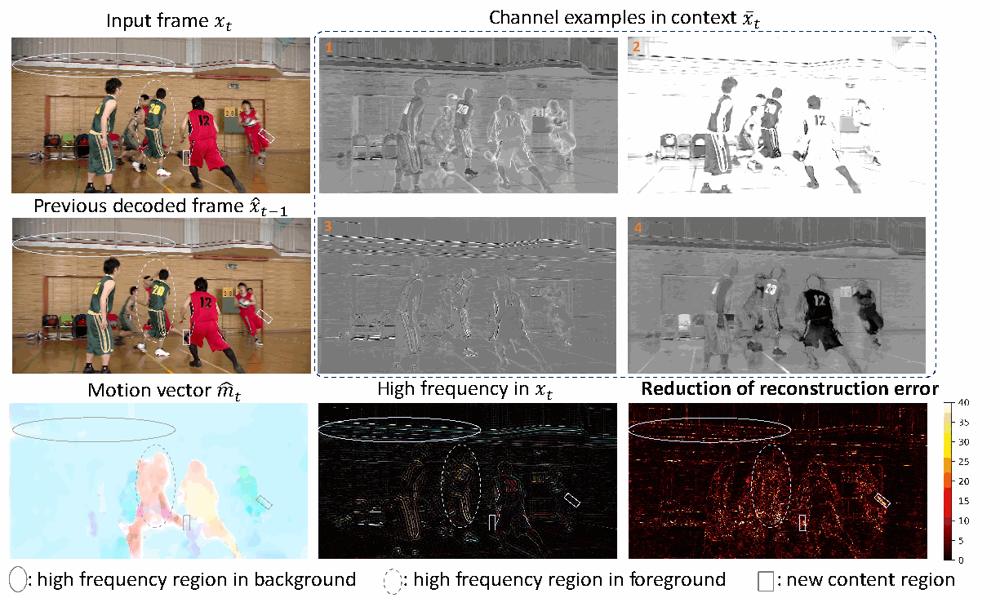

正文先讨论特征通道分工，再用跨页段落讨论新出现内容，最后引出熵模型。图中左侧为当前帧、参考重建帧和运动；右上为四个上下文通道；右下为 DCT 提取的高频图及相对 DVCPro 的重建误差下降图。椭圆、虚线轮廓和矩形分别标示背景高频、前景高频和新出现区域。

【作者解释】部分通道看起来更关注高频，部分更关注颜色；高维特征帮助复杂纹理和新内容的重建。图例来自 MCL-JCV 的 videoSRC05，DCVC 为 0.0306 BPP，DVCPro 为 0.0359 BPP。

【独立分析】这是支持机制直觉的个例，不证明所有通道都具有稳定且唯一的语义，也不单独证明提升来自通道维度而非其他模块。遇到显露背景等没有良好参考的新内容时，条件网络可以减弱对参考的依赖；这是一种隐式适应能力，图中没有另画一个硬性的帧内/帧间开关，不能说模型必然学出了某种固定模式。

**本节要掌握：** 公式 1 改成 2，改变的是使用条件的方式；2 改成 3，改变的是条件的表示。Figure 2 保证这些改动仍能构成可解码系统。最后的过渡段说明，同一上下文还用于压缩 y_hat_t，进入下一节。

#### Section 3.2 Entropy model 第 5 至 6 页

##### 公式 4 与交叉熵

\[
R(\hat y_t)\geq\mathbb E_{\hat y_t\sim q_{\hat y_t}}
[-\log_2p_{\hat y_t}(\hat y_t)].\tag{4}
\]

q 是真实的量化潜变量分布，p 是学习到的概率模型。论文把右侧作为使用该模型进行实际编码时的紧致码率估计，并说明算术编码可以接近它。该关系应放在既定熵模型和编码方案下理解，不应误当作任意 p 都给所有可能编码器提供同一个通用下界。

**补充推导：**

\[
H(q,p)=-\sum_uq(u)\log_2p(u)
=H(q)+D_{\rm KL}(q\Vert p).
\]

推导时在对数中乘除 q(u)：-log p(u)=-log q(u)+log(q(u)/p(u))，分别求和，便得到上式。KL 项非负，所以在真实表示分布固定时，更准确的 p 有机会减少模型失配造成的冗余。真实文件还包含有限精度、终止和封装开销；训练率估计不等于字节数的严格逐项复刻。

##### Figure 4 三种先验

| 来源 | 在解码时何时可用 | 是否形成单独传输的潜变量 |
| --- | --- | --- |
| 超先验 f_hpd(z_hat_t) | 先解码 z_hat_t，再用超先验解码器生成参数 | z_hat_t 需要比特 |
| 空间先验 f_ar(y_hat_{t,<i}) | 当前位置之前的符号已解码后 | 不另传一份空间特征，但引入顺序依赖 |
| 时间先验 f_tpe(x_bar_t) | 已解码运动及参考重建帧生成上下文后 | 不另传一份时间特征；依赖已有参考和运动信息 |

HPE/HPD 是超先验编码器/解码器，Q 是量化，AE/AD 是算术编码器/解码器。绿色支路传送侧信息，蓝色支路从已解码符号获取空间上下文，橙色支路从参考上下文获取时间信息。融合网络输出概率分布参数，而非直接输出图像像素。

##### 公式 5 的完整含义

\[
p_{\hat y_t}(\hat y_t\mid\bar x_t,\hat z_t)
=\prod_i\left[\mathcal L(\mu_{t,i},\sigma_{t,i}^{2})
*\mathcal U(-\tfrac12,\tfrac12)\right](\hat y_{t,i}),\tag{5}
\]

\[
(\mu_{t,i},\sigma_{t,i})=
f_{\rm pf}\!\left(f_{\rm hpd}(\hat z_t),
f_{\rm ar}(\hat y_{t,<i}),f_{\rm tpe}(\bar x_t)\right).
\]

mu 是位置参数，sigma 是论文文字所称的尺度参数；pf 为先验融合，hpd 为超先验解码，ar 为自回归，tpe 为时间先验编码。论文把 i 描述为空间位置；实现需要进一步覆盖相应位置上的通道符号。乘积按解码顺序展开，不意味着所有符号无条件独立，因为 mu、sigma 依赖此前已解码符号。

**补充说明：** 更明确的条件概率形式是乘积 p(y_hat_i given y_hat_<i, z_hat, context)。这揭示空间先验为什么不能在真正解码时全部同时算出。编码时知道所有符号，不等于解码时也知道。

**为什么与均匀分布卷积？** 量化符号的概率是一个宽度为 1 的量化区间内的概率质量，不是连续密度在某点的数值。为避免原文 sigma 平方记号与尺度约定混淆，以下另用 b>0 表示 Laplace 尺度：

\[
f(u)=\frac1{2b}e^{-|u-\mu|/b},\qquad
p(\hat y=k)=\int_{k-1/2}^{k+1/2}f(u)\,du
=F(k+1/2)-F(k-1/2).
\]

均匀密度在 [-1/2,1/2] 上为 1，因此卷积在 k 处的值恰好等于这个积分。若 mu=0、b=1、k=0，得到 1-exp(-0.5)，约 0.39347；不能误用密度 f(0)=0.5 作为该符号概率。

**实现核查：** 官方 2021 子目录的 DCVC_net.py 在 feature_probs_based_sigma 中构造 Laplace(mu,sigma)，并使用 CDF 差计算区间概率。因此实现中的 sigma 直接作为尺度，不应看到公式的 sigma 平方就机械地在实现中再平方。

##### 去掉空间先验的版本

正文最后一段删去自回归输入，使分布参数仅由超先验和时间先验生成：

\[
(\mu_{t,i},\sigma_{t,i})=f_{\rm pf}
\left(f_{\rm hpd}(\hat z_t),f_{\rm tpe}(\bar x_t)\right).
\]

它消除了图像潜变量空间自回归造成的这类位置依赖，但保留超先验，也不能直接推断运动支路和整个文件编解码已完全并行。对压缩率的损失见 Table 3；正文没有给出这一变体完整的实际编解码速度表。

**本节要掌握：** 区分离散概率质量与连续密度；区分超先验、空间先验和时间先验的来源、比特开销与解码顺序；解释概率更准如何通过交叉熵降低码率。

#### Section 3.3 Context learning 第 6 页

第一段指出，直接对上一重建帧应用普通卷积，可能难以在复杂运动下找到当前位置真正相关的信息，因此引入特征域运动补偿。所谓难以学习，是作者对其设计动机的解释，不应说成普通网络理论上不可能处理运动。

\[
\bar x_t=f_{\rm cr}\!\left(
\operatorname{warp}(f_{\rm fe}(\hat x_{t-1}),\hat m_t)
\right).\tag{6}
\]

第二段给出操作顺序：fe 从参考重建帧提取特征；光流网络由参考重建帧与当前帧估计运动；运动编码再解码；warp 按解码后的运动采样参考特征；cr 细化对齐结果，缓解采样造成的不连续。

**补充数值直觉：** 若某一维参考特征在两个相邻采样点为 10 和 14，采样位置位于二者之间的 0.25 处，线性插值得到 0.75×10+0.25×14=11。二维双线性采样相应组合四个相邻点。具体流方向、边界处理和坐标归一化必须遵循实现，不能仅凭“右移几格”的口述确定代码符号。

解码端没有原始当前帧，却有解码后的运动和同一重建参考帧，因而能计算相同的上下文。运动通过压缩引入的误差也会进入后续率失真权衡。

#### Section 3.4 Training 第 7 页

\[
L=\lambda D+R.\tag{7}
\]

第一段用 lambda 协调失真与码率。lambda 越大，同样一点失真下降带来的目标改善越大，通常会选择更高质量、更高码率的工作点；但实际结果要由训练得到。MSE 应越小越好，MS-SSIM 原值则越大越好：当其用于最小化失真时，需要合适的失真形式，不能直接把原始 MS-SSIM 当成越小越好。该正文段落没有展开具体转换公式。

第二段列出学习率初始 1e-4、微调 1e-5、batch size 4。MSE 模型对应 lambda=256、512、1024、2048；MS-SSIM 模型对应 8、16、32、64。是分别训练四个工作点，不应理解为单模型已支持连续码率控制。

【补充材料澄清】R 含图像潜变量、运动潜变量及二者各自的超先验，共四项；不能只数 y_hat。完整渐进训练将在补充材料部分解释。正文与补充材料未在这些段落完整列出每阶段轮数、随机种子、量化梯度处理等细节，复现时不应自行填写后称其为论文配置。

#### Section 4.1 Experimental settings 第 7 页

按四个设置单元阅读：训练集为 Vimeo-90k septuplet 的训练部分，随机裁成 256×256；测试覆盖 MCL-JCV、UVG 与 HEVC Class B/C/D/E；GOP 在 HEVC 上为 10，其余为 12；对照包括 DVC、DVCPro、x264 与 x265。

I 帧使用现成图像压缩模型，MSE 目标为 cheng2020-anchor，MS-SSIM 目标为 hyperprior。DVC 与 DVCPro 使用相同 I 帧编码重新测试，这是控制系统级比较混杂因素的重要安排。x264/x265 用 veryslow 和固定 QP，区别于既有配置的 veryfast 与 CRF。补充材料进一步给出帧数、参数和质量档位。

**补充指标知识：** BPP=比特数/(图像高×宽)，用于整段视频时需对应累计像素数；PSNR=10log10(MAX²/MSE)，越高越好；MS-SSIM 越高通常表示该结构相似性指标越好。不同模型为不同目标训练，不能混合其 PSNR 与 MS-SSIM 结果建立统一排名。

#### Section 4.2 Performance comparison 第 7 至 8 页

##### Figures 5 和 6 率失真曲线

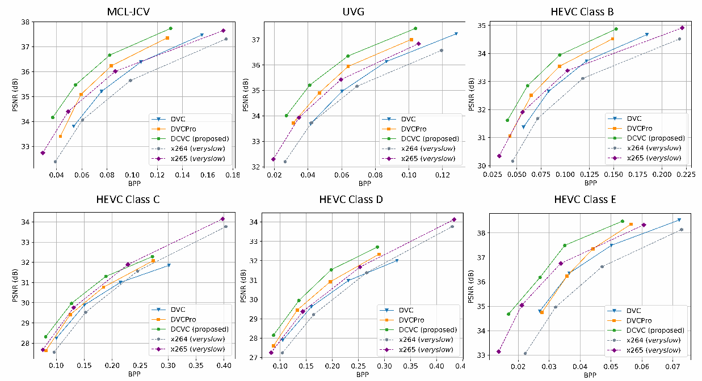

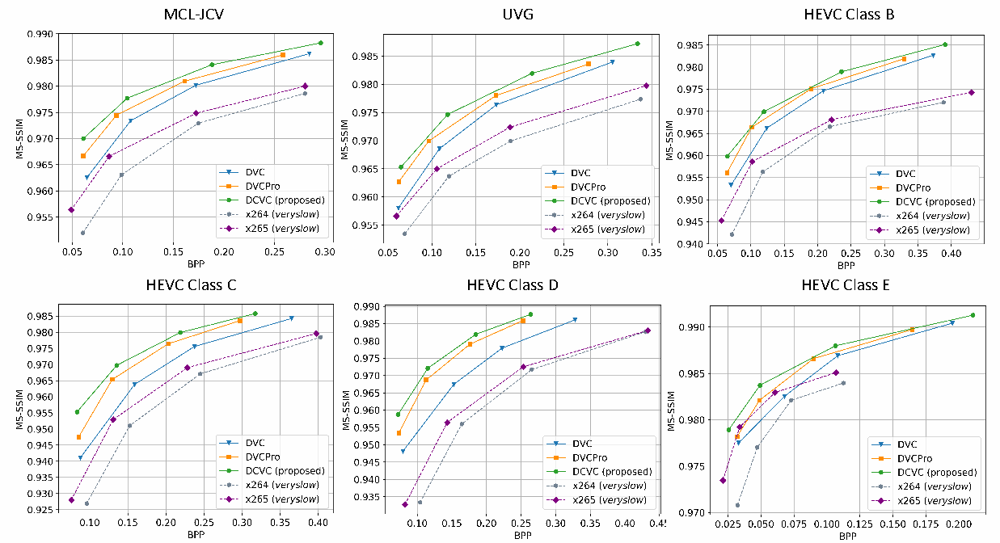

横轴 BPP，纵轴分别为 PSNR 和 MS-SSIM。各子图对应六个测试集合，比较 DVC、DVCPro、DCVC 和两种传统基线；总体更靠左上方表示更有利的率失真取舍。Figure 6 的神经模型经过 MS-SSIM 微调。作者关于优势覆盖码率范围的判断，应限制在图中已测试且有可比质量区间的工作点，不能延伸到未测码率。

##### Table 1 原表与数值

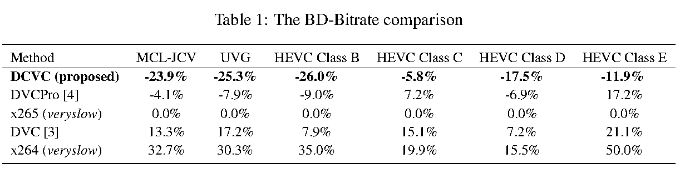

下表照录数值，均以 x265 veryslow 为锚点，指标是基于 PSNR 曲线的 BD-Bitrate：

| 方法 | MCL-JCV | UVG | HEVC B | HEVC C | HEVC D | HEVC E |
| --- | ---: | ---: | ---: | ---: | ---: | ---: |
| DCVC | -23.9% | -25.3% | -26.0% | -5.8% | -17.5% | -11.9% |
| DVCPro | -4.1% | -7.9% | -9.0% | +7.2% | -6.9% | +17.2% |
| x265 veryslow | 0.0% | 0.0% | 0.0% | 0.0% | 0.0% | 0.0% |
| DVC | +13.3% | +17.2% | +7.9% | +15.1% | +7.2% | +21.1% |
| x264 veryslow | +32.7% | +30.3% | +35.0% | +19.9% | +15.5% | +50.0% |

负值表示达到可比质量时平均码率更低。摘要的 26.0% 对应 HEVC Class B，不是三个 1080p 集合共用的固定数值。

**BD-Rate 补充推导：** 在共同质量区间 [d1,d2] 上，用曲线插值得到 log R_A(d) 与 log R_B(d)，计算其差的区间平均 Delta，再计算 exp(Delta)-1，若用 log10 则对应 10^Delta-1。它比较的是质量区间内的平均相对码率，不是某一帧文件大小。不同锚点的 BD-Rate 不能简单相减；积分区间不同，也不宜用两个汇总值的比值代替重新计算第三种比较。本文引言报告相对 DVCPro 的 16.4%，不能由 -26.0% 与 -9.0% 的直接相减验证。

后续正文将高分辨率上的较大提升归因于丰富纹理与高维上下文。【独立分析】这是与可视化相符的解释，但分辨率、内容、运动等同时变化，尚不能仅凭跨数据集比较证明分辨率是独立因果因素。

##### Complexity

正文给出 DCVC 为 2268G MAC，DVCPro 为 2014G MAC，约增加 13%；P40 GPU 上每个 1080p 帧报告的推理耗时为 857 ms 与 849 ms，约增加 1%。运算量与耗时不是线性等价，硬件并行度可以影响这一关系。这组数值没有证明实时运行，也不等价于完整系统每个环节均已计时的部署吞吐率。更不能从“时间先验并行”推断整个编解码链条都并行。

#### Section 4.3 Ablation study 第 8 至 9 页

##### Table 2 条件方式与时间先验

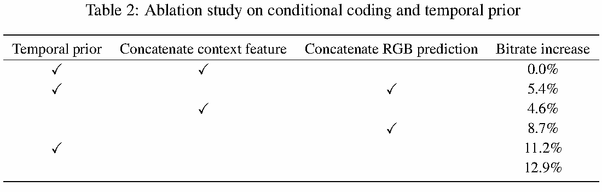

| 时间先验 | 图像编码方式 | 相对最终方案的码率增加 |
| --- | --- | ---: |
| 有 | 拼接特征上下文 | 0.0% |
| 有 | 拼接 RGB 预测图 | 5.4% |
| 无 | 拼接特征上下文 | 4.6% |
| 无 | 拼接 RGB 预测图 | 8.7% |
| 有 | 残差编码 | 11.2% |
| 无 | 残差编码 | 12.9% |

这里重新对照原图勾选位置，避免 PDF 文本提取把勾选错配。第一段试图回答两个问题：条件编码是否有益；时间先验是否有益。在同样有时间先验时，特征条件优于 RGB 条件和残差；没有时间先验时，特征条件同样优于其他两种方式。加入时间先验也改善三种编码方式。这支持方法的组件选择，不能据此认定各项百分数可线性相加。

百分比方向必须保留：RGB 条件比最终方案多 5.4% 码率，不等于最终方案比 RGB 条件少 5.4%；反向相对节省约为 1-1/1.054=5.12%。表头未单独交代完整的汇总数据范围，不将它自行标为某一数据集的结果。

##### Table 3 熵模型

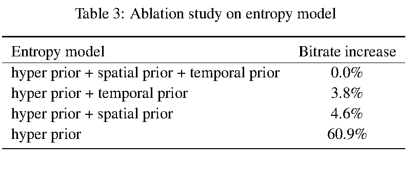

| 图像潜变量的熵模型 | 码率增加 |
| --- | ---: |
| 超先验 + 空间先验 + 时间先验 | 0.0% |
| 超先验 + 时间先验 | 3.8% |
| 超先验 + 空间先验 | 4.6% |
| 仅超先验 | 60.9% |

跨页的第二个实验说明：空间和时间先验各自提供重要帮助，两者共同使用进一步提高压缩率；没有两种上下文时，码率显著上升。去掉空间先验只增加 3.8%，是作者主张进行速度取舍的依据。不能把 60.9% 当作时间先验单独的贡献；它是相对同时使用多种先验的最终方案。该表没有给出重复训练的方差或置信区间，不宜据 3.8% 与 4.6% 的小差别作过强的普遍排序。

#### Section 4.4 Intra frame coding 与更多基线 第 9 至 10 页

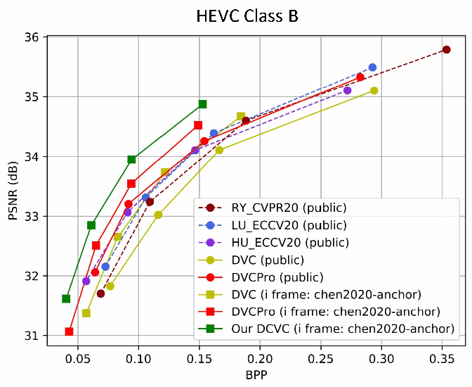

这一跨页段落说明：I 帧编码增强后，DVC 与 DVCPro 都比其公开结果更好；在同一 I 帧设置下 DCVC 仍领先。图中 public 曲线来自既有公开结果，带 I 帧模型名称的曲线为重新测试的配置。加入的 RY_CVPR20、LU_ECCV20、HU_ECCV20 帮助判断当时基线的位置，但不能说这些方法也全部在本文统一配置下重新训练、测试。

**本节要掌握：** 比较帧间方法，仍须控制 I 帧模型、GOP、帧数、颜色转换与指标计算。系统级改进不应全部归给 P 帧新模块。

#### Section 5 Discussion 第 10 页

**第 1 段：** 作者将优势归纳为条件编码在时间与空间信息之间的适应性，以及高维特征对高频内容的帮助，并预计高分辨率下会更有利。【独立分析】适应性与高频解释有实验支持，但不能把理论熵比较扩展为所有残差模型都必然次优；高分辨率趋势也不是对任意内容的保证。

**第 2 段：** 作者再次指出，条件的定义、使用和学习仍是开放问题。本框架是一个有效实例，不是最优条件的证明。

**第 3 段：** 作者明确提出三项尚未解决的问题：上下文通道可能冗余、目前只使用单参考帧、未专门考虑重建质量的时间稳定性。多参考帧、通道利用率与时间一致性因此成为后续方向。这里只记录为本文提出的研究接口，不把它们声称为当下尚无人研究的新颖课题。

本文没有另设独立的 Conclusion 或正文附录；Discussion 是正文最后一节，之后为两页参考文献。完整书目与关键关联见 [参考文献核查表](#file-5)。

#### 本部分进度

正文从 Section 2 到 Discussion 已按顺序讲完，公式 1 至 7、Figures 2 至 7、Tables 1 至 3 均已检查。正文参考文献 40 项已核对并保留条目信息。下一部分继续补充材料的网络结构、渐进训练、测试细节、长 GOP、消融和视觉比较，最后形成整体评价与最小复现路线。
<!-- SOURCE-END:file-3 -->

## 保存稿 4：补充材料与全篇评价

> 来源：论文目录原有讲解文件。原有保存文件；与聊天回复分别保留。可核对[原始文本](DCVC_讲解资源/来源/DCVC_精读04_补充材料与总结.md)。

<!-- SOURCE-BEGIN:file-4 -->
### DCVC 精读第 4 部分 补充材料与全篇总结

本部分接续 [正文精读](#file-3)，按补充材料第 1 至 7 页顺序讲完全部 6 节、Figures 1 至 8、Table 1、脚注与参考文献，再给出全篇评价与复现路线。材料：[补充 PDF](DCVC_讲解资源/原论文/Li_Deep_Contextual_Video_Compression_NeurIPS_2021_supplemental.pdf)。正文与补充材料图表编号独立，以下始终注明“补充”。

采用逐段释义与独立解释，不将网络论文长段转载或逐字全文翻译。模型训练、性能复现和主观视频评测均未实际执行；实验数值来自作者报告，代码核查范围单列。

#### 补充材料开篇说明 第 1 页

开篇列出材料目的：补足网络结构、训练策略和额外实验。它不是一个新模型，与正文共同定义 2021 年 DCVC。以下不引入后续 DCVC 家族模型来替代本文配置。

#### Section 1 Network Architecture 第 1 至 2 页

##### 补充 Figure 1 与对应段落 编码器和解码器

编码器将 RGB 当前帧与 64 通道上下文在通道维拼接，经过卷积、GDN 和残差块，形成每个空间方向下采样 16 倍、通道数为 96 的潜变量。四次 2 倍下采样得到 2^4=16；面积减少到 1/256，不是面积只减到 1/16。

以 NCHW 格式作教学示例，假设尺寸 H、W 能整除相应因子：

\[
x_t:[B,3,H,W],\quad c_t:[B,64,H,W],
\]
\[
\operatorname{concat}(x_t,c_t):[B,67,H,W],
\quad y_t:[B,96,H/16,W/16].
\]

解码器先将潜变量上采样回原分辨率特征，再与原分辨率上下文拼接，经卷积与残差块输出 3 通道重建图像。实际代码中相应的两组特征各为 64 通道，拼接后为 128 通道。上下文不仅影响压缩表示，也在最终重建阶段直接提供信息。

GDN 是广义除法归一化；可用下面常见形式建立直觉，属于补充知识，而非本文新提出的公式：

\[
v_i=\frac{u_i}{\sqrt{\beta_i+\sum_j\gamma_{ij}u_j^2}}.
\]

分母依赖多个通道的响应，帮助改变特征的统计结构。IGDN 用于对应的解码变换，但学习到的分析和合成链条加上量化，不保证严格数学可逆。残差块中的 shortcut 与“帧间残差编码”也不是同一个概念，不能因网络含 ResBlock 就说它仍是正文公式 1 的框架。

##### 补充 Figure 2 与特征提取和细化段落

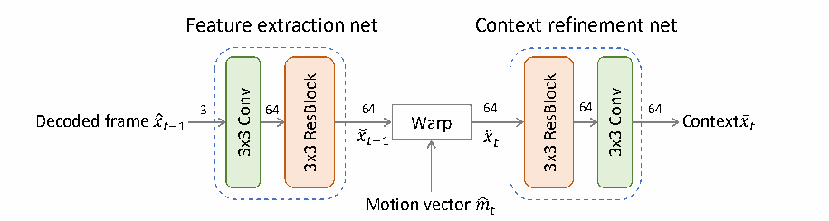

参考重建帧由 3 通道映射到 64 通道，特征提取网络由卷积与残差块构成；warp 使用解码运动进行特征对齐；上下文细化网络由残差块与卷积构成，输出仍为 64 通道。作者为控制复杂度没有使用更深的生成网络。此处是计算成本与表达能力的取舍，不证明浅网络已经最优。

##### 运动生成段落

光流初始化使用 SPyNet 对应工作；运动编码、解码及运动细化网络沿用 DVCPro 的相应结构。它们是既有组件的使用，不应算作 DCVC 新发明的光流算法。要复现运动支路，必须补足被引用实现，而不能仅凭上下文生成图重建所有结构。

##### 补充 Figure 3 与熵模型段落

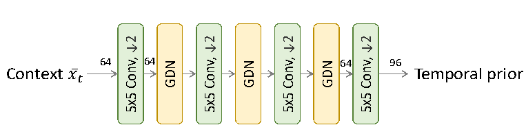

时间先验编码器由四次 stride=2 的 5×5 卷积和中间 GDN 组成，将 64 通道、原分辨率上下文转换到与图像潜变量相容的尺度，末端为 96 通道。超先验、自回归及融合网络承接联合自回归和层次先验的图像压缩结构。

**必须区分两条熵编码支路：** 图像潜变量使用超先验、空间先验和时间先验；运动潜变量另有熵模型，使用超先验与自回归，没有本文这个时间先验编码器。因此，删除图像潜变量的空间先验，不等于所有运动和内容码流都不含自回归处理。

#### Section 2 Progressive training 第 2 至 3 页

前两个段落先明确总码流，再解释直接联合训练的失败现象。四种量化码流分别是：

| 论文符号 | 内容 | 作用 |
| --- | --- | --- |
| y_hat_t | 图像内容潜变量 | 表示当前帧需要编码的内容 |
| z_hat_t | 图像超先验 | 帮助解码图像潜变量的分布 |
| g_hat_t | 运动潜变量 | 恢复运动信息 |
| s_hat_t | 运动超先验 | 帮助解码运动潜变量的分布 |

对于一个 P 帧，完整训练码率为这四项之和。整个视频的码率还要计入 I 帧；完整文件还可能存在头信息、封装等开销。

作者报告：即使使用预训练光流初始化，直接优化全部损失也可能出现运动码率很小、总体率失真却很大的结果。作者解释为模型倾向绕开较难学好的运动补偿路径。这是训练过程的局部失败模式，不是条件编码理论本身要求忽略运动。

##### 补充 Table 1 四阶段目标

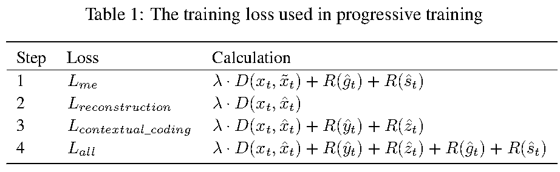

\[
L_{\rm me}=\lambda D(x_t,\tilde x_t)+R(\hat g_t)+R(\hat s_t),
\]
\[
L_{\rm reconstruction}=\lambda D(x_t,\hat x_t),
\]
\[
L_{\rm contextual\_coding}=\lambda D(x_t,\hat x_t)+R(\hat y_t)+R(\hat z_t),
\]
\[
L_{\rm all}=\lambda D(x_t,\hat x_t)+R(\hat y_t)+R(\hat z_t)+R(\hat g_t)+R(\hat s_t).
\]

四个 Step 按原顺序解释：

1. **运动预热。** 训练运动估计、运动编码与解码，以解码运动对参考图像做像素域 warp，所得预测图与当前图像比较，同时计入运动码率。此处使用像素域预测损失训练运动，不与最终特征域补偿冲突。
2. **冻结运动，先学重建。** 训练依赖上下文的重建链条，只追求失真下降，暂不加入内容码率压力。这样先让上下文有实际用处。
3. **冻结运动，加入内容码率。** 在前一阶段基础上加入图像内容与图像超先验的比特成本，学习更紧凑的表示。
4. **解冻运动，端到端优化。** 使用四项码率的完整目标，使运动质量、运动开销和内容开销共同协调。

最后一段报告单张 Tesla V100 约一周训练，并说明 DVCPro 也采用渐进训练重新训练，DVC 使用公开模型。论文未在该段明确这个时间涵盖多少个质量模型，也未完整列出阶段时长；不能把它扩展成所有工作点总共一周的确定预算。

**本节必须掌握：** 好的优化目标不保证从任意初始化都容易学到好解；四阶段分别解决运动可用性、重建可用性、可压缩性和联合权衡。

#### Section 3 Details of experimental settings 第 3 页

##### 数据集段落及脚注

作者说明训练与测试数据来源，并在脚注列出 Vimeo 数据仓库许可证、MCL-JCV 页面、UVG 的 BY-NC 链接及 CompressAI 许可证链接。这些是补充材料发表时的来源说明，本文未另行审计现时授权条款。作者还声称人工检查数据内容；该声称不等于本次阅读者重新完成了数据检查。

##### I 帧及模型档位两段

MSE 使用 cheng2020-anchor，MS-SSIM 使用 hyperprior。CompressAI 的 quality 3、4、5、6 依次匹配 DCVC 的四个 lambda 档位；例如最高档对应 MSE lambda=2048 或 MS-SSIM lambda=64。比较 P 帧模块时，应匹配 I 帧模型，不能将 I 帧质量提升错误归因于上下文设计。

##### FFMPEG 设置段落与命令列表

作者的命令使用输入 yuv420p、明确尺寸与帧率、veryslow、固定 QP 与 GOP；x264 命令还给出 bf=2、b_strategy=0、sc_threshold=0，x265 通过 qp 和 keyint 参数传递工作点与 GOP。两条命令均出现 zerolatency。复现时必须保留整套参数并检查真实帧型，不能只凭某个 tune 名称认定两个传统基线都采用相同参考结构。

文中的 W、H、FR、N、QP、GOP 分别是宽、高、帧率、编码帧数、量化参数和图像组长度。这些占位符不是可原样执行的真实数值。

##### GOP 与帧数段落

主实验 HEVC：GOP=10，100 帧；MCL-JCV 和 UVG：GOP=12，120 帧，各 10 个 GOP。它与下一节长 GOP 测试所用帧数不同。必须让传统与神经方法处理相同裁剪区域、相同帧序列和相同数量的帧，并统一颜色转换、PSNR 通道口径与 I 帧计入方式。

#### Section 4 Test on larger GOP size 第 3 至 5 页

##### 补充 Figure 4 与长 GOP 的两个段落

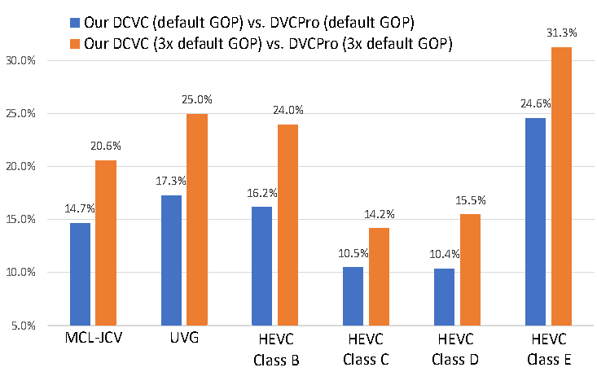

图中锚点是对应 GOP 配置下的 DVCPro，不能与正文以 x265 为锚点的 Table 1 混读。HEVC 的 GOP 从 10 增至 30，其余从 12 增至 36；两种 GOP 比较均只测试 HEVC 30 帧、其余 36 帧。

| 数据集 | 默认 GOP 的节省 | 三倍 GOP 的节省 |
| --- | ---: | ---: |
| MCL-JCV | 14.7% | 20.6% |
| UVG | 17.3% | 25.0% |
| HEVC B | 16.2% | 24.0% |
| HEVC C | 10.5% | 14.2% |
| HEVC D | 10.4% | 15.5% |
| HEVC E | 24.6% | 31.3% |

每组中 DCVC 相对 DVCPro 的节省随 GOP 增大而增加，支持作者关于更好应对参考误差传播的解释。但更大相对优势不等于 DCVC 自身在长 GOP 下绝对质量一定不下降。默认配置 B 的 16.2% 与引言的 16.4% 也不应直接认定为同一次统计：这里 HEVC 仅测试 30 帧，主实验是 100 帧。

##### 补充 Figure 5 与个例段落

该图为 BasketballDrive，GOP=30，测试 60 帧。横轴是帧位置，左轴 PSNR，右轴每帧比特成本，实线表示质量、虚线表示比特。第一 GOP 中 DVCPro 从 34.1 dB 降到 26.6 dB，DCVC 降到 31.8 dB；第二 GOP 结束处图中标注为 25.2 dB 与 30.6 dB。I 帧附近质量回升且出现比特峰值，符合周期性刷新参考的作用。

【独立分析】该个例与六个集合上的长 GOP 比较共同支持缓解误差传播，但不能说已经消除了误差传播，也不能代替专门的闪烁或时间稳定性指标。正文自己明确把时间稳定性留为未来问题。

#### Section 5 Ablation study 第 5 至 6 页

##### 补充 Figure 6 与通道维度段落

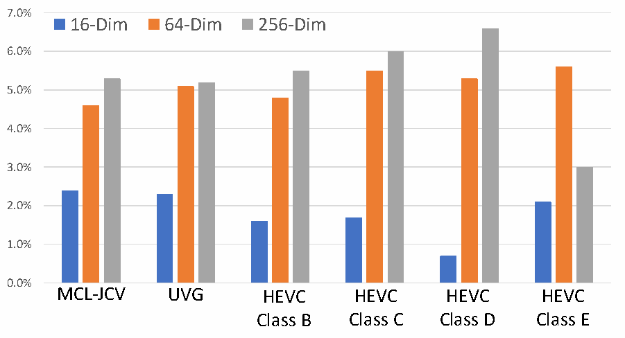

锚点为 3 通道模型，比较 16、64、256 通道。16 通道带来一定改进，64 通道通常进一步改善，256 通道增益有限且在 HEVC E 上明显不如 64 通道。图中 E 的 256 通道相对 3 通道仍有正收益，因此“性能下降”应明确比较对象，不能误写为已经差于 3 通道。

作者推测高维、原分辨率上下文缺少额外监督时训练可能不稳定。这是可能解释，图本身没有排除过拟合、优化难度、容量分配等其他因素。默认选择 64 通道体现收益与成本的折中。

##### 补充 Figure 7 与移除 MEMC 的两段

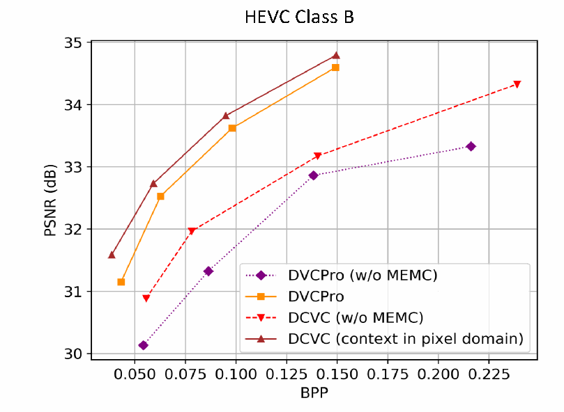

为控制条件表示的差别，实验使用像素域条件的 DCVC 变体，与 DVCPro 比较；去掉 MEMC 后，直接把上一重建帧当条件或预测图。两种框架都显著变差，说明运动对齐仍然重要。

在 HEVC B 上，有 MEMC 时像素域条件 DCVC 比 DVCPro 节省 12.7%；无 MEMC 时比对应无 MEMC 的 DVCPro 节省 22.1%。这是两种配对比较，不能解释为“去掉 MEMC 后 DCVC 本身变得更好”。后面的未来工作段提出更大感受野等学习方式，属于方向设想，不是本文已实现的 Transformer 编码器。

#### Section 6 Visual comparison 第 6 至 7 页

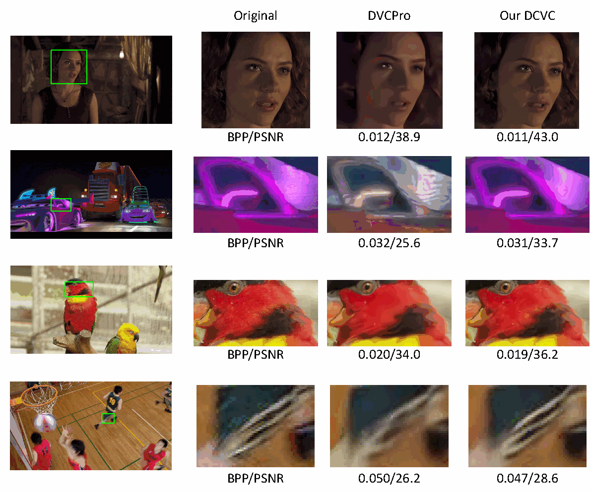

四列依次是完整原图、原图裁切区域、DVCPro、DCVC。正文跨页的两段强调颜色、异常纹理与条纹细节。图中标注的结果如下，单位为 BPP / PSNR(dB)：

| 行 | DVCPro | DCVC |
| --- | --- | --- |
| 人像 | 0.012 / 38.9 | 0.011 / 43.0 |
| 彩色车辆 | 0.032 / 25.6 | 0.031 / 33.7 |
| 鸟 | 0.020 / 34.0 | 0.019 / 36.2 |
| 篮球场景 | 0.050 / 26.2 | 0.047 / 28.6 |

这些个例显示较低 BPP 下获得更好的标注质量与局部观感。它们是挑选出的展示，不是全测试集的均值或盲测人类偏好；图注也不足以把每个标注 PSNR 确定解释为仅裁切小块的 PSNR。

补充材料最后列出 15 项参考文献，其中 Transformer 综述仅服务于未来方向。书目信息保留于 [参考文献核查表](#file-5)，不把被引文献都算作本次全文精读对象。

#### 全篇科研评价

##### 基本信息与一句话概括

Jiahao Li、Bin Li、Yan Lu，Microsoft Research Asia，NeurIPS 2021。DCVC 将由重建参考帧和解码运动生成的特征上下文，共同送入编码器、解码器和熵模型，在实际学习式视频压缩系统中验证条件表示的作用。

##### 背景 核心问题 与创新边界

问题是怎样在同等重建质量下减少视频总码率。作者挑战的是固定图像域残差结构对参考信息使用形式的限制，并从条件定义、参与环节和学习方式三个角度提出方案。

真正值得借鉴的是三个环节共享条件与特征域上下文的系统设计。条件编码概念、超先验、自回归、光流、卷积、GDN 及通用率失真目标均已有基础。理论上给定预测后的残差与原信号可逆，不能把引言不等式解读为所有残差模型都必然严格劣于条件模型。

##### 完整方法链条

第一帧用图像编码器形成参考；后续帧估计并编码运动，用解码运动对参考特征做 warp 与细化；当前帧与上下文形成图像潜变量；超先验、空间先验和时间先验共同估计符号分布；传输四路潜变量后，在解码端以同一参考和已解码信息重建上下文，恢复当前帧并递推。

##### 最有说服力的证据

一是主表六个集合相对 x265 veryslow 的结果；二是 Table 2 对条件形式与时间先验的拆分；三是 Table 3 和长 GOP、MEMC、通道数实验，对概率建模、运动对齐与表示容量提供互补证据。所有数据均为论文报告，本次没有训练或重新跑分。

##### 优势与局限

- 覆盖三种信息使用位置，条件表示灵活；但模块与容量同时变化时，不能把全部收益都归给单个机制。
- 使用重建参考和解码运动，具备可解码的因果结构；仍有运动、超先验与顺序解码等成本。
- 在本文数据与设置下优于主要基线；没有证明优于所有传统编码配置或 VVC，也不代表任意视频都节省 26%。
- I 帧控制和多数据集测试增强可信度；尚未报告重复训练方差、系统性的失效分布或全面端到端速度曲线。
- 长 GOP 实验支持缓解误差传播；未专门优化或完整评估时间稳定性。
- 默认单参考帧，通道可能冗余，256 通道并非更好；这些是可继续研究的明确接口。

##### 复现路线与本次代码核查范围

2026-10-15 核对的官方入口为 [microsoft/DCVC 的 2021 子目录](https://github.com/microsoft/DCVC/tree/main/DCVC-family/DCVC)，不能照仓库根目录后续模型的配置复现本文。原始文档给出的环境为 Python 3.8、CUDA 11.0、PyTorch 1.7.1；这只是其历史配置，不声称当前系统可直接无改动安装。

具体只读核查了 [README](https://raw.githubusercontent.com/microsoft/DCVC/main/DCVC-family/DCVC/README.md)、[test_video.py](https://raw.githubusercontent.com/microsoft/DCVC/main/DCVC-family/DCVC/test_video.py) 和 [DCVC_net.py](https://raw.githubusercontent.com/microsoft/DCVC/main/DCVC-family/DCVC/src/models/DCVC_net.py)。未安装依赖、下载权重、执行外部代码或完成编解码测试。

最小路线是：

1. 固定 2021 版本与模型档位，先准备一段短序列及对应 I 帧模型。
2. 按该子目录要求统一尺寸；README 示例把 1920×1080 裁为 1920×1024，并要求空间尺寸为 64 的整数倍。传统基线必须使用相同裁剪，不能混用像素区域。
3. 用一个质量模型完成完整 GOP，检查重建参考递推、四项 BPP 和质量指标是否合理。
4. 显式开启 write_stream=true 检查真实码流与解码；测试脚本默认 false，走概率估计的 forward 路径。输出重建帧也有独立选项。
5. 模型实际码流路径有 encode_decode、compress、decompress；解码阶段从参考帧和码流生成上下文，验证这个数据依赖，不以只有 forward 输出当作独立可解码性的证明。
6. 区分概率估计、四段 payload 长度与完整文件字节数。当前核查实现的 compress 返回四段 payload 长度之和，头信息或封装是否计入需单独核对，即使开启写流也不应直接把日志 BPP 当成完整文件大小。
7. 在四个工作点上统一 I 帧、GOP、帧数、裁剪、颜色转换、质量统计，再比较曲线与 BD-Rate。最后复现 Table 2、Table 3，分别检查条件与先验的效果。

##### 可执行的延伸实验

以下是从本文出发的实验设计，未声称具有当前年份的新颖性：

| 研究问题 | 可检验假设 | 最小实验与评价 |
| --- | --- | --- |
| 哪些上下文通道真正有用 | 部分通道冗余，适当压缩通道可保留大部分收益 | 在 16/64 通道之间作受控裁剪或门控，统一训练预算，比较 BD-Rate、显存、实际耗时 |
| 遮挡或场景切换时是否仍过度依赖参考 | 按参考可靠性调整条件能改善困难区域 | 构造遮挡和切换分组，记录四路码率、区域失真与失败样本 |
| 多参考信息是否值得其开销 | 更广参考有收益，但运动与计算成本可能抵消 | 同训练预算、同总码率，比较单/多参考，不能只比较内容潜变量比特 |
| 能否兼顾跨帧稳定性 | 加入时间一致性目标可降低闪烁但可能损失逐帧率失真 | 在同码率下同时报告逐帧指标、运动补偿后的时间误差及视频观察结果 |

##### 知识体系与学习顺序

先掌握熵、条件熵、交叉熵与 KL，再掌握图像压缩的变换、量化和概率质量；随后理解超先验与自回归；最后串联光流、warp、参考递推、完整码流、率失真训练和 BD-Rate。这里的空间上下文主要来自当前潜变量中已解码的符号，时间条件主要来自参考信息；来源和可用时刻不能混淆。

##### 完成状态

前两轮已完成标题至 Introduction；本次第 3、4 部分完成正文余下全部章节、40 项正文参考文献的条目核对、7 页补充材料及其 15 项参考文献条目，覆盖正文公式 1 至 7、Figures 1 至 7、Tables 1 至 3，以及补充 Figures 1 至 8、Table 1。没有遗漏等待继续讲解的论文结构单元。

这是论文与补充材料的讲解完成，不是实验复现完成，也不是所有被引论文的全文阅读完成。可继续研究的问题不作为“尚未讲完”的内容。
<!-- SOURCE-END:file-4 -->

## 附录：参考文献与覆盖核查

> 来源：论文目录原有讲解文件。原有保存文件；与聊天回复分别保留。可核对[原始文本](DCVC_讲解资源/来源/DCVC_参考文献与覆盖核查.md)。

<!-- SOURCE-BEGIN:file-5 -->
### DCVC 参考文献与阅读覆盖核查

本表保存论文中可核实的书目信息及结构覆盖范围。参考条目保持作者所列版本与年份，不将书目中每篇文献都标记为已全文精读。正文和补充材料的引用编号独立。PDF 抽取后的排版换行合并为单行；原始 PDF 仍是拼写与排版核对依据。

#### 结构覆盖

| 材料位置 | 覆盖内容 | 讲解文件 |
| --- | --- | --- |
| 正文第 1 页 | 标题、作者、摘要、Introduction 第 1 至 2 段 | [第 1 轮](#file-1) |
| 正文第 2 页 | Figure 1、引言其余两段、贡献导语及四项列表 | [第 2 轮](#file-2) |
| 正文第 3 页 | Section 2 三段、Section 3 导语、Section 3.1 开始 | [第 3 部分](#file-3) |
| 正文第 4 至 5 页 | 公式 1 的说明、公式 2/3、Figure 2/3、特征和新内容的分析、熵模型过渡 | [第 3 部分](#file-3) |
| 正文第 5 至 6 页 | Section 3.2，公式 4/5，Figure 4，三种先验与快速变体 | [第 3 部分](#file-3) |
| 正文第 6 页 | Section 3.3 两段与公式 6 | [第 3 部分](#file-3) |
| 正文第 7 页 | Section 3.4、公式 7、Section 4.1 的数据与测试设置 | [第 3 部分](#file-3) |
| 正文第 7 至 8 页 | Section 4.2，Table 1、Figures 5/6、复杂度 | [第 3 部分](#file-3) |
| 正文第 8 至 9 页 | Section 4.3，Tables 2/3，两类消融 | [第 3 部分](#file-3) |
| 正文第 9 至 10 页 | Section 4.4 跨页段落、Figure 7 | [第 3 部分](#file-3) |
| 正文第 10 页 | Section 5 三段，正文无独立 Conclusion | [第 3 部分](#file-3) |
| 正文第 11 至 12 页 | 40 项书目保留，关键工作的关系分析 | 本文件与第 3 部分 |
| 补充第 1 至 2 页 | 开篇、Section 1 四组结构说明、Figures 1/2/3 | [第 4 部分](#file-4) |
| 补充第 2 至 3 页 | Section 2 全部段落、Table 1 与四阶段训练 | [第 4 部分](#file-4) |
| 补充第 3 页 | Section 3 数据来源、脚注、I 帧档位、命令参数、GOP 与帧数 | [第 4 部分](#file-4) |
| 补充第 3 至 5 页 | Section 4 跨页内容与 Figures 4/5 | [第 4 部分](#file-4) |
| 补充第 5 至 6 页 | Section 5，Figures 6/7，维度与 MEMC 消融 | [第 4 部分](#file-4) |
| 补充第 6 至 7 页 | Section 6 两段、Figure 8、15 项书目 | 本文件与第 4 部分 |

页码为对应 PDF 文件中的页面序号。Figure/Table 2 个编号体系已区分；全部图片均由相应原 PDF 裁切，未重绘。正文图表出现在排版中较早位置时，按首次实质讨论处讲解，未将浮动位置误算为段落顺序。

#### 关键参考工作的作用

- 正文 [3,4]：DVC/DVCPro，是框架与实验的直接参照。
- 正文 [12,15,16,17]：理解条件编码、解码端信息和显式模式选择的先前研究；交叉核查范围见第 3 部分，未独立复现实验结果。
- 正文 [13,14,19,20]：图像压缩、GDN、超先验、自回归和 I 帧模型的来源。
- 正文 [30,40]：信息论与 BD-Rate 指标基础；正文 [30] 列出的是其所用重印版本的书目信息。
- 正文 [31,32,33,34,35,36,38,39]：实现、光流、数据、测试条件、工具与公开结果来源；本次未将所有数据、模型或工具逐一下载运行。
- 补充 [15]：未来方向中的 Transformer 综述，不是本模型已经采用 Transformer 的证据。

#### 正文参考文献 40 项

[1] B. Girod, E. G. Steinbach, and N. Faerber, “Comparison of the H. 263 and H. 261 video compression standards,” in Standards and Common Interfaces for Video Information Systems: A Critical Review, 1995.

[2] B. Bross, J. Chen, J.-R. Ohm, G. J. Sullivan, and Y.-K. Wang, “Developments in international video coding standardization after AVC, with an overview of Versatile Video Coding (VVC),” Proceedings of the IEEE, 2021.

[3] G. Lu, W. Ouyang, D. Xu, X. Zhang, C. Cai, and Z. Gao, “DVC: an end-to-end deep video compression framework,” in Proceedings of the IEEE/CVF Conference on Computer Vision and Pattern Recognition, pp. 11006–11015, 2019.

[4] G. Lu, X. Zhang, W. Ouyang, L. Chen, Z. Gao, and D. Xu, “An end-to-end learning framework for video compression,” IEEE transactions on pattern analysis and machine intelligence, 2020.

[5] G. Lu, C. Cai, X. Zhang, L. Chen, W. Ouyang, D. Xu, and Z. Gao, “Content adaptive and error propagation aware deep video compression,” in European Conference on Computer Vision, pp. 456–472, Springer, 2020.

[6] R. Yang, F. Mentzer, L. V. Gool, and R. Timofte, “Learning for video compression with hierarchical quality and recurrent enhancement,” in Proceedings of the IEEE/CVF Conference on Computer Vision and Pattern Recognition, 2020.

[7] J. Lin, D. Liu, H. Li, and F. Wu, “M-LVC: multiple frames prediction for learned video compression,” in Proceedings of the IEEE/CVF Conference on Computer Vision and Pattern Recognition, 2020.

[8] A. Djelouah, J. Campos, S. Schaub-Meyer, and C. Schroers, “Neural inter-frame compression for video coding,” in Proceedings of the IEEE/CVF International Conference on Computer Vision (ICCV), October 2019.

[9] E. Agustsson, D. Minnen, N. Johnston, J. Balle, S. J. Hwang, and G. Toderici, “Scale-space flow for end-to-end optimized video compression,” in Proceedings of the IEEE/CVF Conference on Computer Vision and Pattern Recognition, pp. 8503–8512, 2020.

[10] C.-Y. Wu, N. Singhal, and P. Krähenbühl, “Video compression through image interpolation,” in ECCV, 2018.

[11] R. Yang, Y. Yang, J. Marino, and S. Mandt, “Hierarchical autoregressive modeling for neural video compression,” 9th International Conference on Learning Representations, ICLR, 2021.

[12] T. Ladune, P. Philippe, W. Hamidouche, L. Zhang, and O. Déforges, “Optical flow and mode selection for learning-based video coding,” in 22nd IEEE International Workshop on Multimedia Signal Processing, 2020.

[13] J. Ballé, D. Minnen, S. Singh, S. J. Hwang, and N. Johnston, “Variational image compression with a scale hyperprior,” 6th International Conference on Learning Representations, ICLR, 2018.

[14] D. Minnen, J. Ballé, and G. Toderici, “Joint autoregressive and hierarchical priors for learned image compression,” arXiv preprint arXiv:1809.02736, 2018.

[15] J. Liu, S. Wang, W.-C. Ma, M. Shah, R. Hu, P. Dhawan, and R. Urtasun, “Conditional entropy coding for efficient video compression,” arXiv preprint arXiv:2008.09180, 2020.

[16] O. Rippel, S. Nair, C. Lew, S. Branson, A. G. Anderson, and L. Bourdev, “Learned video compression,” in Proceedings of the IEEE/CVF International Conference on Computer Vision, pp. 3454–3463, 2019.

[17] T. Ladune, P. Philippe, W. Hamidouche, L. Zhang, and O. Déforges, “Conditional coding for flexible learned video compression,” in Neural Compression: From Information Theory to Applications – Workshop @ ICLR, 2021.

[18] L. Theis, W. Shi, A. Cunningham, and F. Huszár, “Lossy image compression with compressive autoen- coders,” arXiv preprint arXiv:1703.00395, 2017.

[19] J. Ballé, V. Laparra, and E. P. Simoncelli, “End-to-end optimized image compression,” arXiv preprint arXiv:1611.01704, 2017.

[20] Z. Cheng, H. Sun, M. Takeuchi, and J. Katto, “Learned image compression with discretized gaussian mixture likelihoods and attention modules,” in Proceedings of the IEEE/CVF Conference on Computer Vision and Pattern Recognition, pp. 7939–7948, 2020.

[21] G. Toderici, S. M. O’Malley, S. J. Hwang, D. Vincent, D. Minnen, S. Baluja, M. Covell, and R. Sukthankar, “Variable rate image compression with recurrent neural networks,” arXiv preprint arXiv:1511.06085, 2015.

[22] G. Toderici, D. Vincent, N. Johnston, S. Jin Hwang, D. Minnen, J. Shor, and M. Covell, “Full resolution image compression with recurrent neural networks,” in Proceedings of the IEEE Conference on Computer Vision and Pattern Recognition, pp. 5306–5314, 2017.

[23] N. Johnston, D. Vincent, D. Minnen, M. Covell, S. Singh, T. Chinen, S. J. Hwang, J. Shor, and G. Toderici, “Improved lossy image compression with priming and spatially adaptive bit rates for recurrent networks,” in Proceedings of the IEEE Conference on Computer Vision and Pattern Recognition, pp. 4385–4393, 2018.

[24] J. Pessoa, H. Aidos, P. Tomás, and M. A. Figueiredo, “End-to-end learning of video compression using spatio-temporal autoencoders,” in 2020 IEEE Workshop on Signal Processing Systems (SiPS), pp. 1–6, IEEE, 2020.

[25] A. Habibian, T. v. Rozendaal, J. M. Tomczak, and T. S. Cohen, “Video compression with rate-distortion autoencoders,” in Proceedings of the IEEE/CVF International Conference on Computer Vision, pp. 7033– 7042, 2019.

[26] Z. Hu, Z. Chen, D. Xu, G. Lu, W. Ouyang, and S. Gu, “Improving deep video compression by resolution- adaptive flow coding,” in European Conference on Computer Vision, pp. 193–209, Springer, 2020.

[27] W. Bao, W.-S. Lai, C. Ma, X. Zhang, Z. Gao, and M.-H. Yang, “Depth-aware video frame interpolation,” in Proceedings of the IEEE/CVF Conference on Computer Vision and Pattern Recognition, pp. 3703–3712, 2019.

[28] S. Niklaus and F. Liu, “Softmax splatting for video frame interpolation,” in Proceedings of the IEEE/CVF Conference on Computer Vision and Pattern Recognition, pp. 5437–5446, 2020.

[29] H. Wang, W. Gan, S. Hu, J. Y. Lin, L. Jin, L. Song, P. Wang, I. Katsavounidis, A. Aaron, and C.-C. J. Kuo, “MCL-JCV: a JND-based H. 264/AVC video quality assessment dataset,” in 2016 IEEE International Conference on Image Processing (ICIP), pp. 1509–1513, IEEE, 2016.

[30] C. E. Shannon, “A mathematical theory of communication,” ACM SIGMOBILE mobile computing and communications review, vol. 5, no. 1, pp. 3–55, 2001.

[31] “PyTorchVideoCompression.” https://github.com/ZhihaoHu/PyTorchVideoCompression. On- line; accessed 12 April 2021.

[32] A. Ranjan and M. J. Black, “Optical flow estimation using a spatial pyramid network,” in Proceedings of the IEEE conference on computer vision and pattern recognition, pp. 4161–4170, 2017.

[33] T. Xue, B. Chen, J. Wu, D. Wei, and W. T. Freeman, “Video enhancement with task-oriented flow,” International Journal of Computer Vision (IJCV), vol. 127, no. 8, pp. 1106–1125, 2019.

[34] F. Bossen et al., “Common test conditions and software reference configurations,” in JCTVC-L1100, vol. 12, 2013.

[35] “Ultra video group test sequences.” http://ultravideo.cs.tut.fi. Online; accessed 12 April 2021.

[36] J. Bégaint, F. Racapé, S. Feltman, and A. Pushparaja, “CompressAI: a PyTorch library and evaluation platform for end-to-end compression research,” arXiv preprint arXiv:2011.03029, 2020.

[37] D. Xu, G. Lu, R. Yang, and R. Timofte, “Learned image and video compression with deep neural networks,” in 2020 IEEE International Conference on Visual Communications and Image Processing, VCIP 2020, Macau, China, December 1-4, 2020, pp. 1–3, IEEE, 2020.

[38] D. Xu, G. Lu, R. Yang, and R. Timofte, “Tutorial: Learned image and video compression with deep neural networks.” https://drive.google.com/file/d/162omgk0CmHPBj4J7vWsNr8N9SPn5j97F/ view. Online; accessed 12 April 2021.

[39] “Ffmpeg.” https://www.ffmpeg.org/. Online; accessed 12 April 2021.

[40] G. Bjontegaard, “Calculation of average PSNR differences between RD-curves,” VCEG-M33, 2001.

#### 补充材料参考文献 15 项

[1] J. Ballé, V. Laparra, and E. P. Simoncelli, “End-to-end optimized image compression,” arXiv preprint arXiv:1611.01704, 2017.

[2] D. Minnen, J. Ballé, and G. Toderici, “Joint autoregressive and hierarchical priors for learned image compression,” arXiv preprint arXiv:1809.02736, 2018.

[3] A. Ranjan and M. J. Black, “Optical flow estimation using a spatial pyramid network,” in Proceedings of the IEEE conference on computer vision and pattern recognition, pp. 4161–4170, 2017.

[4] G. Lu, X. Zhang, W. Ouyang, L. Chen, Z. Gao, and D. Xu, “An end-to-end learning framework for video compression,” IEEE transactions on pattern analysis and machine intelligence, 2020.

[5] J. Lin, D. Liu, H. Li, and F. Wu, “M-LVC: multiple frames prediction for learned video compression,” in Proceedings of the IEEE/CVF Conference on Computer Vision and Pattern Recognition, 2020.

[6] “PyTorchVideoCompression.” https://github.com/ZhihaoHu/PyTorchVideoCompression. On- line; accessed 12 April 2021.

[7] T. Xue, B. Chen, J. Wu, D. Wei, and W. T. Freeman, “Video enhancement with task-oriented flow,” International Journal of Computer Vision (IJCV), vol. 127, no. 8, pp. 1106–1125, 2019.

[8] H. Wang, W. Gan, S. Hu, J. Y. Lin, L. Jin, L. Song, P. Wang, I. Katsavounidis, A. Aaron, and C.-C. J. Kuo, “MCL-JCV: a JND-based H. 264/AVC video quality assessment dataset,” in 2016 IEEE International Conference on Image Processing (ICIP), pp. 1509–1513, IEEE, 2016.

[9] “Ultra video group test sequences.” http://ultravideo.cs.tut.fi. Online; accessed 12 April 2021.

[10] F. Bossen et al., “Common test conditions and software reference configurations,” in JCTVC-L1100, vol. 12, 2013.

[11] J. Bégaint, F. Racapé, S. Feltman, and A. Pushparaja, “CompressAI: a PyTorch library and evaluation platform for end-to-end compression research,” arXiv preprint arXiv:2011.03029, 2020.

[12] Z. Cheng, H. Sun, M. Takeuchi, and J. Katto, “Learned image compression with discretized gaussian mixture likelihoods and attention modules,” in Proceedings of the IEEE/CVF Conference on Computer Vision and Pattern Recognition, pp. 7939–7948, 2020.

[13] J. Ballé, D. Minnen, S. Singh, S. J. Hwang, and N. Johnston, “Variational image compression with a scale hyperprior,” 6th International Conference on Learning Representations, ICLR, 2018.

[14] “Ffmpeg.” https://www.ffmpeg.org/. Online; accessed 12 April 2021.

[15] S. Khan, M. Naseer, M. Hayat, S. W. Zamir, F. S. Khan, and M. Shah, “Transformers in vision: A survey,” arXiv preprint arXiv:2101.01169, 2021.
<!-- SOURCE-END:file-5 -->

# 补充答疑、纠错与证据边界索引

以下仅为定位索引，完整论证保留在相应正文中。“纠错”包括讲解中明确排除的误读，不意味着每项都是此前回复出现过的错误。

| 问题或易错处 | 保留的解释与边界 | 全文位置 |
| --- | --- | --- |
| 编码残差为什么还需要条件？ | 减法可逆；忽略条件可能多出互信息；给定相同条件的残差编码也能达到相同条件熵 | [第 1 轮](#chat-199)、[保存稿 1](#file-1)、[补充说明](#chat-131) |
| 1.5 bit 与 0.5 bit 怎样得到？ | 数值例子逐步计算联合分布、无条件熵与条件熵，不把平均熵当作单像素半个比特码字 | [第 1 轮](#chat-199)、[保存稿 1](#file-1) |
| Figure 1 是否漏算运动？ | 概念图与完整框架分工不同；运动与其超先验计入完整四路码流 | [第 2 轮](#chat-285)、[第 3 轮](#chat-539)、[保存稿 3](#file-3) |
| 传统编码是否完全没有上下文？ | 引言为简化动机；传统上下文编码不能因此被排除 | [第 1 轮](#chat-199)、[保存稿 1](#file-1) |
| 前作模式是否由人工逐帧标注？ | 显式模式划分不等于人工标注；前作模式参数也可由网络生成 | [第 3 轮 Related works](#chat-539)、[保存稿 3](#file-3) |
| 连续密度能直接当符号概率吗？ | 量化区间积分/CDF 差，示例得到 0.39347；尺度不能看到平方记号就机械再平方 | [第 3 轮熵模型](#chat-539)、[保存稿 3](#file-3) |
| 26.0% 对所有视频都成立吗？ | 对应论文特定 HEVC B、质量指标及测试设置；其他集合分别报告，BD-Rate 不能随意相减 | [第 3 轮实验](#chat-539)、[保存稿 3](#file-3) |
| 去掉空间先验就实时了吗？ | 仍有超先验、时间先验和运动开销；3.8% 率损失不是全链条实时证据 | [第 2 轮](#chat-285)、[第 3 轮](#chat-539)、[补充说明](#chat-437) |
| 长 GOP 相对优势增大是否代表消除误差传播？ | 区分相对收益与绝对质量下降；DCVC 本身仍有质量积累损失 | [第 3 轮长 GOP](#chat-539)、[保存稿 4](#file-4) |
| 256 通道是否差于所有低维模型？ | HEVC E 上不如 64 通道，但不能误写为差于 3 通道；训练不稳定只是可能解释 | [第 3 轮通道消融](#chat-539)、[保存稿 4](#file-4) |
| 去掉 MEMC 后节省 22.1% 是否更好？ | 锚点随变体改变，两者绝对性能均变差，相对优势不能当作去运动的绝对收益 | [第 3 轮 MEMC](#chat-539)、[保存稿 4](#file-4) |
| 网络下采样 16 倍等于面积缩小 16 倍吗？ | 两个空间方向各缩小 16 倍，面积缩小至 1/256 | [第 3 轮网络图](#chat-539)、[保存稿 4](#file-4) |
| 默认测试已经写出真实码流了吗？ | write_stream 默认关闭；概率估计、四路 payload、完整文件字节数要分别核对 | [第 3 轮复现路线](#chat-539)、[保存稿 4](#file-4)、[后续核查](#chat-610) |
| forward() 与真实编解码是否逐像素一致？ | 两条路径的按均值量化处理不同，不能未经运行就保证重建完全相同 | [代码核查 1](#chat-571) |
| GaussianEncoder 是高斯分布吗？ | 名称与实现不同，实际用 Laplace；P 帧头部另有 24 字节 | [代码核查 2](#chat-610) |

本次整理没有静默更改历史结论。数值范围、尺度记号、实时性和消融锚点的限制保留在原解释中；两条代码说明作为后续核查追加，不回写成早先已经完成的代码课。聊天正文中“随后核验”等阶段性措辞可通过本表跳到最终讨论。

# 术语与公式索引

| 术语 / 公式 | 原文定位与讲解位置 |
| --- | --- |
| 预测编码、残差、共享重建参考 | 引言，正文式 1；[第 1 轮](#chat-199)、[第 3 轮](#chat-539)、[保存稿 3](#file-3) |
| 条件编码、特征域上下文、三处条件输入 | Figure 1、正文式 2—3；[第 2 轮](#chat-285)、[保存稿 2](#file-2)、[保存稿 3](#file-3) |
| 熵、条件熵、互信息与可逆变换 | 引言无编号熵不等式；独立推导及教学例子；[第 1 轮](#chat-199)、[保存稿 1](#file-1) |
| 概率码长、交叉熵与 KL 散度 | 正文式 4 及独立补充推导；[第 3 轮](#chat-539)、[保存稿 3](#file-3) |
| Laplace、均匀卷积、离散符号概率、尺度 | 正文式 5 与量化区间积分示例；[第 3 轮](#chat-539)、[保存稿 3](#file-3)、[代码核查 2](#chat-610) |
| 超先验、空间先验、时间先验、自回归 | Figure 4、正文式 5；补充 Figure 3；[保存稿 3](#file-3)、[保存稿 4](#file-4) |
| MEMC、光流、warp、上下文细化 | 正文式 6、Figure 2；补充 Figure 2；[第 3 轮](#chat-539)、[保存稿 3](#file-3)、[保存稿 4](#file-4) |
| 率失真目标、四项码率、lambda | 正文式 7；[第 3 轮](#chat-539)、[保存稿 3](#file-3) |
| Progressive training、四阶段损失 | 补充 Section 2、Table 1；[第 3 轮](#chat-539)、[保存稿 4](#file-4) |
| GDN / IGDN、残差块、通道数、张量尺度 | 补充 Figures 1—3；[第 3 轮](#chat-539)、[保存稿 4](#file-4) |
| BD-Rate、BPP、PSNR、MS-SSIM、I 帧、GOP | 正文 Section 4、Tables 1—3，补充 Sections 3—6；[保存稿 3](#file-3)、[保存稿 4](#file-4) |
| 四路真实码流、均值量化、文件头 | 复现路线与官方代码核查；[第 3 轮末](#chat-539)、[代码核查说明](#code-partial) |

公式保留其来源分类：正文编号式 1—7 是论文公式；引言熵不等式无独立编号；互信息推导、数值例子、交叉熵/KL、量化积分、BD-Rate 与尺度计算属于讲解补充，不追加为论文公式编号。正文图表编号和补充图表编号分别保留，19 张不同原图均来自原先已核对的裁图。

# 来源覆盖与整理核对

原始会话：<code>rollout-2026-10-15T00-15-25-01a13b32-7887-7932-ae4c-b48b02178cf3.jsonl</code>。下表行号是该 JSONL 中实际 assistant message 的行号；message_id、时间及原始哈希另存于[来源清单](DCVC_讲解资源/来源清单.json)。聊天 event_msg 中的 task_complete 副本与同一 response_item 内容重复，因此只取 response_item 一份；不同轮次再次解释同一主题仍保留。

| 来源与定位 | 范围 | 收录位置 | 状态 |
| --- | --- | --- | --- |
| 聊天第 41 行 | 准备说明：材料与解释方式 | [主文对应段](#chat-41) · [原始文本](DCVC_讲解资源/来源/准备说明01.md) | 全文收录 |
| 聊天第 131 行 | 补充说明：残差减法与条件信息 | [主文对应段](#chat-131) · [原始文本](DCVC_讲解资源/来源/补充说明01.md) | 全文收录 |
| 聊天第 187 行 | 补充说明：数值例子与本轮范围 | [主文对应段](#chat-187) · [原始文本](DCVC_讲解资源/来源/补充说明02.md) | 全文收录 |
| 聊天第 199 行 | 第 1 轮完整回复：标题、摘要与引言第 1—2 段 | [主文对应段](#chat-199) · [原始文本](DCVC_讲解资源/来源/聊天讲解01_标题摘要与引言.md) | 全文收录 |
| 聊天第 257 行 | 补充说明：Figure 1 中的条件与运动开销 | [主文对应段](#chat-257) · [原始文本](DCVC_讲解资源/来源/补充说明03.md) | 全文收录 |
| 聊天第 285 行 | 第 2 轮完整回复：Figure 1、引言与贡献 | [主文对应段](#chat-285) · [原始文本](DCVC_讲解资源/来源/聊天讲解02_Figure1与贡献.md) | 全文收录 |
| 聊天第 348 行 | 补充说明：四路码流与实验边界 | [主文对应段](#chat-348) · [原始文本](DCVC_讲解资源/来源/补充说明04.md) | 全文收录 |
| 聊天第 437 行 | 补充说明：先验与通道数消融 | [主文对应段](#chat-437) · [原始文本](DCVC_讲解资源/来源/补充说明05.md) | 全文收录 |
| 聊天第 450 行 | 补充说明：渐进训练与真实码流 | [主文对应段](#chat-450) · [原始文本](DCVC_讲解资源/来源/补充说明06.md) | 全文收录 |
| 聊天第 489 行 | 补充说明：长 GOP 与误差传播 | [主文对应段](#chat-489) · [原始文本](DCVC_讲解资源/来源/补充说明07.md) | 全文收录 |
| 聊天第 539 行 | 第 3 轮完整回复：其余正文、补充材料与全篇评价 | [主文对应段](#chat-539) · [原始文本](DCVC_讲解资源/来源/聊天讲解03_正文与补充材料.md) | 全文收录 |
| 聊天第 571 行 | 代码核查说明 1：两条量化路径 | [主文对应段](#chat-571) · [原始文本](DCVC_讲解资源/来源/代码核查说明01.md) | 全文收录；仅已发出的核查说明 |
| 聊天第 610 行 | 代码核查说明 2：逐位置编码、分布与文件头 | [主文对应段](#chat-610) · [原始文本](DCVC_讲解资源/来源/代码核查说明02.md) | 全文收录；仅已发出的核查说明 |
| 原有文件 DCVC_精读01_标题摘要与引言.md | 保存稿 1：标题摘要与引言 | [主文对应段](#file-1) · [原始文本](DCVC_讲解资源/来源/DCVC_精读01_标题摘要与引言.md) | 全文收录 |
| 原有文件 DCVC_精读02_Figure1与引言贡献.md | 保存稿 2：Figure 1 与引言贡献 | [主文对应段](#file-2) · [原始文本](DCVC_讲解资源/来源/DCVC_精读02_Figure1与引言贡献.md) | 全文收录 |
| 原有文件 DCVC_精读03_正文方法与实验.md | 保存稿 3：正文方法与实验 | [主文对应段](#file-3) · [原始文本](DCVC_讲解资源/来源/DCVC_精读03_正文方法与实验.md) | 全文收录 |
| 原有文件 DCVC_精读04_补充材料与总结.md | 保存稿 4：补充材料与全篇评价 | [主文对应段](#file-4) · [原始文本](DCVC_讲解资源/来源/DCVC_精读04_补充材料与总结.md) | 全文收录 |
| 原有文件 DCVC_参考文献与覆盖核查.md | 附录：参考文献与覆盖核查 | [主文对应段](#file-5) · [原始文本](DCVC_讲解资源/来源/DCVC_参考文献与覆盖核查.md) | 全文收录 |

另保留原有阅读记录与导航快照供核对，但二者属于进度索引，不冒充额外讲解。正文与补充 PDF、bib、19 张原始裁图以及源码选择性快照均在资源目录内。[核对报告](DCVC_讲解资源/完整性核对.json)记录逐项原文转换后全文匹配、段落/列表/表格/公式/图片结构检查和资源链接检查；哈希只作辅助定位。

整理调整仅包括：聊天一级粗体标题改为可导航标题；保存稿标题下移两级；本地文件引用与图片改为可携带的相对路径；聊天专用文件引用改为正常 PDF/bib 链接。原始文本副本不改动。主文中的重复讲解和临时停止位置保留，范围说明及索引补足跨轮定位。

已获取并收录上述全部历史讲解，没有发现已完成回复的正文缺失。尚未完成的是“展开讲代码实现”任务的完整讲解；这属于未完成工作，不是丢失的历史正文。没有补讲未完成代码，也没有因本次整理推进论文阅读或复现实验状态。
