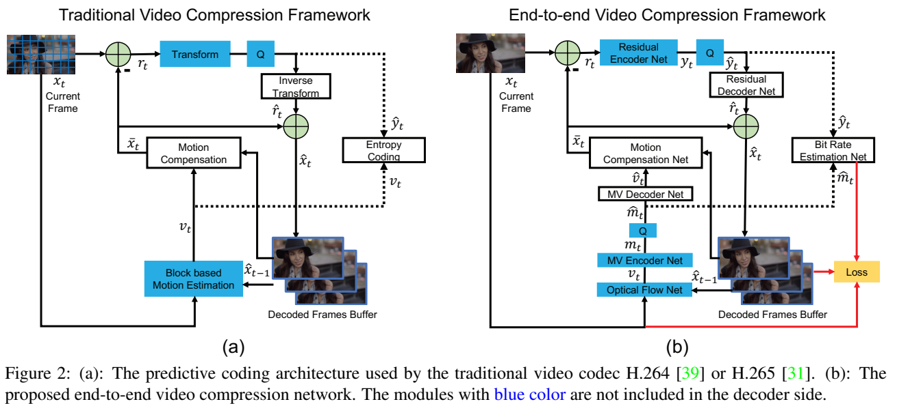
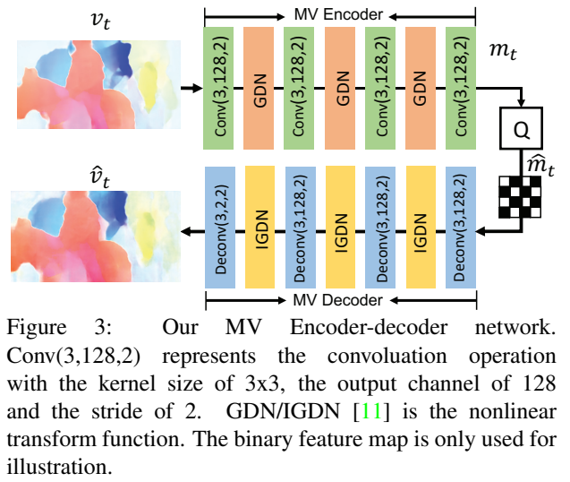
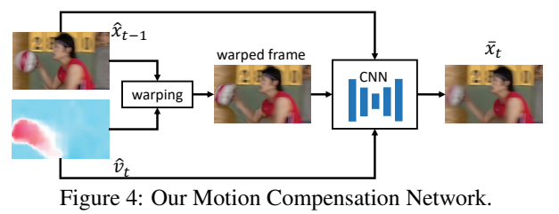
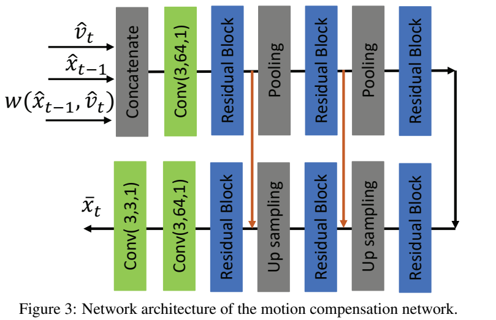
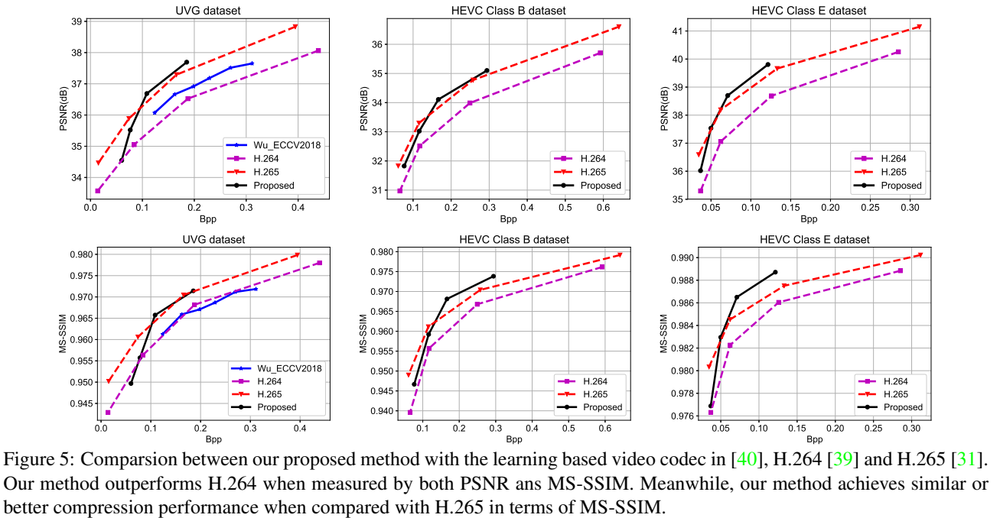
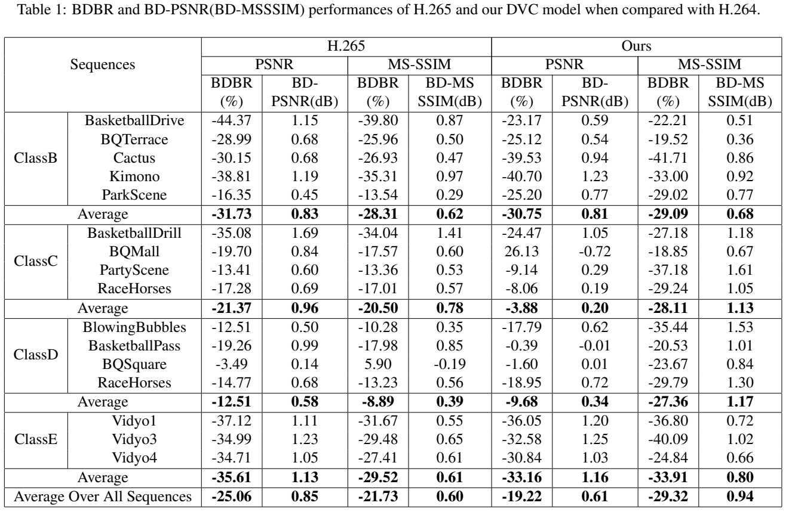
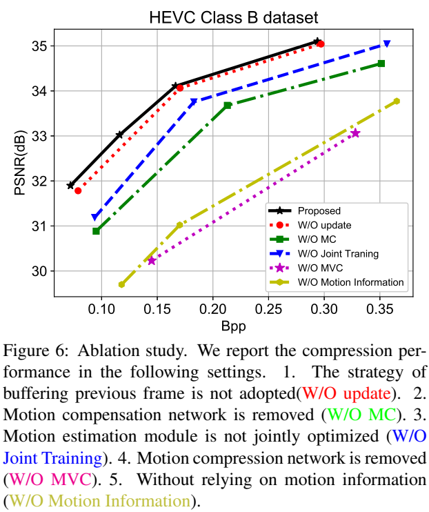
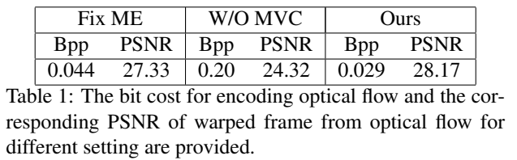
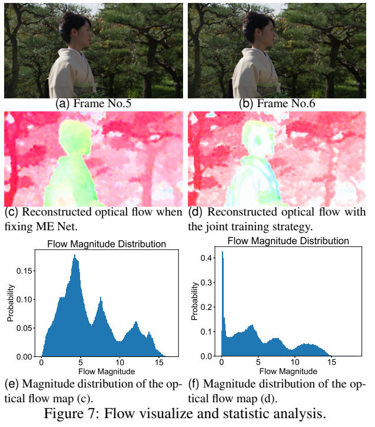
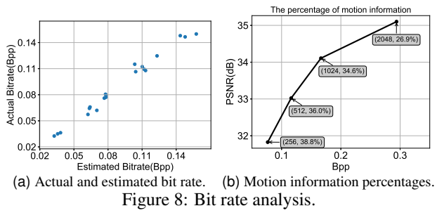

# DVC 讲解全文

## 论文与整理范围

- 论文：**DVC: An End-to-end Deep Video Compression Framework**，Guo Lu、Wanli Ouyang、Dong Xu、Xiaoyun Zhang、Chunlei Cai、Zhiyong Gao，CVPR 2019。
- 原始材料：[主论文（10 页）](Lu_DVC_An_End-To-End_Deep_Video_Compression_Framework_CVPR_2019_paper.pdf)；[补充材料（3 页）](Lu_DVC_An_End-To-End_CVPR_2019_supplemental.pdf)。页码均指 PDF 页面序号；正文印刷页 11006—11013。
- 整理日期：2026-10-15（Asia/Shanghai）。本次执行项目内 `paper-lecture-export` skill。
- **收录范围：本聊天前 7 轮论文讲解与实质性答疑的原始完整回复，5 条进度消息中的实质性说明，以及此前单独编写的学习笔记全文。** 讲解主文按实际发生顺序排列；已有笔记单独列为附录，不用它替代历史回复。
- **历史恢复情况：** 本聊天可访问会话记录中，这 7 轮公开回复均已恢复，没有仅凭摘要补写。工具日志、推理过程、其他聊天、纯文件交付与 skill 操作说明不收录；排除清单单独保存。不能由此宣称恢复了其他会话或未保存的材料。
- **实际阅读状态：** 已讲过压缩基础、DVC 方法与实验，以及 GDN / 光流 / 概率模型和代码；尚未建立逐自然段的全文精读覆盖。原回复的“精读”“讲完”措辞保留，并以[勘误 K01](#erratum-k01)说明其边界。本次整理不推进阅读进度。
- 适用证据类别：原文数据与结构属于【论文事实】；作者对贡献的定位属于【作者主张】；“我的判断 / 解读”、自设数值例子、推导与教学代码属于【独立分析 / 补充讲解】；原文未证明或尚未核实的内容保留【待验证问题】。不将教学代码当成作者原始实现。
- 资源：原图截取、原交互演示、全部静态状态、教学代码及固定版本参考源码均保存在旁边的 `DVC_讲解资源/`。复制时请一并复制资源目录与两份原 PDF；原文件没有改动。HTML 阅读本身不访问网络，外部来源链接在主动打开时才需要网络。

## 导航目录

| 学习主题 | 原讲解与补充定位 |
|---|---|
| 初识 DVC | [第 1 轮：整体框架与实验](#round-1) |
| H.264 需要学到哪里 | [第 2 轮：学习范围](#round-2) |
| 为什么可以压缩 | [第 3 轮：预测与残差](#round-3)；[演示的三种静态状态](#prediction-static) |
| H.264 流程与算法 | [第 4 轮：分块、SAD、变换、量化、RDO 等](#round-4) |
| DVC 方法、训练、实验与消融 | [第 5 轮：专题讲解](#round-5) |
| “讲完了吗” | [第 6 轮：原答复](#round-6)；[勘误 K01](#erratum-k01) |
| GDN、光流、概率、代码 | [第 7 轮：完整推导与实现](#round-7) |
| 原学习笔记 | [附录：单独改写的笔记全文](#existing-notes) |
| 查找与核对 | [答疑与勘误](#qa-index)；[术语与公式](#term-index)；[来源与收录](#source-check) |

## 讲解全文（按实际讲解顺序）

<a id="round-1"></a>
## 第 1 轮｜初次论文介绍

> 用户问题：| [Lu_DVC_An_End-To-End_Deep_Video_Compression_Framework_CVPR_2019_paper.pdf]( 读这个论文
>
> 来源：本聊天 `01a13ae4-6cb2-7f23-b09c-942490bf8387`，公开回复记录第 66 行，2026-10-14 22:54:24 +08:00。
>
> 可核实定位：主文第3—4节；图2、图6—7、表1；补充材料表1。

### 当时的完整回复

<!-- source-body:R01:begin -->
我读完了这篇 CVPR 2019 的 DVC 主文，也核对了补充材料。**它的核心贡献是：保留视频压缩的“预测＋残差”结构，用神经网络实现主要模块，并用同一个率失真目标联合训练。**

原文：[DVC 主论文](Lu_DVC_An_End-To-End_Deep_Video_Compression_Framework_CVPR_2019_paper.pdf)

视频相邻帧通常很相似，所以可以先根据上一帧预测当前帧，再传输预测不准的部分。DVC 围绕这个思路工作：

1. **估计运动。** 输入当前原始帧 \(x_t\) 和上一帧的重建结果 \(\hat{x}_{t-1}\)，用光流网络估计像素如何移动。
2. **压缩运动。** 用一个编码器把光流变成潜变量，量化并编码；解码后得到有损光流 \(\hat{v}_t\)。这样避免直接传输庞大的逐像素光流。
3. **生成预测帧。** 根据解码后的光流，对上一帧进行变形，再用运动补偿网络修正变形产生的伪影，得到预测帧 \(\bar{x}_t\)。
4. **压缩残差。** 计算 \(r_t=x_t-\bar{x}_t\)，用另一个编码器压缩残差，再解码得到 \(\hat{r}_t\)。
5. **重建当前帧。** 将预测和残差相加：
   \[
   \hat{x}_t=\bar{x}_t+\hat{r}_t
   \]
   这个重建结果会成为下一帧的参考。

这里要区分三个东西：**原始帧 \(x_t\)、预测帧 \(\bar{x}_t\)、最终重建帧 \(\hat{x}_t\)**。运动补偿负责预测，残差负责补上预测遗漏的信息。使用上一帧的重建结果作参考，则保证编码端和解码端拥有一致的参考信息。

整套网络的训练目标是：

\[
L=\lambda\,d(x_t,\hat{x}_t)
  +H(\hat{m}_t)+H(\hat{y}_t)
\]

其中，\(d\) 是重建误差，论文采用 MSE；后两项分别估计压缩运动和残差需要的比特数。**网络同时考虑“图像有多准确”和“传输需要多少比特”。** \(\lambda\) 越大，训练越重视重建质量，通常也会使用更多码率。

为了让量化过程能够训练，作者在训练时用添加均匀噪声来近似量化，推理时直接取整；通过学习潜变量的概率分布来估计码率，实际编码时采用熵编码。

**最值得理解的是：用于压缩的好光流，不一定最接近真实运动。** 在颜色均匀的区域，即使运动估计不完全准确，预测出的像素仍可能很接近原图。网络因此可以选择更容易压缩的运动表示，把比特留给更有价值的信息。

主文表 1 支持了这个观点：

| 训练方式 | 运动码率 | 变形后图像的 PSNR |
|---|---:|---:|
| 固定预训练光流网络 | 0.044 bpp | 27.33 dB |
| 按率失真目标联合训练 | 0.029 bpp | 28.17 dB |

联合训练后，**运动信息更省比特，解码光流产生的预测也更准确**。这是整篇论文很有说服力的一组证据。

实验使用 Vimeo-90k 训练，在 UVG 和 HEVC 测试序列上评估。补充材料表 1 给出了 HEVC 所列序列上的平均结果：

| 相对 H.264 的平均码率节省 | DVC | H.265 |
|---|---:|---:|
| 在相同 PSNR 下 | 19.22% | 25.06% |
| 在相同 MS-SSIM 下 | 29.32% | 21.73% |

这些数据来自：[DVC 补充材料](Lu_DVC_An_End-To-End_CVPR_2019_supplemental.pdf)

因此，论文结果应理解为：**DVC 平均优于论文配置下的 H.264；与 H.265 相比，PSNR 结果仍有差距，MS-SSIM 结果更有竞争力。** 对比中的传统编码器采用 FFmpeg 的 `veryfast` 配置，结论需要结合这个实验条件理解。

消融实验还显示，去掉运动补偿网络，PSNR 约下降 1 dB；去掉运动压缩网络，则下降超过 2 dB。这说明仅仅接入光流网络并不够，运动本身的压缩和预测结果的修正都很关键。

我的判断是，这篇论文最有价值的地方在于**让运动估计、运动压缩和残差压缩围绕最终的率失真表现协作**。阅读时建议重点看图 2 的整体流程、公式（1）的训练目标，以及图 6、图 7 的消融与光流分析；这几处串起来，就能理解 DVC 的主要思想。
<!-- source-body:R01:end -->


<a id="round-2"></a>
## 第 2 轮｜H.264 学习范围

> 用户问题：我需要学h.264的算法吗
>
> 来源：本聊天 `01a13ae4-6cb2-7f23-b09c-942490bf8387`，公开回复记录第 87 行，2026-10-14 23:48:47 +08:00。
>
> 可核实定位：传统预测编码前置知识；外部标准链接。

### 当时的完整回复

<!-- source-body:R02:begin -->
**需要掌握核心原理。以你现在理解 DVC 为目标，先学到能讲清楚一帧如何被压缩、再如何被重建，就可以继续读论文。**

DVC 继承了传统视频编码的“预测→残差→变换→量化→熵编码”思路。理解这条流程，才能看懂它为什么设置运动网络和残差网络。[H.264 标准中的预测编码说明](https://www.itu.int/rec/dologin_pub.asp?id=T-REC-H.264-202108-S%21%21PDF-E&lang=f&type=items)

建议按下面的顺序学习：

| 内容 | 你需要理解的问题 |
|---|---|
| 帧内与帧间预测，I/P/B 帧 | 当前帧可以利用哪些已有信息？ |
| 运动估计与运动补偿 | 如何找到移动的位置，再生成预测图像？ |
| 残差 | 为什么传“原图减去预测图”能省比特？ |
| 变换与量化 | 如何把残差变成容易压缩的表示？失真在哪里产生？ |
| 熵编码 | 为什么概率高的符号可以用更少的比特表示？ |
| 率失真优化 | 如何在画质和码率之间做选择？ |

**其中，运动估计、运动补偿、残差和率失真优化，应当优先学透。** DVC 的主要创新就围绕这些模块的联合训练展开。

CABAC 的具体编码步骤、完整码流语法、各种预测模式和编码器源码，可以等到你需要复现、改进传统编码器时再深入。

一个合适的学习验收标准是：你能解释清楚这三个问题：

- 为什么编码端也要重建当前帧？
- 为什么预测越准确，通常越容易压缩残差？
- 为什么更准确的运动估计，未必带来更好的整体压缩效果？

能回答这些问题，再回看 DVC 的图 2 和损失函数，就会容易很多。
<!-- source-body:R02:end -->


<a id="round-3"></a>
## 第 3 轮｜视频基础、预测与残差

> 用户问题：先教我基础知识
>
> 来源：本聊天 `01a13ae4-6cb2-7f23-b09c-942490bf8387`，公开回复记录第 145 行，2026-10-14 23:54:29 +08:00。
>
> 可核实定位：讲解辅助交互演示；原自查问题。

### 当时的完整回复

<!-- source-body:R03:begin -->
我们先学最基础的一层：**视频为什么能压缩，以及“预测”和“残差”是什么。**

一张数字图像，可以理解为一张像素表。以常见的 8 位灰度图为例，每个像素用一个 0～255 的数字表示亮度：0 是黑，255 是白。彩色图像还需要表示颜色。

视频则是一系列按时间播放的图像，每张图像叫一帧。30 fps 表示每秒播放 30 帧。每一帧都包含大量像素，直接保存所有像素会需要很多数据。

视频压缩能省空间，是因为画面中存在大量**重复或可以预测的信息**，也叫“冗余”：

- **空间冗余：** 同一帧里的相邻像素往往很相似，例如一大片天空。
- **时间冗余：** 相邻帧往往很相似，例如背景没变，只有一个人向右移动。

先看时间冗余。假设上一帧里有一个亮块，当前帧里它向右移动了一点。我们可以根据上一帧，生成一张对当前帧的猜测，这张猜测叫**预测帧**。

接着计算：

\[
\text{残差}=\text{当前帧}-\text{预测帧}
\]

“残差”就是预测错了多少。接收端只要拥有相同的预测帧，就可以恢复当前帧：

\[
\text{当前帧}=\text{预测帧}+\text{残差}
\]

下面用一行像素演示。你可以切换预测方式，观察残差如何变化。

[交互演示：预测方式与残差](DVC_讲解资源/interactive/video-prediction-basics.html)

[演示在打印中的全部三种状态](#prediction-static)

**预测越准确，残差通常越容易压缩。** “沿用上一帧”已经能利用重复信息；根据运动调整上一帧，往往能得到更准确的预测。不过，运动参数也需要传输，因此还要考虑它消耗多少比特。演示中的非零数量用于帮助理解，不能直接当成真实码率。

这里就引出了两个容易混淆的概念：

- **运动估计：** 找出画面中的内容移动了多少，例如“向右移动一格”。
- **运动补偿：** 根据这个移动量调整参考帧，生成预测帧。

到这里，预测和残差相加可以精确恢复原图。常见的有损压缩还会加入**量化**：把一些数值近似表示。例如，把 101 和 103 都近似为 100，表示会更简单，但细微差别丢失了。这就是重建图像与原图出现误差的一个主要原因。

H.264 的基本流程可以先这样记：

**生成预测 → 计算残差 → 变换 → 量化 → 熵编码**

其中，变换把残差换成更适合压缩的表示；熵编码把这些符号编码成比特。接收端再通过相应的解码过程重建图像。[H.264 标准中的基本编码说明](https://www.itu.int/rec/dologin_pub.asp?id=T-REC-H.264-202108-S%21%21PDF-E&lang=f&type=items)

实际编码时，预测使用的是**已经重建的参考帧**。因为接收端也只有重建结果，两端必须从相同的信息出发，才能生成相同的预测。

先检查一个小例子：某个像素的预测值是 100，真实值是 108，那么残差是多少？如果压缩后解码出的残差变成了 6，最终重建值又是多少？

<!-- export-addition:R03-demo:begin -->
<div class="demo-embed">
<iframe src="DVC_讲解资源/interactive/video-prediction-basics.html" title="预测方式与残差：三种预测方式" loading="lazy"></iframe>
</div>

<a id="prediction-static"></a>
**讲解辅助演示的打印内容（全部交互状态）**

上一帧：`[20, 20, 100, 100, 20, 20, 20, 20]`；当前帧：`[20, 20, 20, 100, 100, 20, 20, 20]`。

| 预测方式 | 预测像素 | 残差（当前减预测） | 非零数量 | 运动说明 |
|---|---|---|---:|---|
| 沿用上一帧 | 20, 20, 100, 100, 20, 20, 20, 20 | 0, 0, -80, 0, 80, 0, 0, 0 | 2/8 | 0 格 |
| 上一帧向右移 1 格 | 20, 20, 20, 100, 100, 20, 20, 20 | 0, 0, 0, 0, 0, 0, 0, 0 | 0/8 | 向右 1 格 |
| 不预测 | 0, 0, 0, 0, 0, 0, 0, 0 | 20, 20, 20, 100, 100, 20, 20, 20 | 8/8 | 无 |

这是已讲过的自构造示例，不是论文图表。非零数量不能替代实际码率。
<!-- export-addition:R03-demo:end -->
<!-- source-body:R03:end -->


<a id="round-4"></a>
## 第 4 轮｜H.264 流程与算法

> 用户问题：讲完他,适当讲解算法
>
> 来源：本聊天 `01a13ae4-6cb2-7f23-b09c-942490bf8387`，公开回复记录第 218 行，2026-10-15 00:06:22 +08:00。
>
> 可核实定位：分块、SAD、变换、量化、熵编码、RDO、重建与I/P/B。

### 原进度消息中的实质性补充（记录第 205 行）

<!-- source-body:C205:begin -->
需要特别分清：预测、变换和熵编码各有不同作用；量化才是这条流程中引入损失的主要环节。我会用数字例子说明这些步骤，再把它们连成完整的编解码流程。

<!-- source-body:C205:end -->

### 当时的完整回复

<!-- source-body:R04:begin -->
可以。下面把 **H.264 的核心编解码流程讲完整，并穿插必要的算法**，让你能看懂它与 DVC 的对应关系。

上一题的答案是：残差为 \(108-100=8\)；如果解码出的残差为 6，重建值就是 \(100+6=106\)。

先统一三个符号：\(X\) 表示原始图像块，\(P\) 表示预测块，\(E=X-P\) 表示残差。下面主要以亮度像素为例。

1. **先把图像分成块，分别处理不同区域。**

   一幅图像中，背景可能静止，人物可能运动，人物的手和身体还可能往不同方向运动。因此，编码器需要在局部区域选择合适的预测方法。

   H.264 以包含 \(16\times16\) 个亮度像素的宏块作为基本组织单位。运动补偿时，可以进一步使用 \(16\times8\)、\(8\times16\)、\(8\times8\) 等分块，最小可到 \(4\times4\)。

   大块需要描述的运动信息少，小块能更细致地适应局部运动，却需要更多分块和运动信息。**如何分块，本身也是压缩中的选择题。** [帧间预测与分块说明](https://www.vcodex.com/h264avc-inter-prediction)

2. **帧内预测：利用同一帧中已经重建的邻居。**

   假设一个块上方的四个像素是：

   ```text
   100  102  104  103
   ```

   如果当前区域主要沿竖直方向保持相似，可以把这行数值向下复制，作为整个块的预测。这叫竖直预测。

   其他方法包括从左侧向右复制的水平预测、使用邻居平均值的 DC 预测，以及沿不同方向延伸的预测。

   编码器尝试不同预测方式，选出合适的一种，然后编码：

   \[
   E=X-P
   \]

   接收端根据传来的预测模式，用相同的邻居生成 \(P\)，再加上解码出的残差。

   **帧内编码也有预测，也需要残差。** 它利用的是当前帧内部的信息。[帧内预测说明](https://www.vcodex.com/h264avc-intra-prediction)

3. **帧间预测：先搜索运动，再根据运动取出预测块。**

   对当前块，编码器到已经重建的参考图像里寻找相似区域。两个位置之间的偏移，用运动向量表示：

   \[
   v=(d_x,d_y)
   \]

   一个基础搜索方法是比较候选块与当前块的 **SAD，即绝对差之和**：

   \[
   \operatorname{SAD}(d_x,d_y)
   =\sum_{i,j}
   \left|X(i,j)-P_{d_x,d_y}(i,j)\right|
   \]

   SAD 越小，候选块越接近当前块。教学用的穷举搜索可以写成：

   ```text
   最小误差 = 无穷大

   遍历搜索范围内所有合法偏移 (dx, dy):
       从参考图像取出候选块
       误差 = 当前块与候选块的绝对差之和

       如果误差更小:
           保存这个误差
           保存偏移 (dx, dy)

   返回保存的偏移
   ```

   **寻找偏移叫运动估计；根据偏移生成预测块叫运动补偿。**

   穷举搜索计算量很大，实际编码器会采用更快的搜索策略，并考虑运动信息所需的比特数。H.264 亮度运动补偿还支持 \(1/4\) 像素精度：小数位置的像素通过插值得到。

   运动向量本身也可以预测。例如邻块预测的向量为 \((9,2)\)，当前向量为 \((10,2)\)，就可以传输差值 \((1,0)\)。[亚像素补偿与运动向量预测](https://www.vcodex.com/h264avc-inter-prediction)

4. **变换：把残差换成更容易压缩的表示。**

   相邻残差也可能相似。我们可以把它们分解成“整体变化”和“局部差异”。

   用两个数演示：

   \[
   E=[10,12]
   \]

   做一个简单的求和、求差变换：

   \[
   T=[10+12,\ 10-12]=[22,-2]
   \]

   第一个数描述整体水平，第二个数描述两个位置的差异。如果原来是 \([10,10]\)，变换后就是 \([20,0]\)，差异项变成了零。

   这里使用的是教学变换。H.264 常用的 \(4\times4\) 变换采用整数运算，是对 DCT 的近似；其核心运算可以通过加法和移位高效完成。[H.264 变换设计论文](https://www.microsoft.com/en-us/research/publication/low-complexity-transform-and-quantization-in-h-264avc/)

   **变换本身没有减少数值的数量；它为后面的量化和熵编码创造条件。**

5. **量化：用近似值换取更少的编码数据。**

   一个简化的量化模型是：

   \[
   q=\operatorname{round}(T/\Delta)
   \]

   其中 \(\Delta\) 是量化步长。接收端进行反量化：

   \[
   \hat T=q\Delta
   \]

   接着刚才的例子，令 \(\Delta=5\)：

   \[
   [22,-2]\rightarrow[4,0]\rightarrow[20,0]
   \]

   原来的细微差异丢失了。通过逆变换：

   \[
   \hat E=
   \left[
   \frac{20+0}{2},
   \frac{20-0}{2}
   \right]
   =[10,10]
   \]

   残差从 \([10,12]\) 变成了 \([10,10]\)。

   H.264 使用量化参数 **QP** 控制量化粗细。对于常见的 8 位编码，亮度 QP 通常在 0～51；QP 每增加 6，量化步长加倍。QP 越大，通常码率越低、失真越大。实际运算还包含缩放和舍入规则，上面的除法模型用于理解原理。[变换与量化说明](https://www.vcodex.com/h264avc-4x4-transform-and-quantization)

6. **熵编码：把符号无损地变成比特。**

   量化后，经常出现大量零和小数值。如果每个符号都用同样长的编码，会浪费空间。熵编码利用符号的概率，让常见情况占用更少的平均比特。

   H.264 中两种重要的方法是 CAVLC 和 CABAC。CABAC 可以从三个步骤理解：

   - 把系数、运动差值等信息转换成二元决策。
   - 根据邻近已编码信息等“上下文”，选择和更新概率模型。
   - 使用二进制算术编码，将这些决策编码成比特流。

   算术编码可以理解为不断缩小一个数值区间：概率大的结果分到较大的子区间，概率小的结果分到较小的子区间，最终用足够的比特指出落在哪个区间。

   **熵编码能够精确恢复输入符号。它不会修复量化丢失的信息，也不会进一步损失这些符号。** [CABAC 设计者的算法说明](https://www.hhi.fraunhofer.de/en/departments/vca/research-groups/video-coding-technologies/research-topics-of-video-coding-technologies-group/past-research-topics/statistical-modeling-coding/context-based-adaptive-binary-arithmetic-coding-cabac.html)

7. **率失真优化：决定采用哪一种编码方案。**

   编码器面临许多选择：怎样分块、选哪个参考图像、使用哪种预测模式，以及量化多粗。

   一个常用的目标是：

   \[
   J=D+\lambda R
   \]

   \(D\) 是重建失真，\(R\) 是需要的比特数，\(\lambda\) 控制比特成本的权重。编码器比较候选方案，倾向选择 \(J\) 更小的方案。

   看一个自设例子：

   | 方案 | 失真 \(D\) | 比特数 \(R\) |
   |---|---:|---:|
   | A | 10 | 100 |
   | B | 20 | 20 |

   当 \(\lambda=0.1\)，A 的成本为 20，B 为 22，选择 A。

   当 \(\lambda=1\)，A 的成本为 110，B 为 40，选择 B。

   **所以，残差更小的预测方案，可能因为运动或模式信息太贵，整体反而不划算。** 这就是率失真优化的作用。[率失真编码器控制研究](https://doi.org/10.1109/TCSVT.2003.815168)

8. **编码器也要重建图像，再把它作为后续参考。**

   延续数字例子：原始像素为 \([110,112]\)，预测为 \([100,100]\)，解码残差为 \([10,10]\)，那么重建结果是：

   \[
   \hat X=P+\hat E=[110,110]
   \]

   接收端得到的是这个结果。因此，编码器预测后续图像时，也必须从同样的重建信息出发。

   编码器内部会执行反量化、逆变换和重建。H.264 还对重建图像应用**环内去块滤波**，减轻分块处理造成的边界伪影；滤波后的图像可以用于后续帧间预测。[H.264 总览中的重建与环内滤波](https://www.cs.ubc.ca/~krasic/cpsc538a/papers/h264avc-overview.pdf)

   下面这张图体现了编码器中的两个分支：

   ```mermaid
   flowchart TB
       A["原始块 X"] --> B["减去预测块 P"]
       P["由已重建信息生成预测 P"] --> B
       B --> C["残差：变换 → 量化"]
       C --> D["熵编码"]
       D --> E["输出比特流"]
       C --> F["反量化 → 逆变换"]
       F --> G["解码残差"]
       G --> H["加上预测 P"]
       P --> H
       H --> I["重建与环内滤波"]
       I --> J["存储，供后续帧间预测"]
   ```

9. **最后把这些块放回视频序列，理解 I、P、B 的作用。**

   入门时，可以这样理解：

   | 类型 | 主要允许的预测方式 |
   |---|---|
   | I | 使用当前图像内部的信息 |
   | P | 可以使用已解码参考图像，也可以使用帧内预测 |
   | B | 可以使用两组参考列表，并组合两份预测，也可以使用帧内预测 |

   常见 B 帧例子是同时参考播放顺序中前面和后面的帧。假设播放顺序是：

   ```text
   I0 → B1 → B2 → P3
   ```

   如果 B1、B2 都依赖 P3，那么可以先解码：

   ```text
   I0 → P3 → B1 → B2
   ```

   再按播放顺序输出。因此，**解码顺序和播放顺序可以不同**。严格说，I/P/B 是切片类型；把它们当作帧类型，是入门时常用的简化。[参考关系与图像顺序说明](https://www.cs.ubc.ca/~krasic/cpsc538a/papers/h264avc-overview.pdf)

你现在回到 DVC，可以直接对照这些模块：

| 已经理解的作用 | DVC 中的实现 |
|---|---|
| 搜索运动、生成预测 | 光流估计与运动补偿网络 |
| 表示和压缩运动信息 | 运动编码器、解码器 |
| 变换和恢复残差 | 残差编码器、解码器 |
| 估计编码成本 | 学习潜变量的概率分布 |
| 平衡码率与失真 | 用率失真损失联合训练 |

DVC 写的是 \(L=\lambda D+R\)，上面讲的是 \(J=D+\lambda R\)，权重放的位置不同。对正的权重而言：

\[
\lambda D+R
=\lambda\left(D+\frac{1}{\lambda}R\right)
\]

所以 **DVC 的 \(\lambda\) 越大，越重视画质；上面 \(D+\lambda R\) 中的 \(\lambda\) 越大，越重视省比特**。阅读公式时，要先看权重乘在哪一项上。

这些对应关系见原文：[DVC 主论文](Lu_DVC_An_End-To-End_Deep_Video_Compression_Framework_CVPR_2019_paper.pdf)
<!-- source-body:R04:end -->


<a id="round-5"></a>
## 第 5 轮｜DVC 方法、训练与实验（原请求为精读）

> 用户问题：精读论文
>
> 来源：本聊天 `01a13ae4-6cb2-7f23-b09c-942490bf8387`，公开回复记录第 280 行，2026-10-15 00:14:40 +08:00。
>
> 可核实定位：主文第1—5节的专题讲解；图2—8、表1；补充图3、表1。

> **整理时核对发现 · [勘误 K01](#erratum-k01)：** 原回复使用“精读”或“讲完”的措辞；其实际形式是专题讲解，未按原文逐段提供英文摘录、翻译与讲解，不代表全文精读完成。下文保留历史原话。

### 原进度消息中的实质性补充（记录第 270 行）

<!-- source-body:C270:begin -->
图 2 有一个关键约束：运动补偿必须使用“压缩后再解码的光流”，这样接收端才能生成相同的预测。补充实验还显示，DVC 的优势随指标和视频内容变化，并不是每个序列都优于 H.264。

<!-- source-body:C270:end -->

### 当时的完整回复

<!-- source-body:R05:begin -->
我们精读的是 **DVC: An End-to-end Deep Video Compression Framework（CVPR 2019）**。这次重点看清三件事：每个模块为什么存在、最终损失如何影响它们，以及实验究竟证明了什么。

主文：[DVC 主论文](Lu_DVC_An_End-To-End_Deep_Video_Compression_Framework_CVPR_2019_paper.pdf)

补充材料：[DVC 补充材料](Lu_DVC_An_End-To-End_CVPR_2019_supplemental.pdf)

1. **读 Introduction，要抓住“运动也需要付出编码成本”这个问题。**

   作者先回顾传统视频编码：根据参考帧预测当前帧，再编码运动信息和预测残差。你已经学过这条流程。

   深度图像压缩可以用网络学习变换，那么视频压缩能否也采用神经网络？难点在于，视频多了一种需要传输的信息：**运动**。

   光流能够描述逐像素运动，但一张 \(H\times W\) 的光流图有 \(2HW\) 个数值。如果直接传输，可能把预测节省的比特又花掉。

   因此，作者提出的核心问题是：

   > 如何学习一种运动表示，使它既有助于预测，又容易压缩，并与残差编码共同获得好的率失真表现？

   精读时要纠正一个容易产生的误解：**传统编码器已经使用率失真优化。DVC 的新意在于，把多个可学习模块放进同一个率失真训练目标。**

   Related Work 中的对比也围绕这一点展开：一些已有方法只替换传统编码器的某个模块；作者特别强调，DVC 同时学习运动估计、运动压缩、运动补偿和残差压缩。

2. **进入第 3 节，先把符号分清，否则图 2 会越看越乱。**

   | 符号 | 含义 |
   |---|---|
   | \(x_t\) | 当前原始帧 |
   | \(\hat x_{t-1}\) | 上一帧的重建结果，作为参考 |
   | \(v_t,\hat v_t\) | 估计光流、压缩后解码得到的光流 |
   | \(m_t,\hat m_t\) | 运动潜变量、量化后的运动潜变量 |
   | \(\bar x_t\) | 根据参考帧和解码光流生成的预测帧 |
   | \(r_t,\hat r_t\) | 原始残差、解码残差 |
   | \(y_t,\hat y_t\) | 残差潜变量、量化后的残差潜变量 |
   | \(\hat x_t\) | 最终重建的当前帧 |

   这里有两组必须区分：

   **光流 \(v_t\) 描述运动；潜变量 \(m_t\) 是网络为压缩运动而生成的表示。**

   **残差 \(r_t\) 是像素域的预测误差；潜变量 \(y_t\) 是网络变换后的残差表示。**

   帽子通常表示量化或重建结果；横线表示预测结果。

3. **图 2 的运动分支，可以拆成“估计→编码→量化→解码”。**

<!-- export-addition:R05-fig2:begin -->
<figure id="main-figure-2">



<figcaption>【整理时补入原图】主文图 2：传统预测编码与 DVC 架构。主论文 PDF 第4页，印刷页11009；图像直接从原 PDF 截取，保留原图注。来源：<a href="Lu_DVC_An_End-To-End_Deep_Video_Compression_Framework_CVPR_2019_paper.pdf#page=4">主文，对应页面</a>。</figcaption>
</figure>
<!-- export-addition:R05-fig2:end -->

   为了说明流程，下面用 \(F,E_m,D_m\) 分别表示光流网络、运动编码器和运动解码器。这些函数名是我为讲解添加的记号。

   \[
   v_t=F(x_t,\hat x_{t-1})
   \]

   光流网络观察当前原始帧与上一帧重建结果，估计两者之间的运动。该模块使用论文引用的空间金字塔光流网络作为基础，并用预训练权重初始化。

   随后：

   \[
   m_t=E_m(v_t),\qquad
   \hat m_t=Q(m_t),\qquad
   \hat v_t=D_m(\hat m_t)
   \]

   **运动补偿使用的是 \(\hat v_t\)，即压缩后再解码的光流。**

   这是整个框架中的重要约束。接收端只能从码流恢复 \(\hat m_t\)，再得到 \(\hat v_t\)。编码端必须用同样的光流生成预测，才能与解码端保持一致。

   图 3 给出了运动编码器的具体结构：四层步长为 2 的卷积，将空间尺寸连续缩小，并使用 GDN 非线性变换。其尺寸变化为：

   \[
   H\times W\times2
   \rightarrow
   \frac H{16}\times\frac W{16}\times128
   \]

   例如，输入光流为 \(256\times256\times2\)，运动潜变量为 \(16\times16\times128\)。

<!-- export-addition:R05-fig3:begin -->
<figure id="main-figure-3">



<figcaption>【整理时补入原图】主文图 3：运动编码器与解码器。主论文 PDF 第4页，印刷页11009；图像直接从原 PDF 截取，保留原图注。来源：<a href="Lu_DVC_An_End-To-End_Deep_Video_Compression_Framework_CVPR_2019_paper.pdf#page=4">主文，对应页面</a>。</figcaption>
</figure>
<!-- export-addition:R05-fig3:end -->

   空间尺寸缩小，通道数增加，是把运动信息重新组织到特征空间中。**实际节省多少比特，还取决于量化结果和符号概率，不能只看张量尺寸。** 图 3 中黑白格子的特征图也只是示意，不表示每个潜变量只有一位。

4. **第 3.4 节的运动补偿有两步：先变形，再修正。**

   首先，按照解码光流对参考帧进行变形：

   \[
   \tilde x_t=w(\hat x_{t-1},\hat v_t)
   \]

   可以把它理解为：对当前画面中的每个位置，按照光流指定的位置，到参考帧中取像素。

   但变形结果仍可能存在伪影。预测问题本身就可能遇到遮挡、新露出的区域和插值误差，光流压缩还会带来额外误差。

   作者因此把三种信息拼接后送入修正网络：

   \[
   \bar x_t=
   C\!\left(
   \operatorname{concat}
   [\,\tilde x_t,\hat x_{t-1},\hat v_t\,]
   \right)
   \]

   在 RGB 情况下，输入包含变形图像的 3 个通道、参考图像的 3 个通道，以及光流的 2 个通道，共 8 个通道。

   补充材料图 3 展示了这个网络：它使用残差块、两次下采样和两次上采样，并连接不同尺度的特征。

<!-- export-addition:R05-mc:begin -->
<figure id="main-figure-4">



<figcaption>【整理时补入原图】主文图 4：运动补偿流程。主论文 PDF 第5页，印刷页11010；图像直接从原 PDF 截取，保留原图注。来源：<a href="Lu_DVC_An_End-To-End_Deep_Video_Compression_Framework_CVPR_2019_paper.pdf#page=5">主文，对应页面</a>。</figcaption>
</figure>

<figure id="supp-figure-3">



<figcaption>【整理时补入原图】补充材料图 3：运动补偿网络内部结构。补充材料 PDF 第3页；图像直接从原 PDF 截取，保留原图注。来源：<a href="Lu_DVC_An_End-To-End_CVPR_2019_supplemental.pdf#page=3">补充材料，对应页面</a>。</figcaption>
</figure>
<!-- export-addition:R05-mc:end -->

   读这一节时，注意**修正网络没有输入当前原始帧 \(x_t\)**。这些输入在解码端都能获得，所以解码端能够生成相同的预测。

5. **第 3.5 节的残差分支，负责补上预测没有解释好的内容。**

   先计算：

   \[
   r_t=x_t-\bar x_t
   \]

   再经过残差编码、量化和解码：

   \[
   y_t=E_r(r_t),\qquad
   \hat y_t=Q(y_t),\qquad
   \hat r_t=D_r(\hat y_t)
   \]

   最后：

   \[
   \hat x_t=\bar x_t+\hat r_t
   \]

   作者采用已有深度图像压缩工作中的非线性网络来处理残差。它承担了传统变换编码中“把残差转到适合压缩的表示”的作用。

   一个教学例子：当前像素为 120，预测为 115，原始残差为 5。如果残差解码后变成 4，最终重建就是 119。

   这里有一个重要推论：**预测不必完美，残差可以补偿预测误差；但补偿需要花比特。**

   省略熵编码的内部细节，解码端的主体过程可以写成：

   ```text
   从运动码流恢复量化运动潜变量
   从残差码流恢复量化残差潜变量

   解码光流 = 运动解码器(量化运动潜变量)
   变形图像 = warp(上一帧重建结果, 解码光流)
   预测帧 = 运动补偿网络(变形图像, 参考帧, 解码光流)

   解码残差 = 残差解码器(量化残差潜变量)
   当前重建帧 = 预测帧 + 解码残差

   保存当前重建帧，作为后续参考
   ```

   解码端无需重新估计光流，也无需看到当前原始帧。

6. **公式（1）是论文最重要的部分：三个成本一起优化。**

   \[
   L=
   \lambda\,d(x_t,\hat x_t)
   +H(\hat m_t)
   +H(\hat y_t)
   \]

   第一项是最终重建失真，论文使用 MSE；后两项分别表示运动和残差的编码成本。

   这个目标要求网络同时考虑：

   - 最终图像是否准确。
   - 描述运动是否昂贵。
   - 修正预测误差是否昂贵。

   所以，光流网络不能只追求预测准确。它还要考虑自己生成的运动是否容易编码，以及这个运动会留下怎样的残差。

   用一个自设例子理解：某种运动表示多花了 0.01 bpp，却使残差少花 0.03 bpp，且最终失真相同，那么总码率减少了 0.02 bpp，这种变化值得采用。

   这就是**模块之间的协作**。

   论文在这个损失中没有加入真实光流的监督项。光流网络经过初始化之后，服务于最终的视频压缩目标。

   同时注意，\(\lambda\) 乘在失真上：它越大，训练通常越重视画质。作者分别训练了 \(\lambda=256,512,1024,2048\) 的四个模型，得到不同的率失真工作点。

7. **第 3.6 节还要解决两个训练障碍：量化和码率如何参与反向传播。**

   普通取整几乎处处梯度为零，无法直接提供有效的训练信号。作者在训练时，用添加均匀噪声来替代取整：

   \[
   \tilde y_t=y_t+\eta
   \]

   给定采样噪声后，这个表达式对 \(y_t\) 的导数为 1，梯度能够传回编码器。推理时则使用：

   \[
   \hat y_t=\operatorname{round}(y_t)
   \]

   运动潜变量采用相同思路。这里我用波浪号区分训练时的连续近似，避免把它与实际整数符号混淆。

   对码率，作者通过概率估计网络建模潜变量分布。一个符号 \(s\) 的理想码长估计为：

   \[
   \ell(s)\approx-\log_2p(s)
   \]

   例如，概率为 \(1/2\) 时对应约 1 bit；概率为 \(1/8\) 时对应约 3 bits。因此可以把编码成本理解为：

   \[
   R_m\approx\sum_i-\log_2p_m(\hat m_{t,i})
   \]

   残差编码成本同理。

   网络学习的不只是“怎样重建”，还包括“怎样生成容易被概率模型编码的符号”。

   **这里的端到端训练使用量化和码率的可微近似。** 实际推理仍需要离散量化与熵编码。图 8(a) 比较了估计码率和算术编码得到的实际码率，两者相近，为训练中的码率估计提供了支持。

8. **缓存重建帧，是作者为训练效率做的一项具体设计。**

   当前帧依赖 \(\hat x_{t-1}\)，而它又依赖更早的重建帧。如果每次都从前面重新编码，训练会增加计算和显存开销，也不利于一个批次包含多样样本。

   作者采用在线缓存：编码完一帧后保存其重建结果，以后编码后续帧时读取缓存，并在训练中不断更新。

   这既减轻了计算负担，也让训练能够接触已经带有压缩误差的参考图像。

   作者还比较了另一种训练方式：直接使用上一帧原始图像作为参考。缓存重建帧的方案在相同 bpp 下约有 0.2 dB 优势。

   我的解读是，这个实验支持**训练时使用接近实际解码条件的参考图像**。论文没有据此证明整段长视频经过展开、跨所有历史帧反向传播；精读时应区分当前帧网络的联合训练与长序列优化。

9. **看图 5 和补充表 1，要同时看指标、基线和序列差异。**

<!-- export-addition:R05-results:begin -->
<figure id="main-figure-5">



<figcaption>【整理时补入原图】主文图 5：率失真曲线。主论文 PDF 第6页，印刷页11011；图像直接从原 PDF 截取，保留原图注。来源：<a href="Lu_DVC_An_End-To-End_Deep_Video_Compression_Framework_CVPR_2019_paper.pdf#page=6">主文，对应页面</a>。</figcaption>
</figure>

<figure id="supp-table-1">



<figcaption>【整理时补入原图】补充材料表 1：16 个 HEVC 序列的 BD 指标。补充材料 PDF 第1页；图像直接从原 PDF 截取，保留原图注。来源：<a href="Lu_DVC_An_End-To-End_CVPR_2019_supplemental.pdf#page=1">补充材料，对应页面</a>。</figcaption>
</figure>
<!-- export-addition:R05-results:end -->

   实验采用 Vimeo-90k 训练，在 UVG 和 HEVC Class B/C/D/E 上评估。训练裁剪为 \(256\times256\)，批次大小为 4，使用 Adam，初始学习率为 \(10^{-4}\)。

   横轴 bpp 表示每像素所需比特数，越小越省；纵轴 PSNR 或 MS-SSIM 越高，表示对应指标下重建越好。比较曲线时，应在相同码率下比较质量，或者在相同质量下比较码率。

   补充表 1 给出了所列 16 个 HEVC 序列的平均 BD-BR：

   | 相对 H.264 的 BD-BR | DVC | H.265 |
   |---|---:|---:|
   | 以 PSNR 衡量质量 | −19.22% | −25.06% |
   | 以 MS-SSIM 衡量质量 | −29.32% | −21.73% |

   负数代表相对基线节省码率。因此，平均结果支持：

   **DVC 优于论文配置下的 H.264；与 H.265 相比，PSNR 结果仍有差距，MS-SSIM 结果更有竞争力。**

   29.32% 的基线是 H.264，不能把它读成“相对 H.265 节省 29.32%”。

   而且，平均优势不代表每个序列都胜出。例如 BQMall 的 PSNR BD-BR 为 **+26.13%**，说明该序列上 DVC 相对 H.264 需要更多码率。

   传统编码器使用 FFmpeg 的 `veryfast` 配置，所以性能结论需要与这些设置一起理解。论文对 Wu 等人方法的比较还涉及不同预测结构：DVC 使用一个过去的参考帧，而对方使用两个邻近参考帧。

10. **图 6、表 1、图 7 的消融，比“网络更强”更能解释论文贡献。**

<!-- export-addition:R05-ablation:begin -->
<figure id="main-figure-6">



<figcaption>【整理时补入原图】主文图 6：消融实验。主论文 PDF 第7页，印刷页11012；图像直接从原 PDF 截取，保留原图注。来源：<a href="Lu_DVC_An_End-To-End_Deep_Video_Compression_Framework_CVPR_2019_paper.pdf#page=7">主文，对应页面</a>。</figcaption>
</figure>

<figure id="main-table-1">



<figcaption>【整理时补入原图】主文表 1：光流码率与变形图像 PSNR。主论文 PDF 第7页，印刷页11012；图像直接从原 PDF 截取，保留原图注。来源：<a href="Lu_DVC_An_End-To-End_Deep_Video_Compression_Framework_CVPR_2019_paper.pdf#page=7">主文，对应页面</a>。</figcaption>
</figure>
<!-- export-addition:R05-ablation:end -->

    | 改动 | 论文报告的影响 |
    |---|---|
    | 冻结光流网络，不参与联合训练 | 压缩性能下降 |
    | 去掉运动补偿修正网络 | 相同 bpp 下 PSNR 约下降 1 dB |
    | 去掉运动编码器、解码器 | PSNR 下降超过 2 dB |
    | 不使用运动，每帧独立处理 | PSNR 下降超过 2 dB |
    | 训练参考改用上一帧原始图像 | PSNR 约下降 0.2 dB |

    主文表 1 尤其值得看：

    | 方案 | 光流编码成本 | 变形图像 PSNR |
    |---|---:|---:|
    | 冻结光流网络 | 0.044 bpp | 27.33 dB |
    | 联合训练 | 0.029 bpp | 28.17 dB |

    联合训练后，运动编码成本约减少了 34%，变形图像的 PSNR 还提高了 0.84 dB。

    这里的 PSNR 衡量的是**变形图像**，不是最终加上残差后的重建帧。两者不能混用。

    图 7 则提供了机制上的线索：联合训练后的重建光流出现更多零运动区域。对一些纹理均匀的区域，运动值即使偏离真实运动，采样得到的像素仍可能很接近。

<!-- export-addition:R05-flow:begin -->
<figure id="main-figure-7">



<figcaption>【整理时补入原图】主文图 7：光流可视化与运动幅度统计。主论文 PDF 第7页，印刷页11012；图像直接从原 PDF 截取，保留原图注。来源：<a href="Lu_DVC_An_End-To-End_Deep_Video_Compression_Framework_CVPR_2019_paper.pdf#page=7">主文，对应页面</a>。</figcaption>
</figure>
<!-- export-addition:R05-flow:end -->

    **这组结果说明，用于压缩的运动表示可以优先保留对预测有价值、又容易编码的信息。** 但“零光流更多”只是可压缩性的一个解释，实际码率仍由潜变量与概率模型决定。

    图 8(b) 还显示，随着 \(\lambda\) 增大，总码率上升，运动信息所占比例从 38.8% 降至 26.9%。比例下降并不等于运动的绝对码率下降，要同时看分母如何变化。

<!-- export-addition:R05-rate:begin -->
<figure id="main-figure-8">



<figcaption>【整理时补入原图】主文图 8：估计与实际码率、运动码率占比。主论文 PDF 第8页，印刷页11013；图像直接从原 PDF 截取，保留原图注。来源：<a href="Lu_DVC_An_End-To-End_Deep_Video_Compression_Framework_CVPR_2019_paper.pdf#page=8">主文，对应页面</a>。</figcaption>
</figure>
<!-- export-addition:R05-rate:end -->

11. **最后评估论文贡献与边界，避免把实验结论扩大。**

    我的判断是，DVC 最有价值的贡献是：**把可学习的运动表示及其编码成本，纳入运动补偿和残差编码共同参与的率失真优化。** 光流、压缩变换和概率建模都有已有工作的基础，作者的重要工作在于把它们组成有效的视频压缩系统。

    论文还留下几个值得继续研究的问题：

    - **时间信息利用有限。** 主网络只使用一个过去的重建参考帧，多参考帧和双向预测仍有扩展空间。
    - **码率调节依赖多个模型。** 四个 \(\lambda\) 对应分别训练的模型，论文没有由此建立一个完整的连续码率控制机制。
    - **首帧与完整码流细节没有在主网络图中展开。** 复现完整视频编码系统时，还需要明确首帧编码、必要附加信息和总比特统计方式。
    - **运行速度具有具体实验条件。** 论文在 \(352\times288\) 视频上报告约 24.5 fps 编码、41 fps 解码，不能直接据此推断高分辨率实时表现。

    回到图 2，最值得你亲自追踪的一条依赖关系是：

    \[
    \boxed{
    \text{光流}
    \rightarrow\text{运动潜变量}
    \rightarrow\text{解码光流}
    \rightarrow\text{预测}
    \rightarrow\text{残差}
    \rightarrow\text{最终重建}
    }
    \]

    改变前面的光流，不仅改变运动码率，还会改变残差码率和最终失真。**公式（1）把这三个后果一起反馈给网络，这就是理解整篇 DVC 的关键。**
<!-- source-body:R05:end -->


<a id="round-6"></a>
## 第 6 轮｜“讲完了吗”与实际覆盖范围

> 用户问题：讲完了吗
>
> 来源：本聊天 `01a13ae4-6cb2-7f23-b09c-942490bf8387`，公开回复记录第 298 行，2026-10-15 16:31:54 +08:00。
>
> 可核实定位：原短答完整保留；整理勘误K01。

> **整理时核对发现 · [勘误 K01](#erratum-k01)：** 原回复使用“精读”或“讲完”的措辞；其实际形式是专题讲解，未按原文逐段提供英文摘录、翻译与讲解，不代表全文精读完成。下文保留历史原话。

### 当时的完整回复

<!-- source-body:R06:begin -->
**论文的核心内容已经讲完了**：研究动机、网络流程、损失函数、训练方法、实验、消融和局限。

刚才达到的是“理解整篇论文”的深度。GDN、光流网络、概率模型的内部推导，以及代码实现，还没有展开讲。
<!-- source-body:R06:end -->


<a id="round-7"></a>
## 第 7 轮｜GDN、光流、概率模型及代码

> 用户问题：GDN、光流网络、概率模型的内部推导，以及代码实现 这些展开讲
>
> 来源：本聊天 `01a13ae4-6cb2-7f23-b09c-942490bf8387`，公开回复记录第 463 行，2026-10-15 16:48:14 +08:00。
>
> 可核实定位：补充推导；后续PyTorch源码；本地独立教学实现。

### 原进度消息中的实质性补充（记录第 346 行）

<!-- source-body:C346:begin -->
发现了一个需要先说明的区别：作者原始仓库公开的是测试代码，明确未提供熵编码模块，特征以 `.pkl` 保存并报告估计码率。我会结合它链接的 PyTorch 实现讲解，并补一份可运行的教学代码，区分“估计比特数”和“真正生成压缩码流”。

<!-- source-body:C346:end -->

### 原进度消息中的实质性补充（记录第 399 行）

<!-- source-body:C399:begin -->
代码里有几处与论文图示不同：这份后续 PyTorch 实现用四层金字塔估计光流，残差概率采用 Laplace 分布；运动压缩使用 LeakyReLU，运动补偿网络接收变形图与参考图。它还显式统计旁信息 \(z\) 的码率。接下来的推导会标明这些区别，避免把论文和重实现混在一起。

<!-- source-body:C399:end -->

### 原进度消息中的实质性补充（记录第 422 行）

<!-- source-body:C422:begin -->
教学代码已跑通，并通过了 GDN 解析梯度、半像素采样、CDF 单调性与归一化、各模块反向传播，以及编码端和独立重建端一致性的检查。它使用合成图像验证数学和数据流；没有训练权重，码率是概率估计值，不代表论文的压缩性能。

<!-- source-body:C422:end -->

### 当时的完整回复

<!-- source-body:R07:begin -->
可以。这次深入到**公式为什么这样写、梯度怎样传播，以及源码中对应哪几行操作**。

我已经准备并运行了[完整教学代码](DVC_讲解资源/code/dvc_internals.py)。它包含 GDN、金字塔光流、可学习概率模型、超先验和率失真训练。代码使用较小通道数和随机初始化，方便学习；尚未训练成具有实用压缩效果的模型。

先说明依据：下面对照的是[作者原仓库链接的 PyTorch 重实现](https://github.com/ZhihaoHu/PyTorchVideoCompression)。它与论文图示存在部分结构差异，我会逐处注明。

---

1. **GDN：用特征的“局部能量”调节特征幅度。**

   假设卷积层在某个空间位置输出 \(C\) 个特征：

   \[
   \mathbf{x}=[x_1,x_2,\ldots,x_C]
   \]

   GDN 对第 \(i\) 个通道进行变换：

   \[
   \boxed{
   y_i=
   \frac{x_i}
   {\sqrt{\beta_i+\sum_j\gamma_{ij}x_j^2}}
   }
   \]

   其中，\(\beta_i>0\)，\(\gamma_{ij}\geq0\)，它们都是可学习参数。求和发生在**同一空间位置的不同通道之间**。[GDN 原始压缩论文，公式（3）](https://arxiv.org/html/1611.01704v3)

   为什么分母要看其他通道？

   卷积后的特征可能共同受到某种因素影响。例如，局部对比度变强时，多个通道的响应幅度会同时增大。这意味着它们之间仍有统计依赖，分别编码会损失效率。

   用一个简化模型说明：

   \[
   x_i=s\,a_i,\qquad s>0
   \]

   \(s\) 表示共同的幅度因素。暂时忽略较小的 \(\beta_i\)，则：

   \[
   y_i\approx
   \frac{sa_i}{\sqrt{\sum_j\gamma_{ij}s^2a_j^2}}
   =
   \frac{a_i}{\sqrt{\sum_j\gamma_{ij}a_j^2}}
   \]

   共同幅度 \(s\) 被抵消了。这解释了除法归一化为什么能够削弱一部分依赖。实际网络保留 \(\beta_i\)，并通过率失真训练决定合适的变换强度；它不保证所有特征完全独立。

   与 BatchNorm 相比，理解上的重要区别是：**GDN 使用当前位置的特征和共享的可学习参数，不依赖当前批次统计量。**

   再看梯度。令：

   \[
   s_i=\beta_i+\sum_j\gamma_{ij}x_j^2,
   \qquad y_i=x_i s_i^{-1/2}
   \]

   根据乘法和链式法则：

   \[
   \boxed{
   \frac{\partial y_i}{\partial x_k}
   =
   \frac{\delta_{ik}}{\sqrt{s_i}}
   -
   \frac{x_i\gamma_{ik}x_k}{s_i^{3/2}}
   }
   \]

   \(\delta_{ik}\) 在 \(i=k\) 时为 1，否则为 0。

   第一项来自分子 \(x_i\)，第二项来自分母。第二项也说明：**改变一个通道，会通过归一化影响其他通道。**

   教学代码中的核心操作只有几行：

   ```python
   beta = F.softplus(self.beta_raw) + 1e-6
   gamma = F.softplus(self.gamma_raw)[:, :, None, None]

   norm = F.conv2d(x.square(), gamma, bias=beta).sqrt()
   output = x / norm
   ```

   这里的 \(1\times1\) 卷积实现了：

   \[
   \beta_i+\sum_j\gamma_{ij}x_j^2
   \]

   `softplus` 保证参数为正。它定义为：

   \[
   \operatorname{softplus}(a)=\log(1+e^a)
   \]

   原重实现采用的是“平方重参数化＋LowerBound”，与教学版的正值参数化不同。[原 GDN 实现](DVC_讲解资源/code/reference/subnet/GDN.py#L63)

   `LowerBound` 的反向传播也有设计：参数低于下界时，如果梯度会推动它回到允许区域，仍然放行。因为更新为 \(p\leftarrow p-\eta g\)，当 \(g<0\) 时参数会增大。

   解码器中的 IGDN 则使用乘法：

   \[
   \hat x_i=
   y_i\sqrt{\hat\beta_i+\sum_j\hat\gamma_{ij}y_j^2}
   \]

   **IGDN 是学习得到的近似逆变换，不是把 GDN 的同一组参数拿来就能精确求逆。** 编码、解码两侧有各自的参数，并共同接受最终重建损失的训练。

2. **光流网络：先在小图上处理大运动，再逐层修正。**

   先明确光流是什么。它给每个位置一个二维位移：

   \[
   v(x,y)=(u(x,y),v(x,y))
   \]

   在教学代码里，我们把它定义为：**当前输出位置应该到参考图像的哪个位置取样**。

   光流估计的一个基础出发点是亮度恒定假设：

   \[
   I(x,y,t)\approx I(x+u,y+v,t+1)
   \]

   对右侧作一阶展开：

   \[
   I(x+u,y+v,t+1)
   \approx I(x,y,t)+I_xu+I_yv+I_t
   \]

   得到：

   \[
   I_xu+I_yv+I_t\approx0
   \]

   这是一个约束，却有 \(u,v\) 两个未知数，因此单个像素的信息通常不够。网络需要观察邻域、纹理和上下文来估计运动。

   SPyNet 的结构进一步解决了“大运动难估计”的问题：原图中移动 32 个像素，在缩小至 \(1/8\) 的图像中只移动约 4 个像素。

   它从粗到细进行计算。在第 \(k\) 层，先把上一层光流放大：

   \[
   \tilde V_k=2\,\operatorname{Upsample}(V_{k-1})
   \]

   再变形参考图像：

   \[
   W_k=w(I_k^{\mathrm{ref}},\tilde V_k)
   \]

   网络只估计剩余的光流修正量：

   \[
   \Delta V_k=
   G_k\!\left(
   \operatorname{concat}
   [I_k^{\mathrm{cur}},W_k,\tilde V_k]
   \right)
   \]

   最后：

   \[
   \boxed{V_k=\tilde V_k+\Delta V_k}
   \]

   **每一层学习的是修正量。** 金字塔处理大尺度位移，网络负责改善当前估计。[SPyNet 原论文，第 3 节](https://arxiv.org/html/1611.00850v2)

   上采样之后为什么还要乘 2？因为光流的单位也是像素。粗图上移动 2 个像素，对应尺寸加倍的细图上移动 4 个像素。

   每层修正网络的输入有：

   \[
   3\text{ 通道当前图}
   +3\text{ 通道变形参考图}
   +2\text{ 通道已有光流}
   =8\text{ 通道}
   \]

   对照的源码使用五层 \(7\times7\) 卷积，通道依次为：

   \[
   8\rightarrow32\rightarrow64\rightarrow32\rightarrow16\rightarrow2
   \]

   最后一层不加 ReLU，以便输出正、负方向的位移。**原 SPyNet 论文使用五级金字塔，这份 DVC 重实现使用四级。** [对应光流源码](DVC_讲解资源/code/reference/subnet/endecoder.py#L313)

   其中还藏着一个重要问题：`warp` 为什么能够传梯度给光流？

   因为它使用双线性插值。若采样位置落在四个像素之间，水平、竖直小数部分分别为 \(\alpha,\rho\)，则：

   \[
   \begin{aligned}
   w={}&(1-\alpha)(1-\rho)I_{00}
   +\alpha(1-\rho)I_{10}\\
   &+(1-\alpha)\rho I_{01}
   +\alpha\rho I_{11}
   \end{aligned}
   \]

   在一个插值单元内部，对水平位移求导：

   \[
   \frac{\partial w}{\partial u}
   =(1-\rho)(I_{10}-I_{00})
   +\rho(I_{11}-I_{01})
   \]

   因此，图像误差可以通过采样坐标传回光流网络。对一片完全均匀的区域，这个梯度可能很小，也呼应了“局部外观不足以唯一确定运动”。

   教学代码使用 `grid_sample`，并显式设置坐标转换与 `align_corners=True` 一致。还要注意符号：正的水平位移表示**向参考图像右侧取样**，不能直接解释成物体向右运动。

   原 SPyNet 训练会使用真实光流的端点误差：

   \[
   \operatorname{EPE}
   =\frac1{HW}\sum_{x,y}\|V(x,y)-V^*(x,y)\|_2
   \]

   DVC 在此基础上继续优化的是视频压缩目标。因此，预训练光流和为压缩而调整后的光流，优化目的有所不同。

3. **概率模型：学习符号概率，再把概率转成编码成本。**

   先分清三个对象：

   - 编码器产生连续特征 \(y\)。
   - 量化得到整数符号 \(\hat y=\operatorname{round}(y)\)。
   - 概率模型估计这些整数符号出现的概率。

   假设符号的真实分布是 \(q\)，我们使用的编码分布是 \(p\)。理想平均码长为：

   \[
   \mathbb E_{s\sim q}[-\log_2p(s)]
   \]

   将它展开：

   \[
   \boxed{
   \mathbb E_q[-\log_2p]
   =
   H(q)+D_{\mathrm{KL}}(q\|p)
   }
   \]

   右侧第一项是数据本身的熵，第二项是概率模型不匹配带来的额外成本。这解释了为什么改善概率模型能够降低码率。[超先验论文对编码成本的定义](https://arxiv.org/html/1802.01436v2)

   接下来最容易犯的错误是：**把连续概率密度值直接当成整数符号的概率。**

   如果量化结果是整数 \(k\)，说明量化前的值落在：

   \[
   [k-\tfrac12,\ k+\tfrac12)
   \]

   因此，若连续密度为 \(f\)，正确概率为：

   \[
   p(\hat y=k)
   =\int_{k-1/2}^{k+1/2}f(t)\,dt
   \]

   引入累积分布函数 \(F\)，就变成：

   \[
   \boxed{
   p(\hat y=k)
   =F(k+\tfrac12)-F(k-\tfrac12)
   }
   \]

   对照源码，你会反复看到：

   ```python
   probability = cdf(symbols + 0.5) - cdf(symbols - 0.5)
   bits = -torch.log2(probability.clamp_min(1e-9)).sum()
   ```

   前一行求区间概率，后一行估计编码成本。

   那么，CDF 本身怎么学习？

   这份重实现中的 `BitEstimator` 为每个通道学习一条单调 CDF，在不同空间位置共用参数。其内部层可以写成：

   \[
   u=h x+b,\qquad h=\operatorname{softplus}(h_{\rm raw})>0
   \]

   \[
   g(u)=u+a\tanh(u),
   \qquad a=\tanh(a_{\rm raw})\in(-1,1)
   \]

   最后一层通过 sigmoid，把输出限制到 \(0\) 与 \(1\) 之间。[概率估计器源码](DVC_讲解资源/code/reference/subnet/bitEstimator.py#L6)

   为什么这个结构是单调的？因为：

   \[
   g'(u)=1+a\bigl(1-\tanh^2u\bigr)>0
   \]

   正斜率仿射变换、上述单调函数和 sigmoid 连续复合，仍然单调。这样就能把网络输出解释为 CDF，并用两端之差获得非负概率。

   残差潜变量还使用了**尺度超先验**。原因是，不同区域的特征幅度不同：平滑区域可能集中在零附近，复杂区域的分布可能更宽。使用一条固定分布难以同时适配。

   实现过程为：

   \[
   z=h_a(|y|),\qquad
   \hat z=Q(z),\qquad
   b=h_s(\hat z)>0
   \]

   其中 \(\hat z\) 是要传输的旁信息，\(b\) 是为每个残差潜变量预测的分布尺度。

   ```mermaid
   flowchart LR
       A["残差潜变量 y"] --> B["超编码器"]
       B --> C["量化旁信息 ẑ"]
       C --> D["超解码器"]
       D --> E["分布尺度 b"]
       A --> F["量化符号 ŷ"]
       E --> G["条件概率与熵编码"]
       F --> G
   ```

   解码端必须先恢复 \(\hat z\)，才能得到相同的分布参数，再正确熵解码 \(\hat y\)。**旁信息必须付出比特成本。**

   Ballé 2018 的尺度超先验使用零均值 Gaussian 描述条件分布；这份后续 PyTorch 实现实际调用的是 **Laplace 分布**。虽然源码把变量命名为 `gaussian`、`sigma`，仍应以创建的分布对象为准。[实际概率计算](DVC_讲解资源/code/reference/net.py#L121)

   Laplace 分布的密度为：

   \[
   f(t\mid b)=\frac1{2b}e^{-|t|/b}
   \]

   积分得到 CDF：

   \[
   F(t\mid b)=
   \begin{cases}
   \frac12e^{t/b}, & t<0\\
   1-\frac12e^{-t/b}, & t\geq0
   \end{cases}
   \]

   因而：

   \[
   p(\hat y_i=k\mid\hat z)
   =F(k+\tfrac12\mid b_i)-F(k-\tfrac12\mid b_i)
   \]

   这里 \(b_i\) 是 Laplace 的尺度，标准差为 \(\sqrt2b_i\)，不能直接套用 Gaussian 的标准差含义。

   于是实现中的完整码率分成三项：

   \[
   \boxed{
   R=R_m+R_z+R_y
   }
   \]

   \[
   R_m=-\sum_i\log_2p_m(\hat m_i)
   \]

   \[
   R_z=-\sum_j\log_2p_z(\hat z_j)
   \]

   \[
   R_y=-\sum_i\log_2p_y(\hat y_i\mid\hat z)
   \]

   运动潜变量和超潜变量使用可学习 CDF；残差潜变量使用尺度条件分布。**只统计 \(R_y\) 而漏掉 \(R_z\)，会低估码率。**

   训练时为什么它们能产生梯度？取任意一个连续训练符号 \(s\)：

   \[
   R(s)=-\log_2p(s)
   \]

   \[
   \frac{\partial R}{\partial s}
   =-\frac{p'(s)}{p(s)\ln2}
   \]

   编码器因此会收到“怎样改变特征才能降低编码成本”的信号；概率模型同时学习怎样更准确地拟合这些特征。

4. **把代码连起来：一次前向计算同时产生重建误差和三种码率。**

   [教学代码中的 `MiniDVC`](DVC_讲解资源/code/dvc_internals.py#L288) 把上述模块连接起来。主要数据流可以压缩成下面这些操作：

   ```python
   # 运动分支
   flow = model.flow(current, reference)
   m_hat = quantize(model.motion_encoder(flow), model.training)
   prediction, warped = model.predict(reference, m_hat)

   # 残差与超先验
   y = model.residual_encoder(current - prediction)
   z_hat = quantize(model.hyper_encoder(y.abs()), model.training)
   scale = F.softplus(model.hyper_decoder(z_hat)) + 1e-4
   y_hat = quantize(y, model.training)

   # 重建
   reconstruction = prediction + model.residual_decoder(y_hat)

   # 三种编码成本
   R_m = estimated_bits(model.motion_cdf.likelihood(m_hat))
   R_z = estimated_bits(model.hyper_cdf.likelihood(z_hat))
   R_y = estimated_bits(laplace_mass(y_hat, scale))
   ```

   假设图像尺寸为 `[B, 3, H, W]`，则：

   \[
   \operatorname{bpp}
   =\frac{R_m+R_z+R_y}{BHW}
   \]

   **分母使用原图的像素数量，不是潜变量数量，也不再乘 RGB 的通道数 3。**

   在 RGB 像素归一化到 \([0,1]\) 的情况下，教学训练目标为：

   ```python
   loss = 256 * F.mse_loss(reconstruction, current) + bpp
   optimizer.zero_grad()
   loss.backward()
   optimizer.step()
   ```

   `backward()` 会沿着两类路径传播：

   - 重建误差通过残差解码、运动补偿和可微采样，影响前面的网络。
   - 编码成本通过概率模型和连续潜变量，影响特征表示及分布参数。

   训练阶段，三个量化位置都使用：

   \[
   \tilde s=s+\eta,\qquad
   \eta\sim\mathcal U(-0.5,0.5)
   \]

   推理阶段则使用取整。实际代码为：

   ```python
   def quantize(x, training):
       if training:
           return x + torch.empty_like(x).uniform_(-0.5, 0.5)
       return x.round()
   ```

   另外，源码还包含几处值得对照阅读的实现选择：

   | 项目 | 对照代码中的做法 |
   |---|---|
   | 运动压缩 | 八层卷积与 LeakyReLU；论文图 3 使用 GDN 结构 |
   | 运动补偿 | 输入变形图和参考图，输出修正量，再加回变形图 |
   | 残差变换 | 使用 GDN/IGDN |
   | 早期训练 | 前 50 万步增加变形误差和预测误差辅助项，之后移除 |
   | 参考图训练方式 | 此数据加载器直接读取参考图，不能当作论文在线缓存策略的完整复现 |

   其中，辅助训练目标对应：

   \[
   L=
   \lambda\left[
   D_{\rm recon}
   +w(D_{\rm warp}+D_{\rm prediction})
   \right]+R
   \]

   早期 \(w=0.1\)，后期为 0。[训练脚本](DVC_讲解资源/code/reference/main.py#L168)

   我写的教学版使用纯率失真目标，没有加入这段辅助训练日程，也采用较小通道数与不同的正值参数化，因此不能直接加载原仓库权重。

   还有一个实现边界要明确：**计算 `-log2(probability)` 只是估计码率。** 真正生成压缩文件，还需要熵编码器用相同的离散概率表编码符号，解码端再用同样的表恢复符号。

   作者原始 TensorFlow 仓库明确未公开熵编码模块；后续 PyTorch 重实现包含 `torchac` 的实际比特分支，但默认 `calrealbits=False`。[原仓库说明](https://github.com/GuoLusjtu/DVC#entropy-coding)

在你当前环境中，可以直接运行：

```powershell
& "D:\soft\py12\python.exe" "E:\Projects\research\paper-reading\dvc-internals\dvc_internals.py" --check --steps 3
```

我已验证解析 GDN 梯度、半像素采样及其梯度、CDF 单调性和归一化、Laplace 区间概率、各模块反向传播，以及从相同解码潜变量重建出相同图像。[验证记录](DVC_讲解资源/code/verification.json)

读代码时按 `GDN → warp → PyramidFlow → FactorizedCDF → MiniDVC.forward` 的顺序走，最后追踪 `loss.backward()`：这样能把每一个公式与实际张量操作对应起来。

<!-- export-addition:R07-portable:begin -->
【整理时补充运行路径】上方保留当时机器上的原始命令。随本汇编复制的教学代码位于 `DVC_讲解资源/code/dvc_internals.py`。在汇编所在目录中，用装有 PyTorch 的 Python 运行：

```powershell
python .\DVC_讲解资源\code\dvc_internals.py --check --steps 3
```

这只是路径适配；沿用原验证记录，不宣称本次重新训练。
<!-- export-addition:R07-portable:end -->
<!-- source-body:R07:end -->

<a id="existing-notes"></a>
## 附录｜此前单独整理的学习笔记全文

> 来源 N01：原文件 `E:/Projects/research/paper-reading/dvc-internals/DVC_学习笔记.md`。这是后续另行整理的表达，不是逐轮聊天记录；与上面各轮中的重复解释均保留，未静默合并。只将本地链接改为本资源目录，原命令中的历史路径保持原样。

<!-- source-body:N01:begin -->
**DVC 视频压缩学习笔记**

整理日期：2026 年 10 月 15 日。

DVC（CVPR 2019）沿用预测编码框架，把运动估计、运动压缩、运动补偿和残差压缩放进同一个率失真目标中训练。学习重点是理解这些模块如何共同决定最终画质和总码率。

本文将论文设计、作者原始 TensorFlow 仓库、作者链接的后续 PyTorch 重实现，以及本地教学代码分别说明。PyTorch 参考源码固定于提交 `e9dafc2bccfa5d49f464e7b031f587a2225d3927`；对应文件和来源见 [source_manifest.json](DVC_讲解资源/code/source_manifest.json)。

| 学习顺序 | 要掌握的内容 | 对应条目 |
|---|---|---|
| 压缩基础 | 预测、残差、变换、量化、熵编码 | 1 |
| DVC 主线 | 两条压缩分支及编解码约束 | 2—3 |
| 模块推导 | GDN、金字塔光流、概率模型与超先验 | 4—6 |
| 研究证据 | 实验、消融及结论范围 | 7 |
| 源码实践 | 版本差异、代码入口和运行命令 | 8 |
| 复习 | 常见误解与自查问题 | 9 |

1. **视频压缩利用可以预测的信息，量化则通过近似表示降低数据量。**

    一帧图像可以看作像素数组。常见的 8 位灰度像素取值为 0—255，视频是按时间排列的图像序列。空间冗余指同一帧中相邻像素的相关性；时间冗余指相邻帧之间的相关性。

    对原始块 $X$，先生成预测块 $P$，计算残差：

    $$
    E=X-P.
    $$

    如果精确传输残差，接收端可以通过 $X=P+E$ 恢复原图。常见有损编码进一步变换、量化残差，再进行熵编码。

    | 操作 | 作用 | 需要区分的概念 |
    |---|---|---|
    | 帧内预测 | 用同一帧中已重建的邻域预测当前块 | 帧内编码也有预测和残差 |
    | 运动估计 | 找到参考图像中合适的取样位置 | 编码器需要搜索或估计运动 |
    | 运动补偿 | 按运动信息生成预测图像 | 解码端根据收到的运动重建预测 |
    | 变换 | 把残差换成更适合压缩的表示 | 变换本身不直接减少数值数量 |
    | 量化 | 用较粗的数值近似原值 | 常见有损编码中引入失真的主要环节 |
    | 熵编码 | 利用符号概率编码为比特 | 能精确恢复输入符号，但不能找回量化损失 |

    教学例子：$X=[110,112]$，$P=[100,100]$，所以 $E=[10,12]$。使用一个两点求和、求差变换：

    $$
    T=[10+12,10-12]=[22,-2].
    $$

    若量化步长为 5，则 $q=\operatorname{round}(T/5)=[4,0]$，反量化为 $\hat T=[20,0]$，逆变换得到 $\hat E=[10,10]$，最终重建为 $\hat X=[110,110]$。这是说明原理的两点变换；H.264 常用的变换包括 $4\times4$ 整数近似 DCT。

    H.264 的编码器通常还需要选择预测模式、分块和量化参数。常用率失真代价为 $J=D+\lambda_R R$。运动搜索可以用绝对差之和作为基础匹配指标：

    $$
    \operatorname{SAD}(d_x,d_y)=\sum_{i,j}|X(i,j)-P_{d_x,d_y}(i,j)|.
    $$

    SAD 最小的候选预测不一定使总编码成本最小，因为运动和模式信息也要占用比特。

    I、P、B 可分别理解为允许帧内预测、允许参考图像预测、允许两组参考列表组合预测的编码类型。严格说它们是切片类型。B 类型可以造成解码顺序与播放顺序不同；并非每个 B 块都必须同时使用前后两帧。

2. **DVC 用运动分支生成预测，用残差分支补偿预测误差。**

    主论文第 3 节及图 2 是整个方法的阅读中心。[P1]

    | 符号 | 含义 |
    |---|---|
    | $x_t$ | 当前原始帧 |
    | $\hat x_{t-1}$ | 上一帧重建结果，作为参考 |
    | $v_t,\hat v_t$ | 估计光流、压缩后解码光流 |
    | $m_t,\hat m_t$ | 运动潜变量、量化运动潜变量 |
    | $\bar x_t$ | 预测帧 |
    | $r_t,\hat r_t$ | 像素域残差、解码残差 |
    | $y_t,\hat y_t$ | 残差潜变量、量化残差潜变量 |
    | $\hat x_t$ | 当前帧最终重建结果 |
    | $z_t,\hat z_t$ | 实现中显式使用的超潜变量及其量化结果 |

    下面的函数名是为讲解定义的记号。运动分支为：

    $$
    v_t=F(x_t,\hat x_{t-1}),\quad
    m_t=E_m(v_t),\quad
    \hat m_t=Q(m_t),\quad
    \hat v_t=D_m(\hat m_t).
    $$

    论文的运动补偿先变形，再利用参考图、变形图和解码光流进行修正：

    $$
    \tilde x_t=w(\hat x_{t-1},\hat v_t),\qquad
    \bar x_t=C\!\left(\operatorname{concat}[\tilde x_t,\hat x_{t-1},\hat v_t]\right).
    $$

    残差分支为：

    $$
    r_t=x_t-\bar x_t,\quad
    y_t=E_r(r_t),\quad
    \hat y_t=Q(y_t),\quad
    \hat r_t=D_r(\hat y_t).
    $$

    最终：

    $$
    \boxed{\hat x_t=\bar x_t+\hat r_t}.
    $$

    **运动补偿使用解码光流 $\hat v_t$，参考帧使用重建结果 $\hat x_{t-1}$。** 编码端与解码端必须从相同的已知信息生成预测。解码端不需要当前原始帧，也不重新估计光流。

    论文图 3 的运动编码器经过四次空间下采样，将 $H\times W\times2$ 光流变成 $H/16\times W/16\times128$ 潜变量。潜变量通道不是图像颜色通道，量化后也不意味着每个数值只占一位。实际码率由符号及其概率共同决定。

3. **共同的率失真损失，让运动和残差围绕最终效果协作。**

    论文公式（1）为：

    $$
    L=\lambda_D\,d(x_t,\hat x_t)+H(\hat m_t)+H(\hat y_t).
    $$

    $d$ 使用 MSE；两个编码成本项分别对应运动和残差信息。传统编码已经使用率失真优化，DVC 的贡献在于联合学习多个模块的参数。

    光流改变后，运动码率、残差码率和最终失真都会变化。教学例子：若运动多花 0.01 bpp，却让残差少花 0.03 bpp，并保持最终失真不变，总码率就减少 0.02 bpp。

    DVC 的 $\lambda_D$ 乘在失真项上，越大通常越重视画质。与 $D+\lambda_R R$ 比较时，在度量和归一化一致的前提下，等价的权重关系是 $\lambda_R=1/\lambda_D$。论文分别训练了 $\lambda_D=256,512,1024,2048$ 的四个模型。

    取整几乎处处梯度为零。训练时使用均匀噪声近似量化，推理时取整：

    $$
    \tilde s=s+\eta,\quad \eta\sim\mathcal U(-\tfrac12,\tfrac12);
    \qquad \hat s=\operatorname{round}(s).
    $$

    给定采样噪声，$\partial\tilde s/\partial s=1$，梯度可以传回编码器。概率模型提供可微的编码成本估计，实际熵编码不参与这种逐操作反向传播。

    论文训练还缓存已经重建的帧，供之后的训练迭代读取和更新，避免每次重新编码整段历史。该描述支持当前帧链路的联合训练，不能据此推断所有历史帧都展开并跨时间反向传播。

4. **GDN 根据通道能量调节幅度，IGDN 学习近似逆变换。**

    对同一空间位置的多个通道，GDN 定义为：[G1]

    $$
    y_i=\frac{x_i}{\sqrt{\beta_i+\sum_j\gamma_{ij}x_j^2}},
    \qquad \beta_i>0,\quad\gamma_{ij}\geq0.
    $$

    分母中的加权平方和描述特征能量，$\beta_i$ 保证数值稳定。参数通过压缩目标学习，不使用当前批次的均值或方差。

    若多个通道共享幅度因素 $x_i=s a_i$，其中 $s>0$，忽略较小的 $\beta_i$ 时：

    $$
    y_i\approx\frac{s a_i}{\sqrt{\sum_j\gamma_{ij}s^2a_j^2}}
    =\frac{a_i}{\sqrt{\sum_j\gamma_{ij}a_j^2}}.
    $$

    共同幅度因素被削弱，有助于减少某些统计依赖；这不是特征完全独立的保证。

    令 $S_i=\beta_i+\sum_j\gamma_{ij}x_j^2$，利用链式法则得到：

    $$
    \frac{\partial y_i}{\partial x_k}
    =\frac{\delta_{ik}}{\sqrt{S_i}}
    -\frac{x_i\gamma_{ik}x_k}{S_i^{3/2}}.
    $$

    第一项来自分子，第二项来自分母。$\delta_{ik}$ 在 $i=k$ 时为 1，否则为 0；因此一个通道也能通过归一化影响其他通道。

    教学代码使用正值重参数化和 $1\times1$ 卷积：

    ```python
    beta = F.softplus(self.beta_raw) + 1e-6
    gamma = F.softplus(self.gamma_raw)[:, :, None, None]
    norm = F.conv2d(x.square(), gamma, bias=beta).sqrt()
    output = x / norm
    ```

    IGDN 则为：

    $$
    \hat x_i=y_i\sqrt{\hat\beta_i+\sum_j\hat\gamma_{ij}y_j^2}.
    $$

    编码、解码两侧使用各自的可学习参数。IGDN 不是将同一组 GDN 参数直接代入就能获得的精确代数逆。

    原 PyTorch GDN 使用平方重参数化和自定义 `LowerBound`。参数低于下界时，如果梯度会使参数回到可行区域，反向传播仍然放行。教学版改用 `softplus`，保留正值约束，但不保证与原权重兼容。

    代码入口：[教学 GDN](DVC_讲解资源/code/dvc_internals.py#L44)、[原 GDN](DVC_讲解资源/code/reference/subnet/GDN.py#L63)。

5. **金字塔光流先处理粗尺度运动，再逐层学习修正量。**

    亮度恒定假设给出：

    $$
    I(x,y,t)\approx I(x+u,y+v,t+1).
    $$

    对右侧作一阶展开，可得 $I_xu+I_yv+I_t\approx0$。一个像素只有一个约束却有两个位移未知量，所以需要邻域、纹理与先验信息。大运动还会削弱小位移近似的适用性。

    SPyNet 在图像金字塔上由粗到细估计光流。原图中移动 32 个像素，在缩小到 $1/8$ 的图像中只移动约 4 个像素。[F1]

    第 $k$ 层先放大已有光流，再变形参考图，最后估计修正量：

    $$
    \tilde V_k=2\operatorname{Upsample}(V_{k-1}),\qquad
    W_k=w(I_k^{\rm ref},\tilde V_k),
    $$

    $$
    \Delta V_k=G_k\!\left(\operatorname{concat}[I_k^{\rm cur},W_k,\tilde V_k]\right),
    \qquad V_k=\tilde V_k+\Delta V_k.
    $$

    上采样后乘 2 是为了转换位移单位：粗图上 2 个像素的位移，对应尺寸加倍的细图上 4 个像素。

    每层网络输入为 3 通道当前图、3 通道变形参考图和 2 通道光流，共 8 通道。卷积通道为 $8\to32\to64\to32\to16\to2$，卷积核为 $7\times7$，末层不加 ReLU。原 SPyNet 论文使用五级金字塔，对照的 DVC PyTorch 实现使用四级。

    本地代码采用反向取样约定：输出位置 $(x,y)$ 到参考图像 $(x+u,y+v)$ 取值。因此，正水平位移表示向参考图右侧取样，不能直接解释成物体向右运动。

    双线性插值让取样坐标可以接受梯度。令采样位置的水平、竖直小数部分为 $\alpha,\rho$，四个邻居为 $I_{00},I_{10},I_{01},I_{11}$：

    $$
    w=(1-\alpha)(1-\rho)I_{00}+\alpha(1-\rho)I_{10}
    +(1-\alpha)\rho I_{01}+\alpha\rho I_{11}.
    $$

    在同一个插值单元内部：

    $$
    \frac{\partial w}{\partial u}
    =(1-\rho)(I_{10}-I_{00})+\rho(I_{11}-I_{01}).
    $$

    因而图像误差能通过采样位置传给光流。均匀区域的梯度可能很小，也说明其运动难以仅靠局部外观唯一确定。教学版显式设置 `grid_sample` 的 `align_corners=True`，并使用与之匹配的坐标归一化。

    原 SPyNet 的监督训练使用光流端点误差；进入 DVC 后，光流还需要服务于最终的画质和编码成本。论文损失中没有额外的真实光流监督项。

    代码入口：[采样与插值](DVC_讲解资源/code/dvc_internals.py#L67)、[教学光流网络](DVC_讲解资源/code/dvc_internals.py#L107)、[原光流网络](DVC_讲解资源/code/reference/subnet/endecoder.py#L313)。

6. **概率模型通过量化区间的概率计算编码成本，超先验提供分布的条件信息。**

    设真实符号分布为 $q$，编码采用模型分布 $p$。理想平均码长是交叉熵：

    $$
    \mathbb E_q[-\log_2p]=H(q)+D_{\rm KL}(q\|p).
    $$

    模型不匹配会带来额外编码成本；压缩训练既学习特征，也学习其概率模型。[E1]

    连续特征 $y$ 量化成整数 $k$，意味着它落在 $[k-1/2,k+1/2)$。若连续密度为 $f$、CDF 为 $F$，则：

    $$
    \boxed{p(\hat y=k)=\int_{k-1/2}^{k+1/2}f(t)\,dt
    =F(k+\tfrac12)-F(k-\tfrac12)}.
    $$

    连续密度值可以大于 1，不能直接当作整数符号的概率。代码需要计算区间概率，再计算 $-\log_2 p$。

    `BitEstimator` 为每个通道学习一条 CDF，参数在空间位置之间共享。其非末层可以写成：

    $$
    u=h x+b,\quad h=\operatorname{softplus}(h_{\rm raw})>0,
    \qquad g(u)=u+a\tanh u,\quad a=\tanh(a_{\rm raw})\in(-1,1).
    $$

    因为 $g'(u)=1+a(1-\tanh^2u)>0$，这些层保持单调。末层 sigmoid 将输出限制为 0—1，多层复合形成可学习 CDF。

    残差特征在不同位置具有不同幅度，因此使用超编码器提取旁信息：

    $$
    z=h_a(|y|),\quad \hat z=Q(z),\quad b=h_s(\hat z)>0.
    $$

    $\hat z$ 先被编码和传输。接收端先恢复 $\hat z$，再预测分布尺度 $b$，最后用相同的条件概率解码 $\hat y$。一旦 $\hat y$ 已经恢复，像素重建网络就不再需要 $\hat z$；这不代表熵解码时可以省略它。

    Ballé 2018 的尺度超先验使用零均值 Gaussian 描述条件分布；对照的 PyTorch 重实现实际使用 Laplace：

    $$
    f(t\mid b)=\frac1{2b}e^{-|t|/b},\qquad
    F(t\mid b)=\begin{cases}
    \tfrac12e^{t/b},&t<0,\\
    1-\tfrac12e^{-t/b},&t\geq0.
    \end{cases}
    $$

    $b$ 是尺度参数，标准差为 $\sqrt2b$。源码虽然使用 `gaussian`、`sigma` 等变量名，仍应以创建的 `Laplace` 对象为准。

    实现将总成本分成三项：

    $$
    R_m=-\sum_i\log_2p_m(\hat m_i),\quad
    R_z=-\sum_j\log_2p_z(\hat z_j),\quad
    R_y=-\sum_i\log_2p_y(\hat y_i\mid\hat z).
    $$

    旁信息也要付出成本。对 `[B, 3, H, W]` 图像，总 bpp 为：

    $$
    \operatorname{bpp}=\frac{R_m+R_z+R_y}{BHW}.
    $$

    分母是原图像素数，不是潜变量数，也不再乘 RGB 通道数 3。训练时若 $R(s)=-\log_2p(s)$，则：

    $$
    \frac{\partial R}{\partial s}
    =-\frac{p'(s)}{p(s)\ln2}.
    $$

    该梯度把“特征如何变化能降低编码成本”的信号传给编码器；概率参数同时学习如何拟合特征分布。

    代码入口：[可学习 CDF](DVC_讲解资源/code/dvc_internals.py#L243)、[Laplace 区间概率](DVC_讲解资源/code/dvc_internals.py#L260)、[原概率估计器](DVC_讲解资源/code/reference/subnet/bitEstimator.py#L6)、[原残差概率计算](DVC_讲解资源/code/reference/net.py#L121)。

7. **实验支持联合学习的价值，性能结论受指标、序列和编码配置影响。**

    论文使用 Vimeo-90k 训练，在 UVG 和 HEVC Class B/C/D/E 上评估。训练裁剪为 $256\times256$，批次大小为 4，Adam 初始学习率为 $10^{-4}$。传统基线使用 FFmpeg 的 `veryfast` 配置。[P1][P2]

    率失真曲线应在相同 bpp 下比较质量，或在相同质量下比较 bpp。补充表 1 所列 16 个 HEVC 序列的平均 BD-BR 如下，负数表示相对 H.264 节省码率：

    | 质量指标 | DVC 相对 H.264 | H.265 相对 H.264 |
    |---|---:|---:|
    | PSNR | −19.22% | −25.06% |
    | MS-SSIM | −29.32% | −21.73% |

    DVC 平均优于论文配置下的 H.264；与 H.265 相比，平均 PSNR 结果仍有差距，MS-SSIM 结果更有竞争力。29.32% 的比较基线是 H.264。序列差异也明显，例如 BQMall 在 PSNR 下的 DVC BD-BR 为 +26.13%，并非所有序列都胜出。

    主文表 1 对比了冻结与联合训练光流网络：

    | 光流训练方式 | 运动编码成本 | 变形图像 PSNR |
    |---|---:|---:|
    | 冻结预训练光流网络 | 0.044 bpp | 27.33 dB |
    | 联合训练 | 0.029 bpp | 28.17 dB |

    联合训练后，运动成本约降低 34%，变形图像 PSNR 提升 0.84 dB。这里测量的是变形图像，不是加上解码残差后的最终重建。

    图 6 的消融进一步显示：去掉运动补偿修正网络，相同 bpp 下 PSNR 约下降 1 dB；去掉运动压缩网络或不使用运动，下降超过 2 dB；训练时用原始参考帧代替缓存重建帧，约损失 0.2 dB。

    图 7 中联合训练后的重建光流有更多零运动区域。均匀区域即使使用不完全符合真实运动的光流，也可能生成接近的像素，因此压缩目标能够选择更容易编码的运动表示。最终码率仍取决于潜变量和概率模型。

    图 8 中，随 $\lambda_D$ 增大，总码率上升，运动码率占比由 38.8% 降至 26.9%。占比下降不能直接推出运动的绝对码率下降。

    方法的研究边界包括：主网络只使用一个过去的参考帧；不同工作点使用分别训练的模型；论文在 $352\times288$ 上报告约 24.5 fps 编码和 41 fps 解码，该速度不能直接用于推断高分辨率实时表现。

8. **阅读实现时，先确定版本，再追踪张量和编码成本。**

    | 项目 | 论文或引用方法 | 后续 PyTorch 重实现 | 本地教学代码 |
    |---|---|---|---|
    | 运动压缩 | 图 3 使用四次下采样及 GDN/IGDN | 八层卷积和 LeakyReLU | 跟随重实现的数据流，缩小通道数 |
    | 运动补偿 | 参考图、变形图和解码光流共同输入 | 拼接参考图和变形图，预测修正量后加回变形图 | 跟随六通道输入与修正结构 |
    | 残差变换 | 引用深度图像压缩网络 | GDN/IGDN，默认 N=64、M=96 | 默认 N=16、M=24 |
    | 条件分布 | Ballé 2018 以 Gaussian 建模尺度超先验 | 实际使用 Laplace | 使用 Laplace 区间概率 |
    | 训练参考 | 描述在线缓存重建帧 | 数据加载器直接读取参考图 | 合成图像对 |
    | 训练目标 | 主文公式为率失真目标 | 前 50 万步加入辅助预测损失 | 纯率失真目标 |
    | 首帧 | 主网络图未展开 | README 要求先用 H.265 产生 I 帧 | 直接提供参考图像，不编码 I 帧 |
    | 熵编码 | 论文报告算术编码码率检查 | 有 torchac 分支，默认 calrealbits=False | 估计码率，不生成熵编码码流 |

    作者原始 TensorFlow 仓库的 README 则采用学习式图像压缩处理帧内图像，并明确说明公开代码没有提供熵编码模块，特征保存为 `.pkl`，报告估计 bpp。[C1] 上表的 PyTorch 版本与该原始仓库不可直接混为一谈。

    本地教学模型没有预训练权重，与原仓库检查点不兼容。其 GDN 改用 `softplus` 参数化，超解码器也通过 `softplus` 保证尺度为正，并显式设置现代采样坐标约定。

    按以下顺序读代码：

    | 顺序 | 函数或类 | 需要追踪的问题 |
    |---:|---|---|
    | 1 | `GDN` | 跨通道平方和如何用 1×1 卷积实现 |
    | 2 | `warp` | 像素坐标如何转换为 grid_sample 坐标 |
    | 3 | `PyramidFlow` | 上采样与位移单位如何同步变化 |
    | 4 | `FactorizedCDF` | 单调性与区间概率如何保证 |
    | 5 | `laplace_mass` | 如何稳定计算量化区间概率 |
    | 6 | `MiniDVC.forward` | 两条压缩分支和旁信息如何连接 |
    | 7 | `self_check` | 数学约束和梯度是否得到验证 |

    [教学代码](DVC_讲解资源/code/dvc_internals.py#L44)的核心前向过程为：

    ```python
    flow = model.flow(current, reference)
    m_hat = quantize(model.motion_encoder(flow), model.training)
    prediction, warped = model.predict(reference, m_hat)

    y = model.residual_encoder(current - prediction)
    z_hat = quantize(model.hyper_encoder(y.abs()), model.training)
    scale = F.softplus(model.hyper_decoder(z_hat)) + 1e-4
    y_hat = quantize(y, model.training)
    reconstruction = prediction + model.residual_decoder(y_hat)

    R_m = estimated_bits(model.motion_cdf.likelihood(m_hat))
    R_z = estimated_bits(model.hyper_cdf.likelihood(z_hat))
    R_y = estimated_bits(laplace_mass(y_hat, scale))
    ```

    其中 `model`、`current`、`reference` 及函数定义来自教学文件；上面是主体流程摘录。训练步骤为：

    ```python
    B, _, H, W = current.shape
    bpp = (R_m + R_z + R_y) / (B * H * W)
    loss = 256 * F.mse_loss(reconstruction, current) + bpp
    optimizer.zero_grad()
    loss.backward()
    optimizer.step()
    ```

    原重实现的早期目标使用
    $D=D_{\rm recon}+0.1(D_{\rm warp}+D_{\rm prediction})$，50 万步后去掉辅助项；原脚本还逐元素裁剪梯度。教学版使用梯度范数裁剪，不复现整套训练日程。

    当前机器可用以下 PowerShell 命令检查数学与数据流，并运行三步合成训练：

    ```powershell
    & "D:\soft\py12\python.exe" "E:\Projects\research\paper-reading\dvc-internals\dvc_internals.py" --check --steps 3
    ```

    已保存的 [verification.json](DVC_讲解资源/code/verification.json) 记录了 CPU 上的验证：GDN 解析梯度、半像素插值及梯度、CDF 单调性与归一化、Laplace 区间概率、所有模块接受率失真梯度，以及从相同解码潜变量重建出相同图像。该记录使用 PyTorch 2.13.0+cu126，验证不代表真实数据集上的压缩性能。

    实际熵编解码还需要双方一致的离散概率表、符号范围、终止及尾部处理，并需要统计旁信息和必要头信息。`-log2(probability)`、`.pkl` 文件大小和真实压缩码流大小是三个不同概念。

9. **复习时用下面这些问题检查理解。**

    | 问题 | 答案要点 |
    |---|---|
    | 编码端为什么也要重建当前帧 | 后续参考必须与解码端一致 |
    | 为什么用解码光流生成预测 | 解码端只能获得压缩后恢复的光流 |
    | 预测准确是否保证总码率更低 | 还要计算运动、模式和残差的成本 |
    | 光流越接近真实运动越好吗 | 压缩评价需要考虑最终失真和总码率 |
    | GDN 是否保证完全独立 | 不能保证，只学习有利于压缩的非线性表示 |
    | IGDN 是否是精确逆 | 是学习的近似逆形式，参数独立 |
    | 连续密度能否直接当整数概率 | 应计算量化区间的概率质量 |
    | BitEstimator 是否直接输出比特 | 输出 CDF，先作区间差，再取负对数 |
    | 超先验 z 为什么需要传输 | 解码端需要它恢复相同的条件概率模型 |
    | 为什么码率是三项 | 运动 m、旁信息 z、条件残差特征 y 都要编码 |
    | 光流放大为什么乘 2 | 图像像素单位随分辨率变化 |
    | 推理时还能依赖当前原始帧吗 | 编码端可以，解码端只能使用码流、参考与共享模型 |
    | 估计 bpp 是否等于真实码流大小 | 只是理想编码成本估计，实际编码还存在实现开销 |
    | 29.32% 是相对 H.265 的节省吗 | 是补充表 1 中相对 H.264 的平均结果 |

    能够从图 2 独立写出“运动潜变量→解码光流→预测→残差潜变量→解码残差→最终重建”，并补上 $z$ 的条件解码关系、总 bpp 和损失函数，就建立了从论文到代码的对应关系。

**资料与代码来源**

- [P1] [DVC 主论文](Lu_DVC_An_End-To-End_Deep_Video_Compression_Framework_CVPR_2019_paper.pdf)：方法、损失、训练策略、主实验与消融。
- [P2] [DVC 补充材料](Lu_DVC_An_End-To-End_CVPR_2019_supplemental.pdf)：BD-BR、传统编码器设置和运动补偿网络结构。
- [H1] [H.264 AVC 总览论文](https://www.cs.ubc.ca/~krasic/cpsc538a/papers/h264avc-overview.pdf)：预测、变换编码、参考关系与环内滤波。
- [G1] [End-to-end Optimized Image Compression](https://arxiv.org/html/1611.01704v3)：GDN、IGDN 与量化训练近似。
- [F1] [Optical Flow Estimation using a Spatial Pyramid Network](https://arxiv.org/html/1611.00850v2)：金字塔、残差光流及网络结构。
- [E1] [Variational image compression with a scale hyperprior](https://arxiv.org/html/1802.01436v2)：交叉熵、条件尺度模型、可学习 CDF 与旁信息。
- [C1] [作者原始 DVC 仓库](https://github.com/GuoLusjtu/DVC)：原始测试代码与熵编码公开范围。
- [C2] [固定提交的 PyTorch 重实现](https://github.com/ZhihaoHu/PyTorchVideoCompression/tree/e9dafc2bccfa5d49f464e7b031f587a2225d3927/DVC)：本地 `reference` 文件的来源，许可证保存于 [LICENSE](DVC_讲解资源/code/reference/LICENSE)。
- [C3] [本地教学代码](DVC_讲解资源/code/dvc_internals.py)及[来源清单](DVC_讲解资源/code/source_manifest.json)：小通道、无预训练权重的数学与数据流演示。

<!-- source-body:N01:end -->

<a id="qa-index"></a>
## 答疑与勘误索引

| 原问题 / 核对项 | 已保存解释 |
|---|---|
| 我需要学 H.264 的算法吗 | [第 2 轮](#round-2) |
| 先教我基础知识 | [第 3 轮](#round-3) |
| 讲完它，适当讲解算法 | [第 4 轮](#round-4) |
| 精读论文 | [第 5 轮](#round-5)，实际为专题讲解 |
| 讲完了吗 | [第 6 轮](#round-6)与下面 K01 |
| GDN、光流、概率模型推导与代码 | [第 7 轮](#round-7) |
| 论文与 PyTorch 重实现的结构差异 | [第 7 轮](#round-7)的原说明与[笔记附录](#existing-notes)的版本对照表 |
| 29.32% 的比较基线 | [第 5 轮](#round-5)：相对 H.264；未把它改成相对 H.265 |
| 估计 bpp 与真实码流 | [第 7 轮](#round-7)：保留原仓库熵编码公开范围及默认开关说明 |

<a id="erratum-k01"></a>
### K01｜整理时核对发现：专题讲解不等于全文逐段精读

原用户问题是“精读论文”，其后原回复以方法、训练和实验的专题结构讲解；再回答“讲完了吗”时写了“论文的核心内容已经讲完了”。这些原话分别保留在第 5、6 轮，便于追溯。

按本项目当前精读规则，全文精读需沿原文顺序逐自然段提供允许范围内的英文摘录、中文翻译与必要讲解，并记录具体停止位置。本聊天没有这样的完整逐段链条。因此，准确状态是：**已有专题讲解与模块答疑；连续全文精读覆盖未建立，不能登记为全文精读完成。**

若随后恢复全文精读，应从主文 PDF 第 1 页标题、作者与摘要起建立连续记录；已经讲过的背景可引用，不应把它算作已经完成对应自然段。本次只整理旧讲解，不补讲新段落、不更改原话、不推测缺失进度。

### 编辑与图表处理说明

- 各轮原正文、列表、表格、公式、伪代码、例子、自查问题均保留；互动用语保留原样。只增加标题、来源定位、导航和明确标注的整理说明。
- 同一公开回复在会话中同时存在的消息副本只取 `response_item` 一份；不同轮次中重复的解释与后续笔记均保留。
- 聊天专用 PDF 引用改成对应本地 PDF 链接；逐轮的具体章节、图表、页码在来源表与图注中补明。代码链接改为资源目录，行号改用 `#L行号`。原始公开消息文本仍保存在来源快照中。
- 原交互图示恢复为本地可独立打开的演示，保留原脚本与数据；主文另列三种完整静态状态，打印不丢状态。原两段 Mermaid 源码保留，HTML 同时展示按其节点与连线生成的辅助流程图。
- 原图补入第 5 轮相应位置：主文图 2—8、主文表 1、补充材料表 1 与图 3。全部标为“整理时补入原图”，不是新增历史讲解。
- 本次未新增论文内容；未改动原 PDF、旧笔记与旧 HTML。参考源码及教学代码按已有文件复制；沿用当时验证记录，不把历史测试说成本次重新测试。

<a id="term-index"></a>
## 术语与公式索引

| 术语 / 公式 | 解释与推导位置 |
|---|---|
| 空间 / 时间冗余、预测、残差 | [第 3 轮](#round-3)；[第 4 轮](#round-4) |
| SAD、运动向量、亚像素插值 | [第 4 轮](#round-4) |
| 变换、量化、QP、熵编码、CABAC | [第 4 轮](#round-4) |
| RDO：D + λR 与 λD + R | [第 4 轮](#round-4)的例子与权重换算 |
| 运动潜变量 m、残差潜变量 y、旁信息 z | [第 5 轮](#round-5)；[第 7 轮](#round-7) |
| GDN、IGDN、正值参数化与 Jacobian | [第 7 轮](#round-7)第 1 项 |
| 亮度恒定、光流约束、SPyNet、EPE | [第 7 轮](#round-7)第 2 项 |
| 双线性插值及其对坐标的导数 | [第 7 轮](#round-7)第 2 项 |
| 交叉熵 H(q) + KL(q∥p) | [第 7 轮](#round-7)第 3 项 |
| 量化区间概率 F(k+1/2) − F(k−1/2) | [第 7 轮](#round-7)第 3 项 |
| 单调 CDF、BitEstimator、尺度超先验、Laplace | [第 7 轮](#round-7)第 3 项 |
| Rm + Rz + Ry、bpp = R/(BHW) | [第 7 轮](#round-7)第 3—4 项 |
| 均匀噪声量化近似与反向传播 | [第 5 轮](#round-5)第 7 项；[第 7 轮](#round-7)第 4 项 |

<a id="source-check"></a>
## 来源与收录核对表

来源均限于本聊天及其已生成文件。会话定位使用会话标识、时间和 JSONL 行号；不复制内部推理或工具日志。

| 来源编号 | 可核实定位 | 范围 | 对应输出 | 收录状态 |
|---|---|---|---|---|
| R01 | 记录第 66 行；2026-10-14 22:54:24 +08:00 | 初次论文介绍 | [第 1 轮](#round-1) | 完整正文；[独立存档](DVC_略读01_整体框架与实验.md) |
| R02 | 记录第 87 行；2026-10-14 23:48:47 +08:00 | H.264 学习范围 | [第 2 轮](#round-2) | 完整正文；[独立存档](DVC_答疑01_H264学习范围.md) |
| R03 | 记录第 145 行；2026-10-14 23:54:29 +08:00 | 视频基础、预测与残差 | [第 3 轮](#round-3) | 完整正文；[独立存档](DVC_答疑02_预测与残差基础.md) |
| C205 | 记录第 205 行；2026-10-14T16:03:44.821Z | 第 4 轮的实质性补充 | [第 4 轮](#round-4) | 全文保留；仅链接适配 |
| R04 | 记录第 218 行；2026-10-15 00:06:22 +08:00 | H.264 流程与算法 | [第 4 轮](#round-4) | 完整正文；[独立存档](DVC_答疑03_H264核心流程与算法.md) |
| C270 | 记录第 270 行；2026-10-14T16:11:24.496Z | 第 5 轮的实质性补充 | [第 5 轮](#round-5) | 全文保留；仅链接适配 |
| R05 | 记录第 280 行；2026-10-15 00:14:40 +08:00 | DVC 方法、训练与实验（原请求为精读） | [第 5 轮](#round-5) | 完整正文；[独立存档](DVC_专题01_DVC方法训练与实验.md) |
| R06 | 记录第 298 行；2026-10-15 16:31:54 +08:00 | “讲完了吗”与实际覆盖范围 | [第 6 轮](#round-6) | 完整正文；[独立存档](DVC_答疑04_讲解完成范围.md) |
| C346 | 记录第 346 行；2026-10-15T08:34:55.302Z | 第 7 轮的实质性补充 | [第 7 轮](#round-7) | 全文保留；仅链接适配 |
| C399 | 记录第 399 行；2026-10-15T08:38:28.276Z | 第 7 轮的实质性补充 | [第 7 轮](#round-7) | 全文保留；仅链接适配 |
| C422 | 记录第 422 行；2026-10-15T08:42:35.305Z | 第 7 轮的实质性补充 | [第 7 轮](#round-7) | 全文保留；仅链接适配 |
| R07 | 记录第 463 行；2026-10-15 16:48:14 +08:00 | GDN、光流、概率模型及代码 | [第 7 轮](#round-7) | 完整正文；[独立存档](DVC_答疑05_GDN光流概率模型与代码.md) |
| N01 | 此前保存的 `DVC_学习笔记.md`；来源快照随附 | 已整理笔记的全部 9 单元与来源表 | [附录](#existing-notes) | 全文保留；没有代替前 7 轮 |

详细证据：[公开消息快照](DVC_讲解资源/sources/public_messages.json)、[来源清单](DVC_讲解资源/source_inventory.json)、[文本核对报告](DVC_讲解资源/content_audit.json)、[图表清单](DVC_讲解资源/figure_manifest.json)、[HTML 检查报告](DVC_讲解资源/html_audit.json)、[阅读记录](DVC_阅读记录.md)。

**缺口与边界：** 本聊天这 7 轮可获取的原始完整回复已全部收录，另收录 5 条实质性补充与 1 份既有笔记；没有仅凭压缩摘要恢复的正文。未讲过的逐段原文、未单独分析的参考文献与补充实验不能算已完成。原图属于整理时依据原文补入的资源，未冒充历史展示。此处的“讲解全文”指已实际给出的讲解全文，不表示论文全文逐段精读完成。
