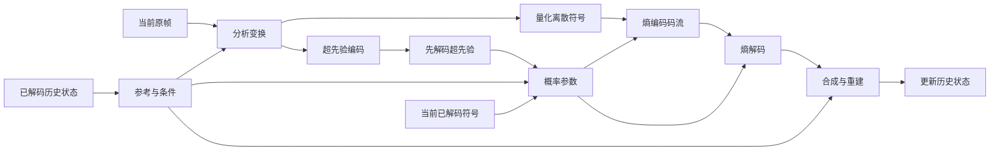
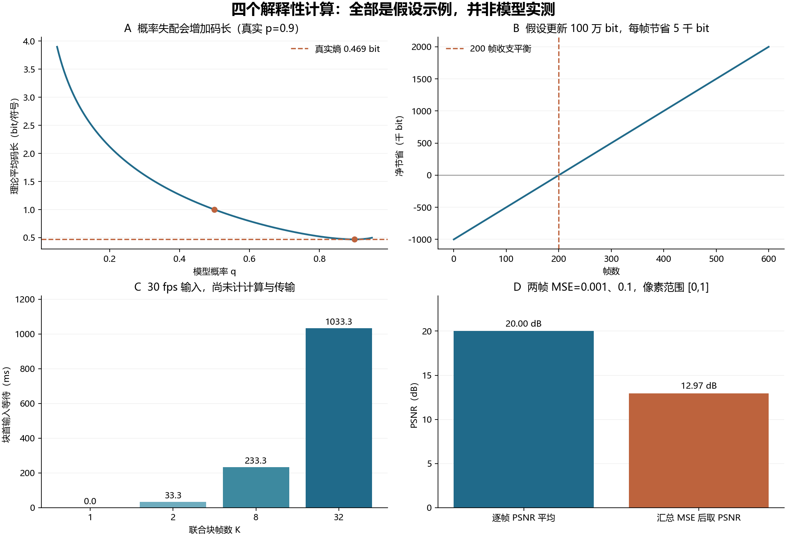

# 神经视频编码九个领域的深入分析

2026-10-19。在上一轮 41 篇代表性文献库的基础上，本轮补读 21 篇的方法或实验章节，其中 19 篇从摘要初筛推进到具体机制分析，另外 2 篇补充实验条件。完成九篇分领域笔记、跨领域问题筛选和四个可复算的数学示例。没有新增 GPU 实验、重新下载现有论文或把作者数字混入本项目 RD。

这里的“深入”是对所列方法、图表与实验段落的分析，**不是 41 篇逐页全文精读**。本轮页码、局部摘读范围和 10 张已检查原文页图见[阅读依据](../../experiments/field_analysis_20261019/阅读依据.md)。原阶段索引保留原来的阅读深度，新累计索引单独保存。

## 九个领域各自回答什么

| 领域与详细笔记 | 分析的核心 | 当前最有用的认识 |
|---|---|---|
| [01 概率模型与量化](01_概率模型与量化.md) | 离散符号、超先验、AR、分组、步长与实际码流 | 降低概率失配、减少符号信息和减少串行等待是不同目标 |
| [02 表示变换与时域参考](02_表示变换与时域参考.md) | DVC/SSF/FVC/条件变换/VCT/RT 的信息流 | 时间信息可以进入变换、概率或重建，各自改变不同依赖 |
| [03 实时执行与硬件](03_实时执行与硬件.md) | RT/UF/手机路线、访存、融合、流水、输入等待 | 优化对象是关键路径；MAC、FPS、首帧延迟不能互换 |
| [04 参考失效与混合编码](04_参考失效与混合编码.md) | 对齐、内容新生、状态分布、概率失配、门控可解码性 | 先识别失效类型；MaskCRT 的切换处 I 帧设置限制其结论范围 |
| [05 双向结构与时间调度](05_双向结构与时间调度.md) | 分层 B 帧、运动差分、基础/增强层、重排 | 未来参考与更高层参考质量都要付等待、缓存和比特成本 |
| [06 内容适配与编码端搜索](06_内容适配与编码端搜索.md) | 运动/内容潜变量搜索、参数更新和摊销 | 应比较同总预算下的收益；解码不变不代表编码免费 |
| [07 隐式表示与逐实例压缩](07_隐式表示与逐实例压缩.md) | NeRV/HNeRV/HiNeRV/C3/GIViC 的内容载体 | 信息可能同时存于参数、嵌入和网格，完整表示都须计码率 |
| [08 感知与生成式编码](08_感知与生成式编码.md) | 扩散条件、时间复用、单步化、保真与自然度 | 自然细节、真实细节和时间稳定是三件事 |
| [09 评价方法与证据边界](09_评价方法与证据边界.md) | PSNR/LPIPS/DISTS/FVD/BD、颜色和时间口径 | 指标必须对应问题；集合分布指标不能代替配对保真 |

每篇都给出“要解决的问题—机制与设计原因—代表方法差异—代价和适用条件—可检验的问题”。它们不是互斥模型分类；一项改进经常同时涉及几个领域。

## 先有一个共同的编解码框架

此图是共同概念图，并非某个网络的完整源码图。某些方法有运动分支、参数流、多帧联合变换或生成细化；每一种新增条件都要能在解码所需时刻取得。编码端也必须维护与解码端一致的参考。训练时能看到的原图教师信号不能自动变成推理时的免费信息。

常见训练目标可统一理解为 `R+λD`，但原论文也可能写 `D+λR`，或另加感知、时间和参数码率项；不能直接比较 λ 的数值。系统选择则更适合看多目标向量：

`(总码率，保真失真，感知质量，编码总时间，解码时间，输入/显示延迟，内存)`。

在没有明确应用权重时，应展示可取方案和约束，不强行合成一个总排名。

## 本轮补读改变了哪些认识

**量化和概率调度不可割裂。**ELIC 的不均匀通道组是五组，而完整棋盘空间通道模型是十组依赖；HEM 的动态细粒度量化由解码可用先验提供，不能仅视为用户输入的全局 QP。详见领域 01 和对应原文页。

**参考门控的证据范围比名称更重要。**MaskCRT 在测试切换处插 I 帧；它不直接回答保留跨场景参考时会怎样。UI²C 的训练和两帧联合设置、BiECVC 的未来参考也各自改变条件。已有场景切换诊断仍有意义，但不能据此宣称新颖性。

**参数量、单次前向和完整编码是三种成本。**PEIAVC 要发送更新，HNeRV 要计算嵌入和网络大小，C3/GIViC 的拟合成本不能从低解码 MAC 或一次前后向 FPS 中消失。适配窗口与视频长度决定更新能否摊薄。

**生成式路线需要独立评价。**DiffVC 的时间复用跳过部分 U-Net，仍有后验采样；OSD 则把结构和训练调整到单步。作者 OSD 的 HEVC-C 结果是 0.40 s/P 帧，并不能因相对多步快约二十倍就称为实时。FVD 又是集合分布指标，不能替代逐片段的内容正确性与闪烁检查。

上述是论文及其设置的解释；所有性能数字都保留来源、硬件或已知统计边界，不视作本项目测量。

## 四个可复算的解释性示例

所有曲线来自明确假设与公式，**不是任何神经编解码器的 RD 或速度结果**。原始数值在[示例数据](../../experiments/field_analysis_20261019/analysis_examples.json)。

1. Bernoulli 源中 p=0.9，模型预测 q=0.5 时理论平均码长为 1 bit；q=p 时约 0.469 bit。差额来自概率失配，未改变符号本身。
2. 假设更新需要 1,000,000 bit，每帧同质量节省 5,000 bit，200 帧仅收支平衡，超过才净省。该值不是 PEIAVC 的实际视频门槛。
3. 30 fps 输入的 K 帧联合块，块首等待为 `(K−1)/30` 秒。它与模型计算时间不同，也不能直接等同任意 B 帧结构的等待。
4. 两帧 MSE 分别为 0.001、0.1、MAX=1 时，平均逐帧 PSNR 为 20 dB，合并 MSE 后约 12.97 dB；因此聚合规则可以实质改变结果。

## 从阅读推进到研究：五个候选问题

| 问题 | 先行研究与需要补的证据 | 最小下一步 | 当前优先级 |
|---|---|---|---|
| 旧参考在何种内容变化下失效，刷新修复什么 | MaskCRT、UI²C、BiECVC 已涉及混合/参考；需匹配目标帧的历史干预 | 已准备两条 129 帧场景切换流，复用旧自然历史控制，按协议执行 | 高；直接连到现有可运行 RT |
| 概率模型还是表示承担了切换成本 | HEM/VCT 提供不同时间建模；需把符号与 PMF 变化区分 | 先做各组估计码长、实际载荷和状态描述；必要时固定符号做 PMF 对照 | 高；需要可复核观测，暂不重训 |
| 编码端多花多少时间才值得 | OFENH/DT/PEIAVC/C3 均有相关研究；总成本常被隐藏 | 选一个可运行共享解码器方法，做有超时的搜索预算曲线和真实流闭环 | 中；先核验模型/实现，不启动整视频拟合 |
| 条件放在概率域与表示域，对长链失效有何影响 | VCT 与 RT 是有用系统对照，但训练差异很大 | 验证 VCT 检查点、运行入口与评价条件，先观察现象再提出单模块因果问题 | 中；权重/运行未确认 |
| 低码率纹理增强是否改变内容和时间稳定 | DiffVC/OSD/S²VC/GNVC-VD；需保真、感知、时间联合证据 | 先固定评价与短片段协议，选择可运行生成器后执行 | 中；不以一张图或单视频 FVD 下结论 |

硬件剖析和双向编码是独立分支：前者适合定位真正耗时，后者先明确是否允许未来帧。后续每轮选择一个有明确对照、资源边界和停止条件的问题；先用小实验决定是否值得扩大投入。

## 与已有证据的连接

- [上一轮 41 篇广泛调研](../神经视频编码_广泛文献调研_20261019.md)：技术全景、原始版本和代码入口的观察。
- [研究问题与旧数据分析](../../experiments/research_questions_20261019/研究报告.md)：48 个旧实际码流点的刷新选择分析；其小样本结论不能外推所有内容。
- [输出保存精度诊断](../../experiments/writer_precision_20261019/研究报告.md)：统一像素口径后，仍需解释的长期质量差异。
- [最新原始权重短测](../../experiments/original_weight_smoke_20261019/研究报告.md)：只支持短前缀，保留原观测断言失败及恢复边界。
- [本轮阶段报告和阅读记录](../../experiments/field_analysis_20261019/研究报告.md)：文件、页码、计算示例和下一步状态。

本轮没有访问集群；此前 GPU/会话记录仍是历史观察。后续进入集群时继续用内置浏览器中的 VSCode 集成终端，先核查实际会话和进程，再执行有界实验。
